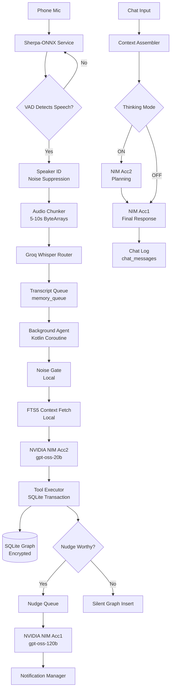

# System Architecture

## High-Level Data Flow

## Component Stack

| Layer | Technology | Purpose |
|-------|-----------|---------|
| Platform | Android API 28+ | Operating system |
| Language | Kotlin | Primary development language |
| UI | Jetpack Compose | User interface toolkit |
| Architecture | MVVM + Repository | Code organization |
| Database | SQLite via Room + SQLCipher | Encrypted local storage |
| Search | SQLite FTS5 | Full-text node search |
| Audio | Sherpa-ONNX via JNI | VAD, NS, Speaker ID |
| Network | Ktor Client | API communication |
| Background | WorkManager + Coroutines | Queue draining, pruning |
| Crypto | Android Keystore + EncryptedSharedPreferences | Secure key storage |
