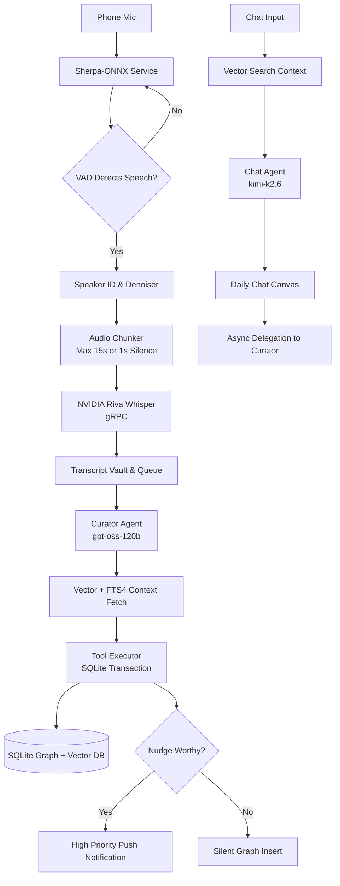

# System Architecture

## High-Level Data Flow

## Component Stack

| Layer | Technology | Purpose |
|-------|-----------|---------|
| Platform | Android API 28+ | Operating system |
| Language | Kotlin (Coroutines/Flow) | Primary development language |
| UI | Jetpack Compose | User interface toolkit |
| Architecture | MVVM + Hilt DI | Code organization |
| Database | SQLite via Room + SQLCipher | Encrypted local storage |
| Search | SQLite FTS4 + Cosine Similarity | Keyword & Semantic node search |
| Audio | Sherpa-ONNX via JNI | VAD, Denoiser, Speaker ID |
| Network | Ktor + gRPC | REST and Binary API communication |
| Background | WorkManager | Offline queues, Chronos, Pruning |
| Crypto | Android Keystore + BuildConfig | Secure key storage |
