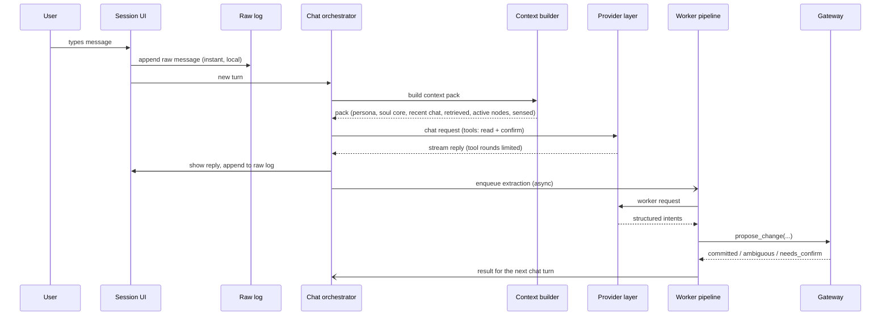

# Architecture

Status: core     Version: 0.1     Depends on: 00-vision, 01-glossary

## 1. Purpose

Show how the parts fit together, who is allowed to do what, and how one message travels through the system.

## 2. Actors

| Actor     | Is an LLM? | Can read memory   | Can write memory                                                                                                | Talks to user         |
| --------- | ---------- | ----------------- | --------------------------------------------------------------------------------------------------------------- | --------------------- |
| Chat AI   | yes        | yes (tools)       | yes, through the gateway, only for what the user just said (explicit commands, confirmations) | yes                   |
| Worker AI | yes        | yes (tools)       | yes, only through the gateway                                                                                   | no                    |
| Scheduler | no         | yes               | yes (status changes such as expiry), through the gateway                                                        | via alarms and nudges |
| User      | n/a        | via memory viewer | via viewer edits, through the gateway                                                                           | n/a                   |

Only the gateway touches the derived tables. Nothing else writes to them.

## 3. Module map (Kotlin packages under `com.anchor.mine`)

```mermaid
flowchart LR
    subgraph UI
      A1[session] --- A2[memoryviewer] --- A3[settings] --- A4[onboarding]
    end
    subgraph Core
      B1[chat orchestrator] --- B2[context builder] --- B3[worker pipeline]
      B4[gateway] --- B5[resolver] --- B6[scheduler] --- B7[nudge engine]
    end
    subgraph Data
      C1[(raw)] --- C2[(derived)] --- C3[(operational)]
      C4[embedding service] --- C5[retrieval]
    end
    subgraph Platform
      D1[provider layer] --- D2[alarms] --- D3[notifications] --- D4[export] --- D5[security]
    end
    UI --> Core --> Data
    Core --> Platform
```

Rules:

- UI never talks to the database or the provider layer directly. It talks to the orchestrators.
- The provider layer knows nothing about memory. It only sends and receives messages and tool calls.
- The data layer knows nothing about AI. It stores and retrieves.
- Each module exposes an interface, and implementations can be swapped (for example the embedding model).
- Core logic (gateway, resolver, retrieval math, scheduler decisions, nudge scoring, date parser) lives in a pure Kotlin module with no Android imports. Android code is limited to adapters.

## 4. Life of one user message

The Worker skips any message where the operation log already has ops with that `cause_msg_id`.

Key points:

1. **Capture first.** The user's message is written to the raw log before anything else, so nothing is lost even if the network fails.
2. **Chat does not wait for the worker** unless the turn needs a committed result. When a change must be confirmed ("Which dinner?"), the chat reply reads the worker's result so the assistant never says "done" before it is true.
3. **Extraction is async and idempotent.** Each raw message has an extraction state in the operational layer. Retrying never duplicates.

## 4.1 Life of one reminder (summary)

Scheduler stores `fire_at` and guards, registers an alarm, and at fire time re-checks guards in code. It then
suppresses, merges into the live chat, or notifies. The LLM only writes the opener text, and a stored template
covers the offline case. Details in `30-reminder-engine.md`.

## 5. Threads and background work

- UI on the main thread. Database access on a single-writer dispatcher (SQLite allows one writer).
- Heavy jobs (embedding, extraction, rebuilds, summaries) run through WorkManager with constraints.
- Alarms use AlarmManager. No persistent foreground service in normal operation.
- Rate limiter state and queues are in the operational layer, so they survive process death.

## 6. Failure containment

| Failure                       | Effect                  | Containment                                        |
| ----------------------------- | ----------------------- | -------------------------------------------------- |
| Provider down or rate-limited | Chat cannot reply       | Fallback chain, then queue; capture continues      |
| Worker returns garbage        | Nothing written         | Gateway validates; retry; log; skip                |
| Embedding model missing       | Retrieval quality drops | Keyword (FTS5) search only                         |
| Process killed mid-write      | Partial state           | Single transaction per gateway operation           |
| Alarm killed by OEM           | Missed reminder         | `setAlarmClock`, self-test screen, boot receiver |

## 7. Settings

None specific. See `52-onboarding-settings.md`.

## 8. Tests

- A message sent in airplane mode appears in the raw log and is processed after reconnection.
- Killing the process during extraction leaves no half-written nodes.
- Swapping the embedding implementation does not change calling code.

## 9. Open questions

- None at this stage.

## 10. Changelog

- 0.1 (2026-10-21): first draft.
