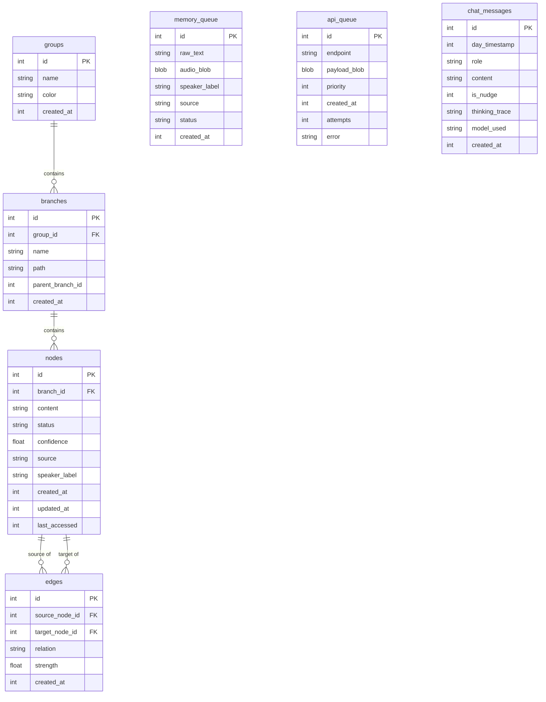

# Database Schema

## groups
```sql
CREATE TABLE groups (
    id INTEGER PRIMARY KEY AUTOINCREMENT,
    name TEXT UNIQUE NOT NULL,
    color TEXT DEFAULT '#4CAF50',
    created_at INTEGER NOT NULL
);
```

## branches
```sql
CREATE TABLE branches (
    id INTEGER PRIMARY KEY AUTOINCREMENT,
    group_id INTEGER NOT NULL,
    name TEXT NOT NULL,
    path TEXT UNIQUE NOT NULL,
    parent_branch_id INTEGER,
    created_at INTEGER NOT NULL,
    FOREIGN KEY(group_id) REFERENCES groups(id)
);
```

## nodes
```sql
CREATE TABLE nodes (
    id INTEGER PRIMARY KEY AUTOINCREMENT,
    branch_id INTEGER NOT NULL,
    content TEXT NOT NULL,
    status TEXT DEFAULT 'active',
    confidence REAL DEFAULT 1.0,
    source TEXT,
    speaker_label TEXT,
    created_at INTEGER NOT NULL,
    updated_at INTEGER NOT NULL,
    last_accessed INTEGER NOT NULL,
    FOREIGN KEY(branch_id) REFERENCES branches(id)
);
```

## edges
```sql
CREATE TABLE edges (
    id INTEGER PRIMARY KEY AUTOINCREMENT,
    source_node_id INTEGER NOT NULL,
    target_node_id INTEGER NOT NULL,
    relation TEXT NOT NULL,
    strength REAL DEFAULT 0.8,
    created_at INTEGER NOT NULL,
    FOREIGN KEY(source_node_id) REFERENCES nodes(id),
    FOREIGN KEY(target_node_id) REFERENCES nodes(id)
);
```

## FTS5 Virtual Table
```sql
CREATE VIRTUAL TABLE nodes_fts USING fts5(
    content, 
    content='nodes', 
    content_rowid='id'
);
```

## node_embeddings (Future RAG)
```sql
CREATE TABLE node_embeddings (
    node_id INTEGER PRIMARY KEY,
    embedding BLOB,
    FOREIGN KEY(node_id) REFERENCES nodes(id)
);
```

## memory_queue
```sql
CREATE TABLE memory_queue (
    id INTEGER PRIMARY KEY AUTOINCREMENT,
    raw_text TEXT,
    audio_blob BLOB,
    speaker_label TEXT,
    source TEXT DEFAULT 'ambient',
    status TEXT DEFAULT 'pending',
    created_at INTEGER NOT NULL
);
```

## api_queue
```sql
CREATE TABLE api_queue (
    id INTEGER PRIMARY KEY AUTOINCREMENT,
    endpoint TEXT NOT NULL,
    payload_blob BLOB NOT NULL,
    priority INTEGER DEFAULT 5,
    created_at INTEGER NOT NULL,
    attempts INTEGER DEFAULT 0,
    error TEXT
);
```

## chat_messages
```sql
CREATE TABLE chat_messages (
    id INTEGER PRIMARY KEY AUTOINCREMENT,
    day_timestamp INTEGER NOT NULL,
    role TEXT NOT NULL,
    content TEXT NOT NULL,
    is_nudge INTEGER DEFAULT 0,
    thinking_trace TEXT,
    model_used TEXT,
    created_at INTEGER NOT NULL
);
```

## rejected_logs
```sql
CREATE TABLE rejected_logs (
    id INTEGER PRIMARY KEY AUTOINCREMENT,
    transcript TEXT,
    reason TEXT,
    created_at INTEGER NOT NULL
);
```

## Indexes
```sql
CREATE INDEX idx_nodes_branch ON nodes(branch_id);
CREATE INDEX idx_nodes_status ON nodes(status);
CREATE INDEX idx_nodes_last_accessed ON nodes(last_accessed);
CREATE INDEX idx_edges_source ON edges(source_node_id);
CREATE INDEX idx_edges_target ON edges(target_node_id);
CREATE INDEX idx_memory_queue_status ON memory_queue(status);
CREATE INDEX idx_api_queue_priority ON api_queue(priority, created_at);
CREATE INDEX idx_chat_day ON chat_messages(day_timestamp, created_at);
```

## Entity Relationship Diagram


