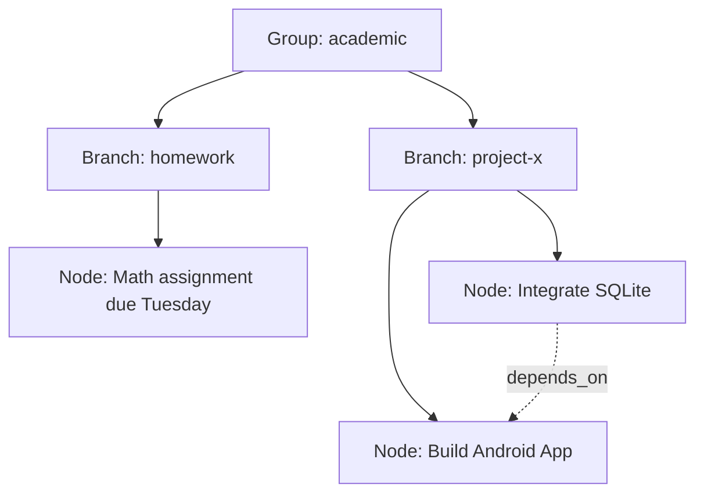

# Memory Graph Model

## Hierarchy Concept

The second brain is organized as a tree of contexts, supercharged by a local Vector Database.

## Nodes (Atomic Memories)
A single fact, task, event, or preference.
- `status`: active | completed | trashed
- `source`: ambient | chat | call_reflection | manual

## Edges (Rich Relationships)
Connect nodes with semantic meaning.
- `depends_on`: Prerequisite logic
- `sub_task_of`: Hierarchical breakdown
- `blocks`: Active impediment
- `related_to`: General association
- `contradicts`: State changes (e.g., quitting a diet)

## Local Vector Database
Every time a node is created, MineAI calls `nv-embed-v1` to generate a FloatArray vector. This is stored as a BLOB in SQLite. When searching, Kotlin performs local Cosine Similarity math to find semantic matches, completely eliminating duplicate memories.

## Proactive Memory Management & Pruning
**1. Automated Nightly Compression (PruningWorker):**
- Deletes `trashed` nodes older than 7 days.
- Deletes `failed` offline queue items to prevent DB bloat.
- Grabs all chat messages from the day, sends them to the 120B Curator for a final summary, and deletes the raw chat logs to clear the canvas for tomorrow.

**2. Proactive AI (ChronosWorker):**
- Wakes up every 4 hours.
- Reads active nodes and the current time.
- Decides if the user needs a proactive reminder (e.g., "Where are we on that database?").
