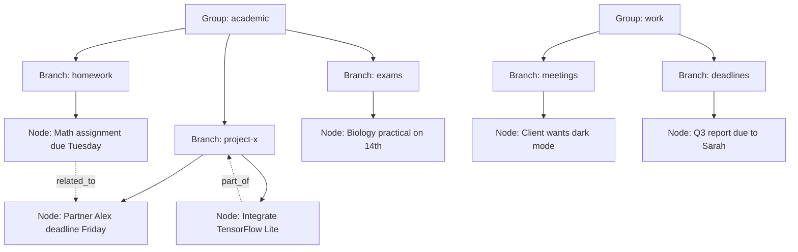

# Memory Graph Model

## Hierarchy Concept

The second brain is organized as a tree of contexts, not a flat list.

## Groups (Top Level)
Groups are hardcoded categories with assigned colors.

| Group | Color | Description |
|-------|-------|-------------|
| academic | #4CAF50 | School, courses, learning |
| work | #2196F3 | Job, career, professional |
| health | #E91E63 | Medical, fitness, mental |
| people | #FF9800 | Relationships, contacts |
| finance | #009688 | Money, budgets, purchases |
| personal | #9C27B0 | Identity, preferences, goals |
| purchases | #795548 | Shopping, wishlists, orders |
| emotions | #607D8B | Mood tracking, journal entries |

## Branches (Dynamic Sub-Contexts)
Branches are created dynamically under groups. They represent specific projects, contexts, or topics.

- Auto-created by MineAI Curator via `branch_ensure` tool
- Manually creatable in Dev Mode
- Path format: `group/branch` (example: `academic/project-x`)
- Future versions may support nesting via `parent_branch_id`

## Nodes (Atomic Memories)
A single fact, task, event, or preference.

- `status`: active | completed | stale | archived
- `confidence`: 0.0 to 1.0, set by Curator
- `source`: ambient | chat | call_reflection | manual | nudge

## Edges (Relationships)
Connect nodes with semantic meaning.

| Relation | Meaning |
|----------|---------|
| related_to | General association |
| part_of | Component or subset |
| caused_by | Causation |
| contradicts | Opposing information |
| reminds_of | Similarity trigger |
| enabled_completion_of | Prerequisite fulfilled |
| rescheduled_due_to | Schedule change reason |

## Proactive Memory Management & Pruning
Mine does not just blindly delete old data; it manages state like a human co-founder.

**1. Automated Nightly Compression:**
- Find nodes with `status = 'completed'` and `updated_at < now - 30 days`
- Compress into weekly summary node with `source: archive`
- Delete original completed nodes or mark as `archived`
- Delete `rejected_logs` older than 7 days
- Vacuum database

**2. Proactive Stale Node Querying:**
- Nodes that remain `active` for long periods are NOT automatically deleted.
- Instead, they are flagged as `stale`.
- During natural conversation lulls in Chat, MineAI will proactively ask the user about these stale nodes to determine if they should be marked completed, updated, or archived (e.g., "Hey, did you ever finish integrating TensorFlow last month?").