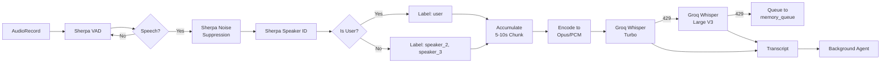

# Audio Processing Pipeline

## Component Stack

| Stage | Technology | Function |
|-------|-----------|----------|
| Capture | AudioRecord | Raw microphone input |
| VAD | Sherpa-ONNX | Detect speech vs silence |
| Noise Suppression | Sherpa-ONNX | Remove background noise |
| Speaker ID | Sherpa-ONNX | x-vector matching |
| Chunking | Kotlin | Accumulate 5-10s windows |
| Encoding | Opus/PCM | Format for API |
| Transcription | Groq Whisper | Text extraction |

## Pipeline Flow

## Speaker Identification Logic

During onboarding, the user reads a prompt while Sherpa-ONNX captures an x-vector template.

At runtime:
- Match incoming audio x-vector against enrolled template.
- If similarity > threshold: label `user`.
- If unknown: label `speaker_2`, `speaker_3`, etc., based on session consistency.
- **Crucial Context:** Non-user audio is NEVER dropped. It is transcribed to provide the LLM with the context of the world around the user (e.g., knowing what a boss asked the user to do).

## Resource Management

- Sherpa-ONNX loaded once in `AmbientListeningService.onCreate()`
- Model files stored in `assets/` or downloaded on first run
- AudioRecord buffer size: 3200-6400 samples (200-400ms at 16kHz)
- Chunk accumulation buffer: circular ByteBuffer, flush every 5-10 seconds or on VAD silence timeout