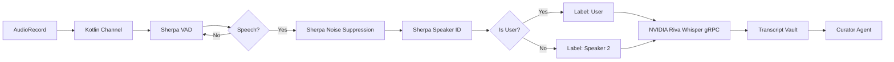

# Audio Processing Pipeline

## Component Stack

| Stage | Technology | Function |
|-------|-----------|----------|
| Capture | AudioRecord | Raw microphone input (16-bit PCM, 16kHz) |
| VAD | Sherpa-ONNX (Silero) | Detect speech vs silence |
| Noise Suppression | Sherpa-ONNX (GTCRN) | Remove background noise |
| Speaker ID | Sherpa-ONNX (WeSpeaker)| x-vector matching |
| Transcription | NVIDIA Riva (gRPC) | Whisper Large v3 |

## Pipeline Flow

## Resource Management & Safety
- **C++ Memory:** Sherpa-ONNX models are extracted from APK assets to internal storage on a background thread to prevent Main Thread ANRs. `vad.pop()` is called strictly to prevent C++ memory leaks.
- **Audio Decoupling:** The microphone reader and the AI processor are decoupled using a Kotlin `Channel`. This prevents the hardware buffer from overflowing while Sherpa is processing.
- **OOM Prevention:** VAD is configured with `maxSpeechDuration = 15.0f` to force chunking, preventing continuous talkers from crashing the phone's RAM.
