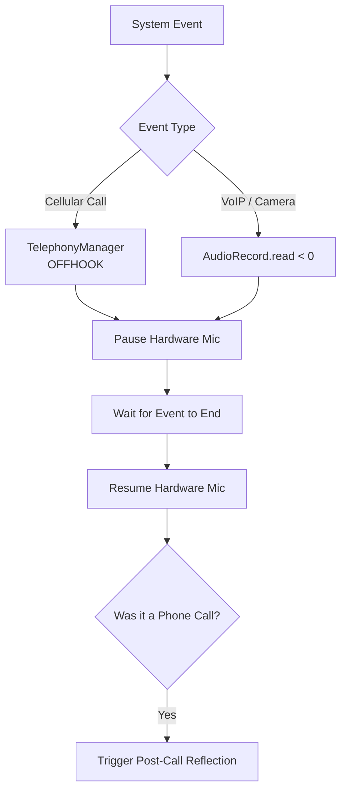

# Feature: Ambient Listening

## User Story
As a user, I toggle Ambient Listening ON. Mine listens to my day, identifies my voice, suppresses noise, and silently builds my graph.

## Mic Hijacking & Call Interruption Handling
Mine gracefully yields the microphone to other apps and phone calls to prevent hardware crashes and battery drain.

## States & Notifications
The persistent notification in the silent channel provides:
- Status text: "Listening to your day..."
- Action: Stop (fully terminates service)

The service uses `START_STICKY` to survive Android battery management, and explicitly tracks the `listeningJob` to ensure Coroutine scopes are never permanently killed when toggled.