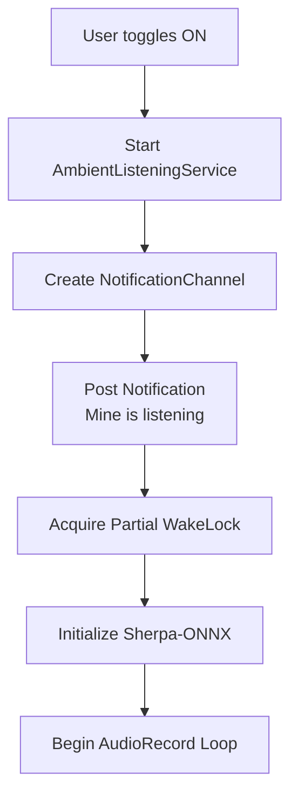
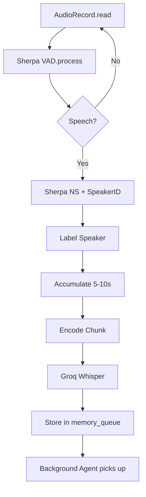
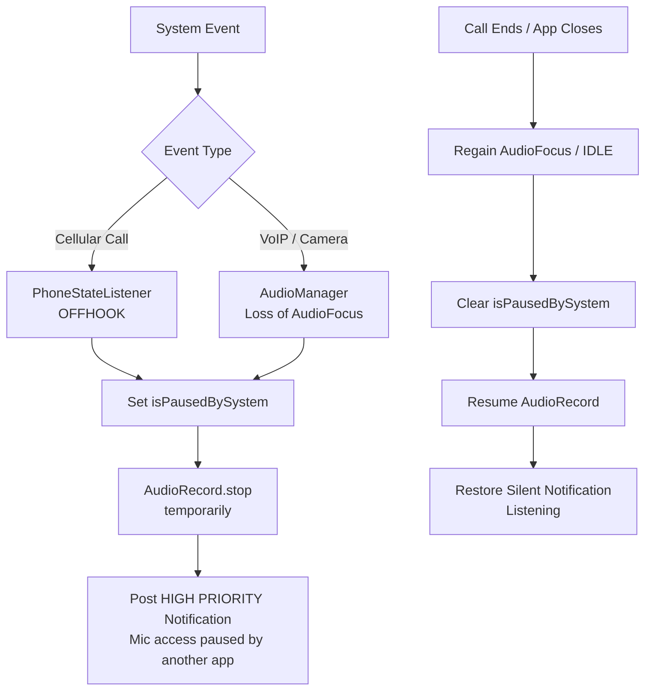

# Feature: Ambient Listening

## User Story

As a user, I open Mine, toggle Ambient Listening ON, and place my phone in my pocket. Mine listens to my day, identifies my voice, suppresses noise, and silently builds my graph.

## Activation Flow

## Runtime Loop

## Mic Hijacking & Call Interruption Handling

Mine must gracefully yield the microphone to other apps (Cellular calls, WhatsApp, Instagram, Zoom) and notify the user.

## Notification Actions

The persistent notification in the silent channel provides:
- Status text: "Ambient Listening is on"
- Action: Pause (temporarily stops mic read loop)
- Action: Stop (fully terminates service)

## States

| State | Visual | Behavior |
|-------|--------|----------|
| OFF | Toggle gray, mic slashed | No service running |
| ON | Toggle green, mic active | Full pipeline active |
| PAUSED | Toggle yellow | Service alive, mic paused by user or system |
| PROCESSING | Subtle progress indicator | Agent working on backlog |