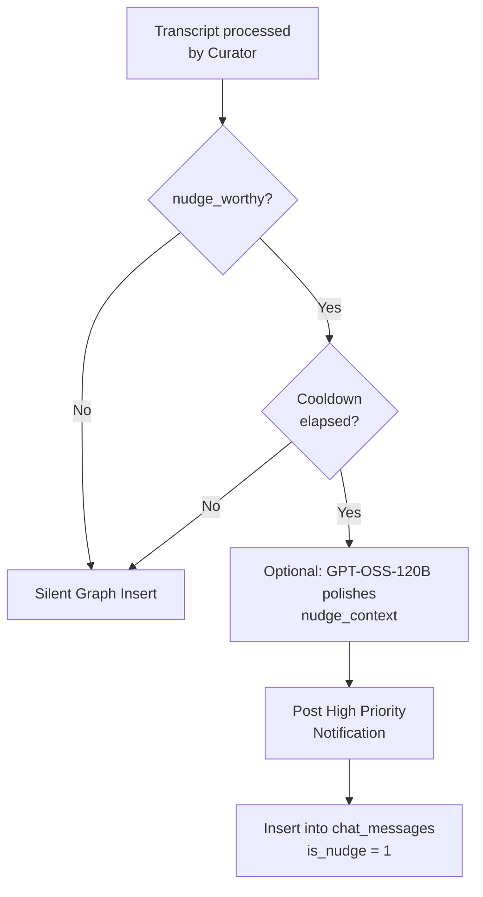

# Feature: Nudge Talking

## Philosophy

Nudges are invisible until needed. They are not chat. They are contextual memory surfacing at the exact moment of relevance. They can also act as interventions (e.g., scolding the user for contradicting a core goal).

## Trigger Conditions

A nudge fires ONLY when all conditions are met:
1. Ambient Listening is ON
2. Nudge sub-toggle is ON
3. GPT-OSS-20B curator returns `nudge_worthy: true` with `confidence >= 0.85`
4. Cooldown window elapsed (default 5 minutes)
5. User is not in active Chat session

## Pipeline

## Notification Behavior & Feedback Loop

- **Visual:** Heads-up notification on lock screen + status bar.
- **Action (Tap):** Opens Chat scrolled to today's section, message marked with lightning bolt text prefix.
- **Action (Good Nudge):** Button on notification. Silently updates `nudge_preferences` node to encourage similar nudges.
- **Action (Bad Nudge):** Button on notification. Silently updates `nudge_preferences` node to teach the AI to avoid this context.
- **Dismiss:** Swipe away archives reference in chat as dismissed.
- **Channel:** `nudge_talk` with high importance.

## Cooldown Configuration

Settings option:
- 1 minute
- 5 minutes (default)
- 15 minutes
- 30 minutes

Enforced locally via `last_nudge_timestamp` in EncryptedSharedPreferences.