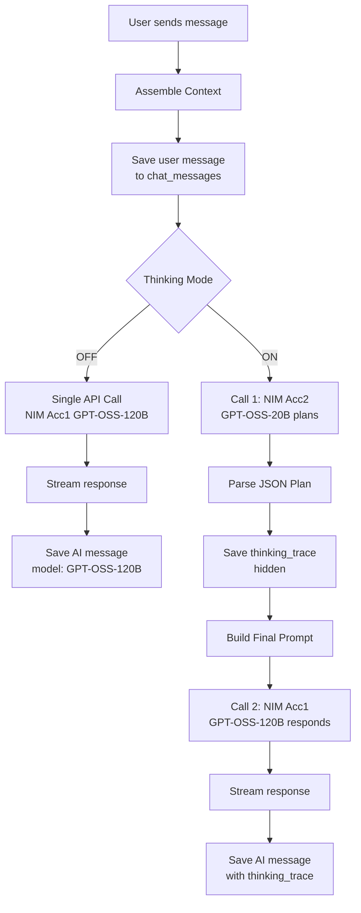

# Feature: Chat Interface

## Design Principle

No sessions. No threads. One continuous, chronological stream of your relationship with MineAI, divided only by time.

## Layout Structure

- Main surface: Infinite vertical scroll, reverse chronological
- Day headers: Sticky date separators ("Today", "Yesterday", "Monday, Jan 12")
- Input: Floating Orb at bottom-center
 - Tap: Opens text keyboard
 - Hold: Voice input via Sherpa + Groq
- Timeline drawer: Swipe from left edge, vertical day minimap

## Message Types

| Type | Alignment | Marker |
|------|-----------|--------|
| User | Right | None |
| MineAI | Left | None |
| Nudge | Left | [NUDGE] prefix |
| System | Center | Muted text |

## Proactive Conversation (Anti-Creep Logic)

To make the AI feel like a co-founder without being creepy:
- **Semantic Routing:** The AI only brings up past memories if they are semantically related to the current chat context (via FTS5).
- **Lull Detection:** If the user sends a conversation-ending message ("ok", "thanks"), the AI is permitted to pull a `stale` node from the graph and ask for an update to keep the momentum going naturally.

## Thinking Mode Flow



## Context Assembly

Every request automatically prepends:

```kotlin
fun assembleContext(userMessage: String): String {
  val core = prefs.getString("core_md", "")
  val souls = prefs.getString("souls_md", "")
  val relevantNodes = fts5Search(userMessage, limit = 5)
  val recentChat = chatDao.lastN(10)

  return """
    |$souls
    |
    |CORE MEMORY:
    |$core
    |
    |RELEVANT CONTEXT:
    |${relevantNodes.joinToString("\n")}
    |
    |RECENT CHAT:
    |${recentChat.joinToString("\n")}
    |
    |USER: $userMessage
  """.trimMargin()
}
```

## The Orb Component

- Position: Bottom center, floating above scroll content
- Idle: Soft glow animation
- Tap: Expands upward into text field + send button
- Hold: Scales up, turns accent color, records voice. Release to send.
- Loading: Morphs into progress circle while awaiting response

## Timeline Drawer

- Trigger: Swipe from left edge or tap hamburger menu
- Content: Vertical list of dates
- Interaction: Tap date jumps Chat scroll to that day's header