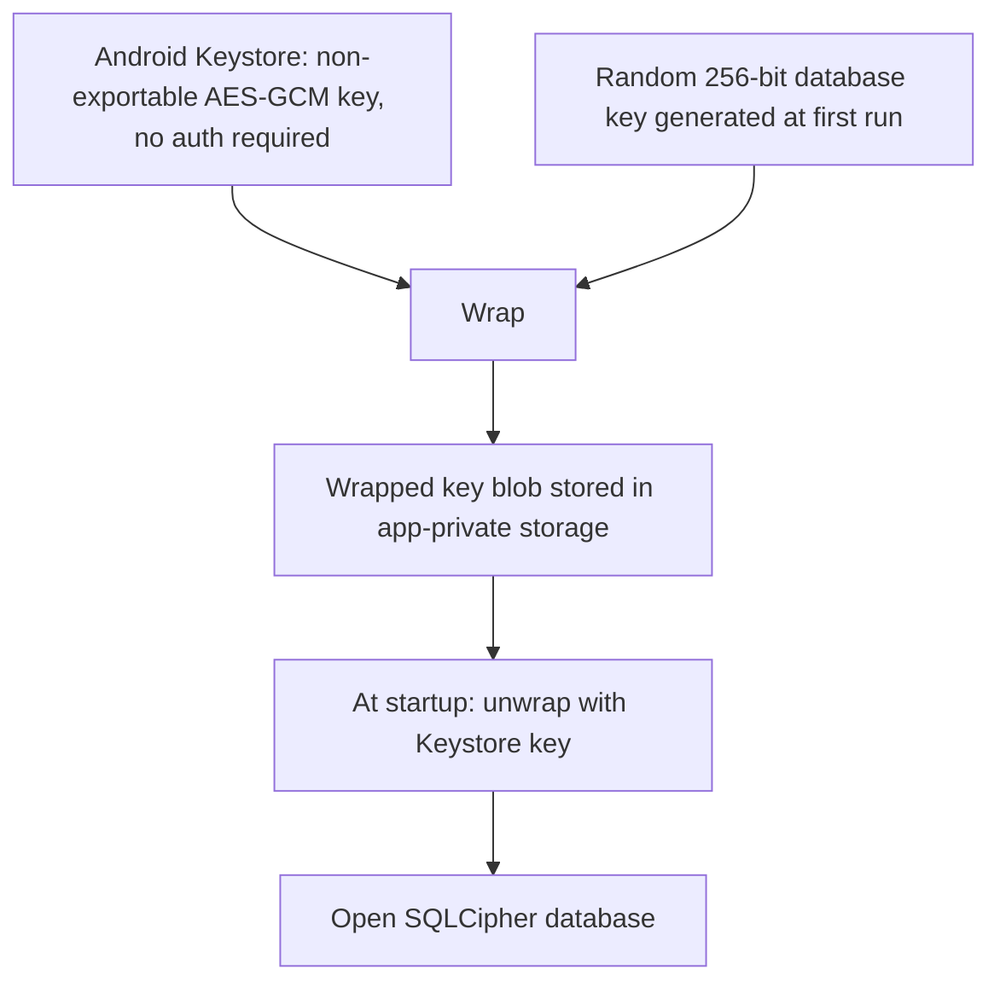

# Storage and Encryption

Status: v1     Version: 0.1     Depends on: 11-layers-raw-derived, 16-security-privacy

## 1. Purpose

Define how data is stored on the device, how it is encrypted, and how it leaves the device (export).

## 2. Behavior (what the user sees)

- The app opens like any other app. Optional PIN or biometric lock (off by default).
- No account, no cloud. Nothing syncs by itself.
- "Export everything" creates one file, protected by a passphrase the user chooses. "Import" restores it on a new phone.
- The app says plainly: lose the passphrase and the export cannot be opened. There is no recovery.

## 3. Design

### 3.1 Database

- One SQLite database, accessed through Room, opened with SQLCipher (AES-256).
- WAL mode, `secure_delete` on, foreign keys on. Single-writer dispatcher.
- FTS5 virtual tables for keyword search. Embeddings stored as BLOBs.

### 3.2 Key management



- The database key is random and never shown to the user or typed.
- The Keystore key is not bound to user authentication. This is deliberate (D-030): reminders, nudges and
  alarms must read data while the phone is locked.
- The optional app lock gates the UI only (BiometricPrompt with PIN or biometric, using the system lock).
- **Android backup is disabled** (`allowBackup=false` plus data extraction rules excluding everything). A
  restored backup could never be opened without the original Keystore key.
- API keys are stored separately, encrypted with the same Keystore-wrapped scheme (not in plain DB columns).

### 3.3 What encryption does not protect

- Data in memory while the app runs.
- Content sent to the user's AI provider (see `16-security-privacy.md`).
- A rooted device with an attacker who can call into the Keystore as the app.
- Notification text on the lock screen, which is why there is a "hide content on lock screen" setting.

### 3.4 Export file

Goal: one file the user can move between devices, safe if it is lost.

The authoritative export format is defined in `15-export-sync-prep.md` section 3.1. It uses a random data key
wrapped by a passphrase-derived key, JSON Lines records, gzip then chunked AES-GCM, and a final-chunk flag.

## 4. Data

```sql
CREATE TABLE app_meta (
  key   TEXT PRIMARY KEY,
  value TEXT NOT NULL
);   -- schema_version, extractor_version, embedding_version, created_at, ...

CREATE TABLE device (
  device_id  TEXT PRIMARY KEY,   -- ULID, generated at first run
  name       TEXT,
  created_at INTEGER NOT NULL,
  is_self    INTEGER NOT NULL DEFAULT 0
);
```

Every other table is defined in the blueprint that owns it. All share these columns where they apply:
`id` (ULID), `device_id`, `created_at`, `updated_at`, `deleted_at` (tombstone), `attrs` (JSON for flexible fields).

## 5. Settings

| Setting                                    | Default |
| ------------------------------------------ | ------- |
| App lock (PIN or biometric)                | Off     |
| Hide notification content on lock screen   | Off     |
| Block screenshots in the app (FLAG_SECURE) | Off     |
| Export: include API keys                   | Off     |
| Export: include embeddings                 | Off     |

## 6. Edge cases and failure modes

- **User forgets the export passphrase.** Data is unrecoverable. The UI warns before export and after.
- **Keystore key lost** (phone reset, OEM bug, restored backup). The database cannot be opened. The app detects
  this at startup and offers "import an export" or "start fresh". It never silently creates an empty database over the old one.
- **Database corruption.** On open failure, keep the file, show an error, and offer restore from the latest export. Never auto-delete.
- **Disk full during export.** Write to a temp file, verify, then rename.
- **Big exports.** Streamed in chunks, not built in memory.
- **Clock changes.** Timestamps are UTC with stored offset. Never rely on local time for ordering (ULIDs plus UTC).
- **Scheduled auto-export reminder.** Suggest an export every N weeks, since there is no cloud backup. Off by default, prompted in onboarding.

## 7. Offline behavior

Everything here is local and offline.

## 8. Tests

- Create data, export, wipe, import: row counts and hashes of raw tables match.
- Wrong passphrase fails cleanly with no partial import.
- Tampered export (flip a byte) is rejected by chunk authentication.
- App starts and fires an alarm while the phone is locked.
- Corrupt the wrapped key blob: the app refuses to create a new database over the old one.

## 9. Open questions

- Should export be offered as an automatic scheduled file to a user-chosen folder (for example one a sync app watches)? Planned for v1.1, see `90` section 3.3.

## 10. Changelog

- 0.1 (2026-10-21): first draft.
