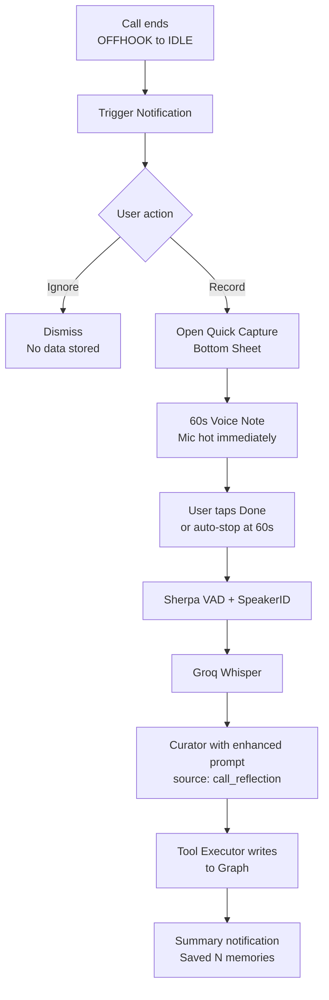

# Feature: Post-Call Reflection

## User Story

I take a call. Mine was listening but politely paused. The call ends. Mine asks: "How was the call? Capture it?" I tap Record and dictate a 30-second summary. Mine extracts the commitments and files them.

## Detection

```kotlin
class CallStateListener : PhoneStateListener() {
    private var lastState = TelephonyManager.CALL_STATE_IDLE
    
    override fun onCallStateChanged(state: Int, phoneNumber: String?) {
        if (lastState == CALL_STATE_OFFHOOK && state == CALL_STATE_IDLE) {
            triggerPostCallNotification(phoneNumber)
        }
        lastState = state
    }
}
```

## Flow Diagram



## Quick Capture Sheet

- Bottom sheet UI
- 60-second countdown timer
- Done button and Cancel (swipe down)
- Audio processed identically to ambient but tagged differently

## Graph Tagging

- `source`: `call_reflection`
- `people`: Extracted caller name if known from contacts or prior nodes
- `branch`: Inferred from content (example: `work/meetings`, `personal/family`)

## Notification UX

- Non-sticky heads-up notification
- Title: "Call ended"
- Text: "Capture what mattered?"
- Actions: Record, Ignore
- Auto-dismiss after 5 minutes if untouched