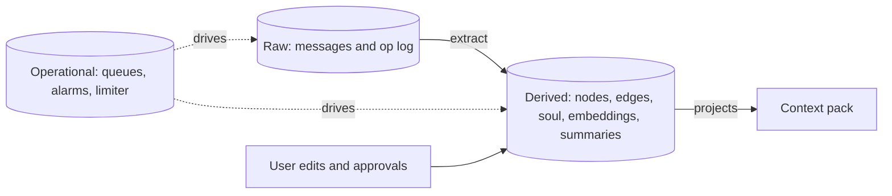
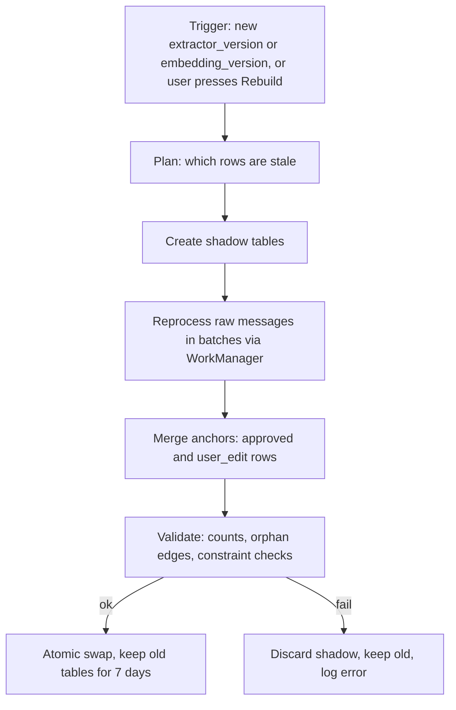

# Layers: Raw, Derived, Operational

Status: core     Version: 0.1     Depends on: 10-storage-encryption

## 1. Purpose

This is the durability backbone. It separates data that must never change from data that can be regenerated,
so the app can improve for years without breaking the user's history.

## 2. The three layers

| Layer                 | Contains                                                                                     | Mutable?         | Migrated?                                        | Rebuildable?                         |
| --------------------- | -------------------------------------------------------------------------------------------- | ---------------- | ------------------------------------------------ | ------------------------------------ |
| **Raw**         | `raw_message`, `raw_event`                                                               | Append-only      | Never altered in meaning (only additive columns) | n/a: it is the source of truth       |
| **Derived**     | `node`, `edge`, `soul_fact`, `embedding`, `summary`, `learned_pref`, `day_block`, `day_rule`, FTS indexes | Yes, via gateway | Yes, or rebuilt                                  | Yes, from raw plus user-touched rows |
| **Operational** | `outbox`, `extraction_state`, `alarm_registry`, `limiter_state`, caches              | Yes              | Dropped and recreated if needed                  | Disposable                           |



## 3. Raw layer rules

1. **Append-only.** There is no UPDATE or DELETE path in code, and database triggers reject both on raw tables.
2. Each message stores: id (ULID), device, UTC time plus offset, `day_key`, role, content, optional reasoning
   text (display only, never sent back to a provider), tags (for example `form_nudge`), persona and model used,
   and token counts. `day_key` comes from the **day rule in force** at the message timestamp (`day_rule` table,
   defined in `50-daily-session.md` section 4), and is **monotonic**: never earlier than the previous message's
   `day_key`. A reply copies the `day_key` of the message that triggered it.
3. **The operation log (`raw_event`)** records every change to derived data: who (actor), what (op type), target,
   before and after as JSON, the message that caused it, and (for undo) which op it reverses.
4. `day_key` is never rewritten. If the user changes the day rule later, old messages keep their old day.
5. **Right to erase.** The user can erase a message or a day. Erasure is a *redaction*: the content is
   replaced by a tombstone marker, the ULID and timestamp stay, an erase op is logged (without the content), and
   derived rows that cite that message are flagged for review or removal. This is the only way raw
   content ever changes, and it is user-initiated.
6. Ambient transcripts (v3) are **not** raw-layer data. They live in a short-lived staging table and
   expire (see `61-ambient-listening.md`).

```sql
CREATE TABLE raw_message (
  id            TEXT PRIMARY KEY,
  device_id     TEXT NOT NULL,
  ts_utc        INTEGER NOT NULL,
  tz_offset_min INTEGER NOT NULL,
  day_key       TEXT NOT NULL,          -- 'YYYY-MM-DD' under the rule in force at write time
  role          TEXT NOT NULL,          -- user | assistant | system_event
  content       TEXT,                   -- NULL after redaction
  redacted_at   INTEGER,
  reasoning     TEXT,
  tags          TEXT,                   -- comma separated, e.g. form_nudge
  persona_id    TEXT,
  model_ref     TEXT,
  tokens_in     INTEGER, tokens_out INTEGER,
  client_msg_id TEXT UNIQUE,            -- idempotency key
  attrs         TEXT                    -- JSON
);
CREATE INDEX idx_raw_message_day ON raw_message(day_key, ts_utc);

CREATE TABLE raw_event (
  op_id         TEXT PRIMARY KEY,
  ts_utc        INTEGER NOT NULL,
  device_id     TEXT NOT NULL,
  actor         TEXT NOT NULL,          -- user | chat_ai | worker_ai | scheduler | system | rebuild
  op_type       TEXT NOT NULL,          -- create | update | status_change | link | unlink | soul_accept | erase | ...
  target_type   TEXT NOT NULL,          -- node | edge | soul_fact | message | setting
  target_id     TEXT,
  before_json   TEXT,
  after_json    TEXT,
  cause_msg_id  TEXT,
  undo_of       TEXT,
  attrs         TEXT
);
CREATE INDEX idx_raw_event_target ON raw_event(target_type, target_id);
```

Pending or failed delivery of a message is **not** a column on `raw_message` (that would be mutation). It lives
in `outbox` in the operational layer.

## 4. Derived layer rules

1. Every derived row carries **provenance**: `source_msg_ids` (or `source_op_id`), `extractor_version`, and
   `origin`.
2. Gateway-owned mutable rows carry `hlc TEXT NOT NULL`, set by the gateway. This includes `setting` rows.
3. `origin` has three values:
   - `extracted`: produced by the AI. Replaceable by a rebuild.
   - `approved`: AI-produced and then approved by the user (Soul accepted, proposal confirmed).
   - `user_edit`: authored or edited by the user directly.
4. **A rebuild never overwrites `approved` or `user_edit` rows (D-028).** They are carried into the new
   derived set as anchors. If a rebuilt row conflicts with an anchor, the anchor wins and the conflict is
   listed for the user.
5. The derived state is the *current* state. History is the operation log. Mine is **not** full event
   sourcing: replaying every event to compute state would be too heavy for little gain.

## 5. Rebuild jobs



- Rebuilds are resumable (progress stored in `app_meta`), rate-limited by the provider layer, and can be paused.
- The embedding rebuild is separate and cheap (on device, no provider calls).
- A full re-extraction costs provider calls. It is always user-initiated for extraction (never automatic) and shows an estimate first.
- Old tables are kept for 7 days after a swap, so a bad rebuild can be reverted.

## 6. Operational layer rules

- May be dropped and recreated on any app update without ceremony.
- Must never contain the only copy of anything the user cares about.
- Example tables: `outbox` (pending sends), `extraction_state` (message to extraction status), `alarm_registry`
  (what is registered with AlarmManager), `limiter_state` (sliding windows, 429 cooldowns).

## 7. Settings

| Setting                                    | Default          |
| ------------------------------------------ | ---------------- |
| Keep old tables after rebuild              | 7 days           |
| Rebuild extraction automatically on update | Off (always ask) |

## 8. Edge cases and failure modes

- **App killed mid-rebuild.** Shadow tables are ignored until the swap. Resume or discard on next start.
- **Bad extractor.** Revert to old tables within 7 days.
- **Erased message cited by nodes.** The node is flagged "source erased". The user chooses to keep it or remove it.
- **Two devices (future sync).** Raw logs merge by ULID. Derived data syncs as ops or rebuilds. See `15-export-sync-prep.md`.

## 9. Offline behavior

Rebuilds that need a provider wait for connectivity. Embedding rebuilds run offline.

## 10. Tests

- Attempt an UPDATE on `raw_message`: the trigger rejects it.
- Rebuild with a user-edited node present: the node survives unchanged.
- Kill the process during rebuild: the old data is intact and the job resumes.
- Erase a message: content is gone, ID and time remain, a log entry exists, citing nodes are flagged.

## 11. Open questions

- Should erasing a whole day also remove its summary and embeddings automatically? Proposed: yes, with confirmation.

## 12. Changelog

- 0.1 (2026-10-21): first draft.
