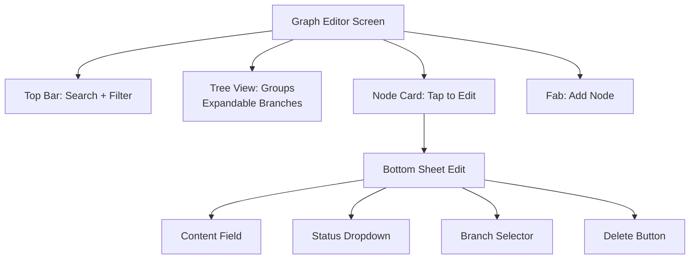
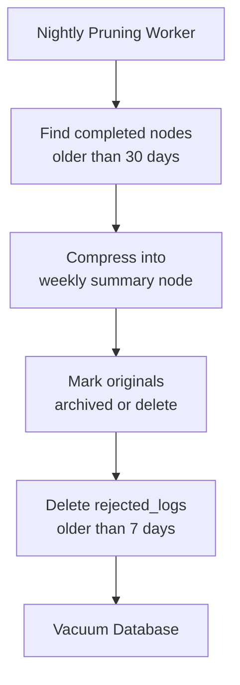

# Feature: Memory Graph UI & Dev Mode

## Memory Map (Read-Only Viewer)

- Tree layout: Groups as root nodes, expandable branches
- Node cards: Tap to view full content, status, source, date
- Edge lines: Curved connections between related nodes
- Search bar: FTS5 query filters visible tree
- Color coding by group

## Dev Mode Editor

Unlocked via Settings -> Dev Mode ON.

Capabilities:
- Add manual nodes to any branch
- Edit node content, status, branch assignment
- Delete nodes with confirmation dialog
- Force-create branches and groups
- View raw edges between nodes
- View raw queue states (memory_queue, api_queue)
- View API call log (last 50 calls with latency)

## Graph Editor Screen Layout

## Pruning Strategy

Automated nightly WorkManager task:

## Screen Inventory Related to Graph

- MemoryMapScreen: Read-only tree viewer
- GraphEditorScreen: Dev mode CRUD interface
- NodeDetailScreen: Single node view with incoming/outgoing edges