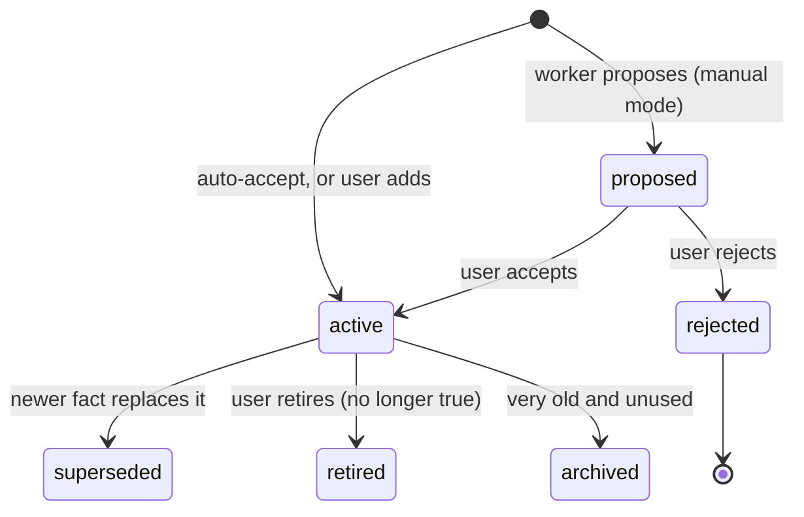

# Soul

Status: v1     Version: 0.1     Depends on: 11-layers-raw-derived, 21-retrieval-embeddings, 25-learning

## 1. Purpose

Soul is the app's model of **who the user is**: personality, qualities, constraints, tastes, history. It is what
makes replies feel personal instead of generic. Soul is about the *person*. What the person has to *do* belongs in the memory graph (`13-nodes-edges-statuses.md`).

## 2. Behavior (what the user sees)

- During onboarding, the user answers a few light questions. They seed Soul.
- While chatting, MineAI notices facts about the user ("I'm diabetic", "I hate phone calls", "I study at night").
- **Manual mode (default):** each proposed fact appears as a small card: *Add to Soul?* with Accept, Edit, Reject.
- **Auto mode:** facts are added immediately with an Undo chip, and listed in a weekly digest.
- The user can open the Soul view at any time, read every fact, edit it, pin it, retire it or delete it.
- Occasionally MineAI asks a small, friendly question to fill a gap, at most once a day (see `31-nudge-engine.md`).

## 3. Design

### 3.1 What belongs in Soul and what does not

| Statement                                       | Goes to                                  | Why                          |
| ----------------------------------------------- | ---------------------------------------- | ---------------------------- |
| "I am diabetic"                                 | Soul (core)                              | Stable fact, safety relevant |
| "I prefer short answers"                        | Soul                                     | Stable preference            |
| "I have a dentist appointment Friday"           | Node (event)                             | Time-bound                   |
| "I have a fever today"                          | Node (note, expires)                     | Temporary state              |
| "Mom is allergic to peanuts"                    | Person node plus a fact linked to it     | About someone else           |
| "I want to learn guitar this year"              | Node (goal)                              | Actionable                   |
| "I'm a person who procrastinates when stressed" | Soul, confidence medium, source inferred | Trait                        |

Rule: **stable and about the user means Soul. Time-bound or actionable means node.** If both, make the node
and link it to the fact.

### 3.2 Fact categories

`identity`, `health`, `preferences`, `dislikes`, `habits_routines`, `skills`, `experiences`, `values`,
`relationships`, `communication_style`, `constraints`, `goals_longterm`, `other`.
Categories are strings, so new ones need no migration. The category list drives the **gap map** used for questions.

### 3.3 Fact lifecycle



- Facts are **not overwritten**. A change creates a new fact with `supersedes` pointing to the old one, so history is kept ("quit smoking in March").
- **Rejected facts are remembered** in a suppression list so the worker does not propose them again.
- A fact has `valid_from` and `valid_to`, so "I lived in X until 2024" is representable.

### 3.4 Core profile

- A small set of facts is always included in the context pack: `pinned_core = 1`, budget about 600 tokens.
- Candidates are selected by rules: category `health` or `constraints` with high confidence, plus name, language
  and strongly stated preferences. The user can pin or unpin.
- Everything else is retrieved per turn by similarity to the conversation (see `20-context-pack.md`).
- This is what makes "I'm going to a birthday party" bring up diabetes: the party text is embedded, diabetes-related facts match, and the Chat AI warns about sweets.

### 3.5 Confidence and source

| source          | typical confidence | note                                                                                                     |
| --------------- | ------------------ | -------------------------------------------------------------------------------------------------------- |
| `user_stated` | high               | The user said it directly                                                                                |
| `onboarding`  | high               | Answered in setup                                                                                        |
| `ai_inferred` | low to medium      | Pattern noticed by the AI. Always manual approval, even in auto mode, if confidence is below a threshold |
| `ambient`     | low                | v3. Proposal-only                                                                                        |
| `user_edit`   | high               | Typed in the Soul view                                                                                   |

### 3.6 Proposals

Worker calls `soul_propose(statement, category, evidence_msg_ids, confidence)`. The gateway:

1. Normalizes and checks for a near-duplicate (embedding plus keyword). If one exists, it refreshes `last_confirmed_at` instead of adding.
2. Checks the suppression list.
3. Detects contradiction with an active fact and proposes a **supersede** instead of a second active fact.
4. Applies the mode: card (manual) or add (auto, with undo).

### 3.7 Persona independence

Personas change the *voice*. They never change Soul. A sarcastic cofounder persona and a gentle one read the same facts.

## 4. Data

```sql
CREATE TABLE soul_fact (
  id               TEXT PRIMARY KEY,
  device_id        TEXT NOT NULL,
  category         TEXT NOT NULL,
  statement        TEXT NOT NULL,          -- short, third-person-free: "Is diabetic"
  attrs            TEXT,                   -- JSON: structured details (type, since, severity)
  confidence       REAL NOT NULL DEFAULT 0.7,
  source           TEXT NOT NULL,          -- user_stated | onboarding | ai_inferred | ambient | user_edit
  origin           TEXT NOT NULL,          -- extracted | approved | user_edit
  status           TEXT NOT NULL,          -- proposed | active | superseded | rejected | retired | archived
  pinned_core      INTEGER NOT NULL DEFAULT 0,
  sensitive        INTEGER NOT NULL DEFAULT 0,
  local_only       INTEGER NOT NULL DEFAULT 0,
  hlc              TEXT NOT NULL,
  valid_from       INTEGER,
  valid_to         INTEGER,
  supersedes       TEXT,                   -- id of the fact this replaces
  source_msg_ids   TEXT,                   -- JSON array
  extractor_version TEXT,
  last_confirmed_at INTEGER,
  created_at       INTEGER NOT NULL,
  updated_at       INTEGER NOT NULL,
  deleted_at       INTEGER
);
CREATE INDEX idx_soul_status ON soul_fact(status, category);

CREATE TABLE soul_suppression (
  id          TEXT PRIMARY KEY,
  statement_hash TEXT NOT NULL,
  embedding_ref  TEXT,
  created_at  INTEGER NOT NULL
);
```

## 5. Settings

| Setting                                   | Default                                    |
| ----------------------------------------- | ------------------------------------------ |
| Soul update mode                          | Manual approve (switchable to auto-accept) |
| Auto mode: minimum confidence to auto-add | 0.75                                       |
| Core profile token budget                 | 600                                        |
| Soul questions                            | On, at most once a day                     |

## 6. Edge cases and failure modes

- **Sarcasm or jokes** ("I love Mondays") become low-confidence proposals, never auto-added.
- **Third-party facts** go to person nodes, not Soul.
- **A fact the user later contradicts.** Propose supersede, keep the history.
- **Sensitive facts (health).** They are flagged `sensitive`. They are still sent to the provider when relevant (that is how the warning works), so the app is honest about it in `16-security-privacy.md`. The user can mark any fact as "never send" (kept local, excluded from the context pack).
- **Too many facts.** Merge and archive facts unused for a long time. Archived facts are still searchable on demand.
- **Wrong fact accepted.** Undo, edit or retire in the Soul view. Retiring keeps history.

## 7. Offline behavior

Viewing and editing Soul works offline. Proposals are created when the Worker runs, so they queue until it can.

## 8. Tests

- "I'm diabetic" proposes a `health` fact. Accepting it makes the party example produce a sweets warning without the user repeating it.
- Rejecting a fact and repeating the statement later does not re-propose it.
- "I quit smoking" supersedes "I smoke" and keeps both.
- A joke does not become a fact in auto mode.
- A "never send" fact never appears in a captured provider request.

## 9. Open questions

- Should the user be able to share a **redacted Soul** with someone (for example a friend setting up Mine)? Parked.

## 10. Changelog

- 0.1 (2026-10-21): first draft.
