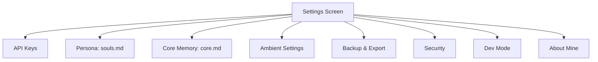

# Settings & Configuration

## Main Settings Hierarchy

## API Keys Screen

- Inputs: Groq Key, NIM Acc1 Key (Kimi K2.6), NIM Acc2 Key (GPT-OSS-20B/120B)
- Masked by default, toggle visibility per field
- Validate button: sends dummy request to each endpoint
- Stored via EncryptedSharedPreferences + Keystore

## Persona Editor (souls.md)

- Character counter: 0 / 3000
- Basic markdown syntax highlighting
- Live preview tab
- Helper text: "This defines how MineAI speaks to you."

## Core Memory Editor (core.md)

- Character counter: 0 / 2000
- Helper text: "MineAI will remember this in every conversation."
- Examples provided in helper:
 - "I am a night owl."
 - "I have a dog named Rex."
 - "I am allergic to peanuts."

## Ambient Settings

- Nudge Talking toggle
- Nudge Cooldown: Radio buttons (1m, 5m, 15m, 30m)
- Auto-pause on calls toggle
- Link to system notification channel settings

## Backup & Export

- Export Now: Prompts user to create a password -> Creates AES-encrypted ZIP -> Triggers system share sheet
- Auto-Backup: Toggle + "Last backup: X days ago" (Uses same user-defined password)
- Import: File picker -> Prompts for password to decrypt -> Validates schema -> Replaces database with confirmation

## Dev Mode

- Toggle with warning: "Advanced features. May break things."
- Unlocks:
 - Graph Editor
 - Raw Queue Viewer
 - API Call Log
 - Debug notification channel