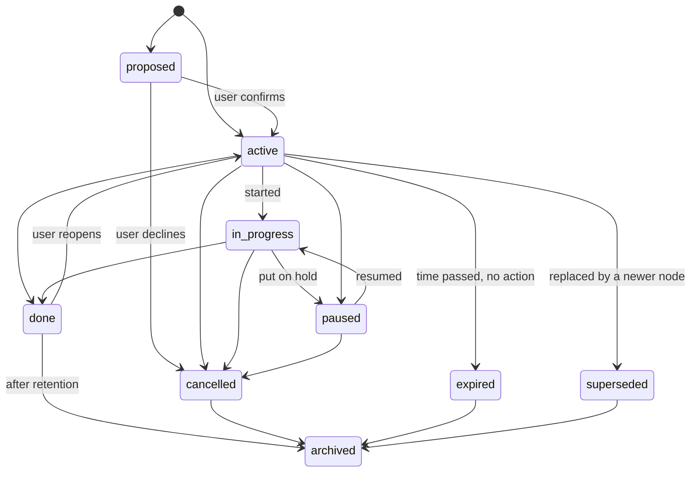

# Memory Graph: Nodes, Edges, Statuses

Status: v1     Version: 0.1     Depends on: 11-layers-raw-derived, 12-soul, 22-resolver, 23-tool-contracts

## 1. Purpose

The memory graph stores what is happening in the user's life: tasks, promises, goals, events, people. Items
(nodes) are connected by relations (edges) so that the AI can find relevant information and notice conflicts.
It is SQLite tables, not a graph database (D-003).

## 2. Behavior (what the user sees)

- Things the user mentions turn into items: "I'll finish the report by Friday" becomes a task with a due date.
- The memory viewer shows items by type, status and date. The user can edit, complete, pause or archive any item.
- MineAI notices relations: this task depends on that one, this plan conflicts with that commitment.
- Small throwaway actions ("drink water") are tracked lightly and quietly vanish.

## 3. Design

### 3.1 Node types

| Type           | Meaning                                               | Example                          |
| -------------- | ----------------------------------------------------- | -------------------------------- |
| `task`       | Something to do                                       | "Write the report"               |
| `commitment` | A promise to someone                                  | "Send Ravi the files"            |
| `goal`       | Larger outcome, often with sub-tasks                  | "Learn guitar this year"         |
| `event`      | Something happening at a time                         | "Dinner Wed 21 Oct"              |
| `note`       | Free information or idea worth keeping                | "Idea: weekly review on Sundays" |
| `person`     | Someone in the user's life                            | "Mom"                            |
| `place`      | A named place                                         | "College"                        |
| `habit`      | Repeating behavior (full support later, schema ready) | "Walk daily"                     |

Types are strings, so new types need no migration.

### 3.2 Node fields (important ones)

- `title`, `body`, `status`, `priority` (0 to 3), `severity` (how bad it is if it slips, 0 to 3).
- `start_at`, `due_at`, `time_precision` (`exact` | `day` | `week` | `none`), `flexible` (soft deadline).
- `lane`: `standard` or `ephemeral`.
- `expires_at`: optional expiry.
- `source`: `chat` | `onboarding` | `user_manual` | `call_nudge` | `ambient` | `system`.
- `origin`: `extracted` | `approved` | `user_edit`.
- Provenance: `source_msg_ids`, `extractor_version`.
- `attrs`: JSON for anything else (location text, recurrence draft, person details). Defined keys include
  `est_minutes`, `promised_part_of_day`, and `last_asked_at`; other keys are not part of the v1 contract.

### 3.3 Statuses



Meaning of each state:

- `proposed`: suggested (for example from ambient or low confidence) and awaiting confirmation. Not included in reminders.
- `active`: valid and open.
- `in_progress` and `paused`: the user is working or has deliberately set it aside. Used by the post-task review.
- `done`, `cancelled`, `expired`, `superseded`: closed states with different meanings that the AI uses when answering "what happened to X?".
- `archived`: out of normal retrieval. Always reachable by explicit search.

Rules:

- Only the **gateway** changes status, and every change writes a `raw_event`.
- Closed states can be reopened by the user. Reopening writes an op and does not create a new node.
- The Scheduler may move items to `expired` (never to `cancelled` or `done`).
- The AI may never move a node to `cancelled` or `done` on a vague reference. It goes through the resolver (`22-resolver.md`).

### 3.4 Ephemeral lane

For things that finish in minutes ("drink water", "step outside"):

- Stored in the same table with `lane = 'ephemeral'`, with `expires_at` (default 90 minutes after creation).
- No embedding and no edges, so the graph stays clean.
- On expiry or completion, the row is removed from the active set and its existence is counted in `daily_stat`
  (type, count, date). Habit insight can use the counts without keeping every item.
- An ephemeral item can be promoted to a standard node if it grows ("remind me to drink water" repeating).

### 3.5 Retention tiers

| Tier                | Contains                                               | Retrieval                     |
| ------------------- | ------------------------------------------------------ | ----------------------------- |
| Hot                 | active, in_progress, paused, and closed within 14 days | Always considered             |
| Warm                | closed 14 to 180 days ago                              | Considered when relevant      |
| Cold (`archived`) | older than 180 days                                    | Only when explicitly searched |

Tier is computed from status and time. It is not a column that needs updating by hand.

### 3.6 Edge types

| Edge               | Meaning                                        | Direction                 | Effect in the app                                   |
| ------------------ | ---------------------------------------------- | ------------------------- | --------------------------------------------------- |
| `part_of`        | Sub-task of a goal or project                  | child to parent           | Progress rolls up                                   |
| `depends_on`     | Cannot proceed until the target is done        | dependent to prerequisite | Nudge the prerequisite, not the dependent           |
| `supports`       | Helps the target succeed                       | from to target            | Context for advice                                  |
| `conflicts_with` | Contradicts or collides with the target        | symmetric                 | Conflict nudge candidate                            |
| `elevates`       | Raises the importance or urgency of the target | from to target            | Priority boost                                      |
| `negates`        | Makes the target moot                          | from to target            | Proposes cancelling the target (never auto-cancels) |
| `supersedes`     | Newer replaces older                           | new to old                | Old becomes `superseded`                          |
| `involves`       | Mentions a person                              | node to person            | People lookup                                       |
| `at`            | Takes place at a place                         | node to place            | Sensing triggers (`43` 3.5)                 |
| `constrained_by` | Limited by a Soul fact                         | node to soul fact         | Warnings (for example sweets at a party)            |
| `relates_to`     | Weak generic link                              | from to target            | Retrieval only                                      |

New edge types are just new strings. Unknown types in imported or old data are accepted and shown as `relates_to`.

A place node and its saved `place` row are joined by `node_id`.

Edge rules:

- The gateway validates **allowed endpoint types** (for example `involves` must end at a `person` node).
- Edges carry `weight` or `confidence`, `source` (`extracted` | `user` | `inferred`) and provenance.
- The AI cannot create edges on arbitrary IDs. It names two aliases and a type through `link_nodes`.
- Cycles in `depends_on` are rejected.
- **Most useful links are found at retrieval time**, not stored. The diabetes warning does not need a stored
  edge: retrieval finds the Soul fact from the party text. `constrained_by` is only stored when a link is clear and long-lived.

### 3.7 Graph traversal

- Default retrieval: top-k by hybrid search, then **one hop** along edges, capped at a small fan-out per node.
- Two hops only for explicit "why" or "what depends on this" questions.
- Traversal is bounded by the context pack budget, never by graph size.

### 3.8 Creation rules (anti-duplicate)

Before creating a node, the gateway searches for near-duplicates (similar title, close time). If one exists, it
returns `duplicate_candidate` to the worker, which then updates it or the resolver asks the user. Two dinners at
different times are different nodes, and the resolver is what tells them apart.

## 4. Data

```sql
CREATE TABLE node (
  id               TEXT PRIMARY KEY,
  device_id        TEXT NOT NULL,
  type             TEXT NOT NULL,
  title            TEXT NOT NULL,
  body             TEXT,
  status           TEXT NOT NULL,
  priority         INTEGER NOT NULL DEFAULT 1,
  severity         INTEGER NOT NULL DEFAULT 1,
  start_at         INTEGER,
  due_at           INTEGER,
  time_precision   TEXT NOT NULL DEFAULT 'none',
  flexible         INTEGER NOT NULL DEFAULT 0,
  lane             TEXT NOT NULL DEFAULT 'standard',
  expires_at       INTEGER,
  source           TEXT NOT NULL,
  origin           TEXT NOT NULL,
  source_msg_ids   TEXT,
  extractor_version TEXT,
  attrs            TEXT,
  local_only       INTEGER NOT NULL DEFAULT 0,
  hlc              TEXT NOT NULL,
  created_at       INTEGER NOT NULL,
  updated_at       INTEGER NOT NULL,
  closed_at        INTEGER,
  deleted_at       INTEGER                     -- tombstone, used for sync
);
CREATE INDEX idx_node_status_due ON node(status, due_at);
CREATE INDEX idx_node_type ON node(type, status);

CREATE TABLE edge (
  id          TEXT PRIMARY KEY,
  device_id   TEXT NOT NULL,
  src_id      TEXT NOT NULL,
  dst_id      TEXT NOT NULL,
  dst_kind    TEXT NOT NULL DEFAULT 'node',   -- node | soul_fact
  type        TEXT NOT NULL,
  weight      REAL NOT NULL DEFAULT 1.0,
  source      TEXT NOT NULL,                  -- extracted | user | inferred
  origin      TEXT NOT NULL,
  source_msg_ids TEXT,
  attrs       TEXT,
  hlc         TEXT NOT NULL,
  created_at  INTEGER NOT NULL,
  updated_at  INTEGER NOT NULL,
  deleted_at  INTEGER
);
CREATE INDEX idx_edge_src ON edge(src_id, type);
CREATE INDEX idx_edge_dst ON edge(dst_id, type);

CREATE TABLE daily_stat (
  day_key TEXT NOT NULL,
  kind    TEXT NOT NULL,
  count   INTEGER NOT NULL,
  PRIMARY KEY (day_key, kind)
);
```

Search support: an FTS5 table over `title` and `body`, and embeddings in `embedding` (see `21-retrieval-embeddings.md`).

## 5. Settings

| Setting                 | Default    |
| ----------------------- | ---------- |
| Ephemeral item lifetime | 90 minutes |
| Retention: hot window   | 14 days    |
| Archive after           | 180 days   |
| Conflict warnings       | On         |

## 6. Edge cases and failure modes

- **"Cancel the dinner" with two dinners.** Resolver asks which one. Nothing is changed until answered.
- **A relative date** ("next Thursday"). Resolved in code, echoed back as an exact date for the user to see.
- **A node with no date.** Valid (`time_precision = none`). It can still be nudged by stall rules.
- **Contradicting statements** ("move it to Friday" after "move it to Thursday"). The latest explicit one wins and the earlier one stays in the op log.
- **Orphan edges** (endpoint deleted). The edge is tombstoned with it.
- **Huge graphs.** Hot tier keeps the working set small, and archived rows are skipped by default.
- **Imported or old rows with unknown types or statuses.** Kept and displayed, never crash the app.

## 7. Offline behavior

Everything local works offline. Node changes are applied immediately by the gateway. Only AI extraction waits for a provider.

## 8. Tests

- Two dinners, "cancel the dinner": a question is asked and nothing is changed before the answer.
- One clear dinner, "cancel it": it is cancelled with an Undo chip, and the op log has the before state.
- Undo restores the exact prior status and fields.
- A `depends_on` cycle is rejected.
- An ephemeral item expires, leaves no node, and increments the daily stat.
- Retrieval stays within the budget on a graph of 50,000 nodes.

## 9. Open questions

- Is `priority` (user-intent) versus `severity` (consequence) worth keeping as two fields, or should they merge into one? Proposed: keep both, since the nudge engine uses them differently.

## 10. Changelog

- 0.1 (2026-10-21): first draft.
