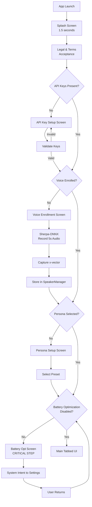

# User Flow: Onboarding

## Complete Flow Diagram

## State Persistence
Each onboarding step writes to `EncryptedSharedPreferences` upon completion. The app checks all flags before showing the main UI.