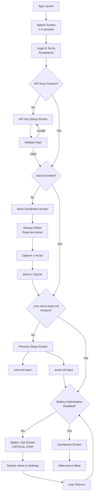

# User Flow: Onboarding

## Complete Flow Diagram

## Entry Points

- Fresh install: Full flow
- Update or reinstall: Skip if keys, voice, and persona exist in storage
- User can skip persona setup (uses defaults), but cannot skip Legal, API keys, Voice enrollment, or Battery Optimization.

## State Persistence

Each onboarding step writes to EncryptedSharedPreferences upon completion:
- `terms_accepted: boolean`
- `api_keys_configured: boolean`
- `voice_enrolled: boolean`
- `persona_configured: boolean`
- `battery_opt_disabled: boolean`

Dashboard checks all flags before showing main UI.