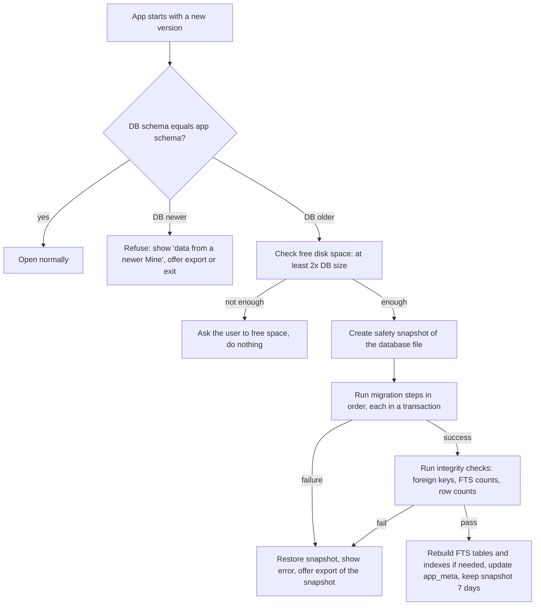

# Migrations

Status: core     Version: 0.1     Depends on: 11-layers-raw-derived, 10-storage-encryption, 15-export-sync-prep

## 1. Purpose

Mine should run for years and gain features without damaging the user's history. This file sets the rules for changing
the database, the data formats, and the AI logic, so that an update is never a gamble.

## 2. Behavior (what the user sees)

- Updating the app just works. If a migration takes time, a progress screen appears.
- Before every migration the app keeps a safety copy and can roll back if something fails.
- If the user installs an **older** app over newer data, the app refuses to open it and explains, instead of corrupting anything.
- When improved extraction or embeddings are available, the app offers a **rebuild** (never forces it).

## 3. Design

### 3.1 What carries a version

| Thing                     | Where                                  | Changes when                                    |
| ------------------------- | -------------------------------------- | ----------------------------------------------- |
| `schema_version`        | Room database version and `app_meta` | A table or column changes                       |
| `extractor_version`     | Stamp on derived rows                  | Extraction logic or prompts change meaningfully |
| `embedding_version`     | `embedding.model_version`            | The embedding model or its settings change      |
| `prompt_version`        | `raw_message.attrs.prompt_v`         | A prompt is edited (for debugging and tests)    |
| `export_format_version` | Export header                          | The export layout changes                       |
| `blueprint_version`     | `README.md`                          | The design docs change                          |
| Feature flags             | `app_meta` (`flag.*`)              | A feature ships dark and is enabled later       |

### 3.2 Golden rules

1. **Additive first.** New tables, new nullable columns, and new columns with defaults are always safe.
2. **Raw layer**: only additive columns. No rewrites, no drops, no meaning changes (`11`).
3. **Derived layer**: structural changes are migrated, but changes to *logic* are handled by a **rebuild**, not by migration.
4. **Never rely on a migration to fix data semantics.** If the meaning of a field changes, add a new field.
5. **Unknown values are tolerated.** Code must never crash on an unrecognized `type`, `status`, `edge type`, `category`, `source`, or `kind` string
   (D-056). Unknown values are shown as "other", preserved on export, and ignored by logic that does not understand them.
6. **Expand, migrate, contract.** For a breaking change, release 1 adds the new shape and writes both, release 2 reads the new shape and backfills, and release 3 (much later) removes the old. Dropping columns is rare, and never on raw tables.
7. **No downgrades.** Data written by a newer schema is never opened by an older app.
8. **Every migration has a test** (section 3.6). No test, no merge.

### 3.3 Migration procedure



- **Safety snapshot:** a file copy of the (already encrypted) database, kept for 7 days or until the next successful migration, whichever is later. At most two snapshots.
- **Large migrations** (millions of rows) run in batches with progress, and are resumable through a `migration_state` record.
- **Migrations run before any alarm handler writes**, and alarm receivers that start during a migration wait for it, or post a generic notification if it is long.
- **Room:** use exported schemas and explicit `Migration` objects (auto-migrations only for trivial additions). FTS5 tables, triggers, and virtual tables are created
  by raw SQL in migrations, because Room does not manage them (**verify** that the SQLCipher build includes FTS5 before relying on it).
- **Triggers** that protect raw tables (`11`) are recreated by every migration that touches those tables.

### 3.4 Rebuilds (logic changes)

Defined in `11-layers-raw-derived.md` section 5. Additional rules:

- An app update that bumps `extractor_version` or `embedding_version` shows a **Rebuild available** card. It explains the benefit, the estimated provider cost for extraction rebuilds, and that user-approved data is preserved.
- Embedding rebuilds are free and offline and may run automatically while charging (setting, default on).
- Extraction rebuilds are always user-initiated.
- The old derived tables are kept 7 days after the swap.

### 3.5 Seed and config data

- Preset personas, templates, vendor guides, and default settings ship with the app and are **upserted by stable id** at start.
- User copies and edits are separate rows and are never overwritten (`24-personas.md`).
- Removing a preset in a later version hides it for new users but never deletes it from existing users.

### 3.6 Testing migrations

- Keep a **golden database fixture** for every released schema version (a small synthetic dataset covering every table, including rows with unknown enum values).
- For every new version: migrate each old fixture to the latest and assert row counts, hashes of raw tables, foreign keys, FTS consistency, and that the app's key queries still work.
- A **fuzz fixture** with weird data (very long text, empty fields, odd Unicode, nulls) migrates cleanly.
- A test for "database newer than app" asserts the refusal.
- A test kills the process mid-migration and asserts the snapshot restore path.
- Export from an old version is imported by the newest version (backward compatibility, section 3.7).

### 3.7 Export and import compatibility

- The newest app reads exports from the **previous two** format versions.
- Unknown record types and unknown fields are skipped and counted, not errors.
- An export from a **newer** format than the app understands is refused with a clear message ("update Mine first").
- Importing an old export runs the same migrations on the imported data, then queues rebuilds if its `extractor_version` is old.

### 3.8 Settings and preferences

User settings use the versioned key-value store defined in `52-onboarding-settings.md` section 4 (`key`,
`value_json`, `scope`, `hlc`, `updated_at`, `deleted_at`). Renamed settings are migrated with a mapping.
Unknown keys are preserved.
Settings are stored in the database (not scattered preference files) so export and sync carry them.

### 3.9 Planned schema growth (examples, not commitments)

| Release | Likely changes                                                                                                  | Type       |
| ------- | --------------------------------------------------------------------------------------------------------------- | ---------- |
| v1.1    | Recurrence on reminders and habits (`attrs` today, columns later), direct-boot alarm table, auto-export state | Additive   |
| v2      | `place`, `place_signal`, `sensing_event`, `call_event`, `voice_job`, `model_asset`                         | Additive   |
| v3      | `voiceprint`, `ambient_session`, `ambient_window`, `ambient_segment`, `ambient_report`, `ambient_report_item` | Additive   |
| Sync    | `hlc` columns, `sync_peer`, `sync_cursor`, tombstone GC state                                             | Additive   |

### 3.10 PR checklist for any schema change

- [ ] Additive? If not, is it expand, migrate, contract?
- [ ] Migration written and tested against every golden fixture
- [ ] New fixture added for the new version
- [ ] Raw triggers recreated if needed
- [ ] FTS and index rebuilds handled
- [ ] Unknown-value handling in the code that reads the changed field
- [ ] Export and import updated, format version bumped if the layout changed
- [ ] Blueprint file updated and this log changed
- [ ] Rebuild needed? If yes, version stamp bumped and the Rebuild card text written

## 4. Data

```sql
CREATE TABLE migration_state (            -- operational
  id TEXT PRIMARY KEY, from_version INTEGER, to_version INTEGER,
  step TEXT, progress REAL, started_at INTEGER, updated_at INTEGER, status TEXT
);
```

`app_meta` keys: `schema_version`, `extractor_version`, `embedding_version`, `prompt_version`, `flag.*`, `last_migration_at`.

## 5. Settings

| Setting                                | Default |
| -------------------------------------- | ------- |
| Keep migration snapshot                | 7 days  |
| Auto-rebuild embeddings while charging | On      |
| Show "Rebuild available" cards         | On      |

## 6. Edge cases and failure modes

- **Disk full mid-migration.** The transaction fails, the snapshot is restored, and the user is told how much space is needed.
- **Battery dies during migration.** On the next start, the `migration_state` shows an unfinished run, and the app restores the snapshot and retries.
- **User downgrades the app** (installs an old APK over a new one). Refused, with an option to export.
- **Imported data has a newer schema than the app.** Refused.
- **A rebuild changes a node the user relied on.** Anchors (approved or edited rows) are never overwritten (D-028).
- **Corrupt snapshot.** Falls back to the export file advice.
- **Same device, multiple app updates skipped.** Migrations are chained from any old version, so skipping releases is safe.

## 7. Offline behavior

Migrations and embedding rebuilds are local. Extraction rebuilds wait for a provider.

## 8. Tests

Section 3.6, plus: migrate a 500k-message fixture within an acceptable time with a progress screen, and verify alarms still re-arm after migrating.

## 9. Open questions

- Keep only the last 2 migration snapshots, or also one before each major version for a month? Proposed: last 2 only.

## 10. Changelog

- 0.1 (2026-10-21): first draft.
