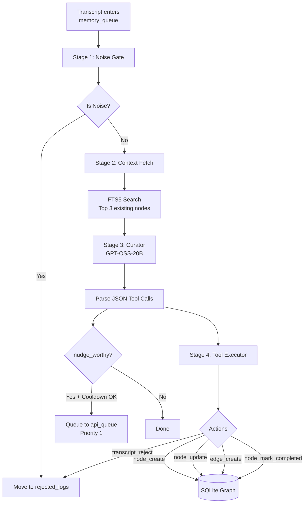
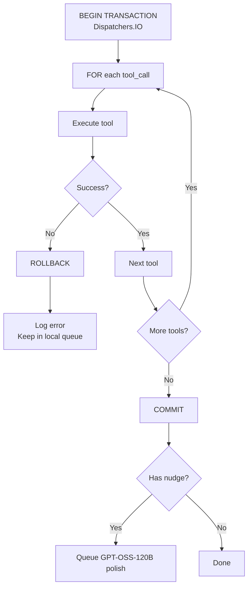
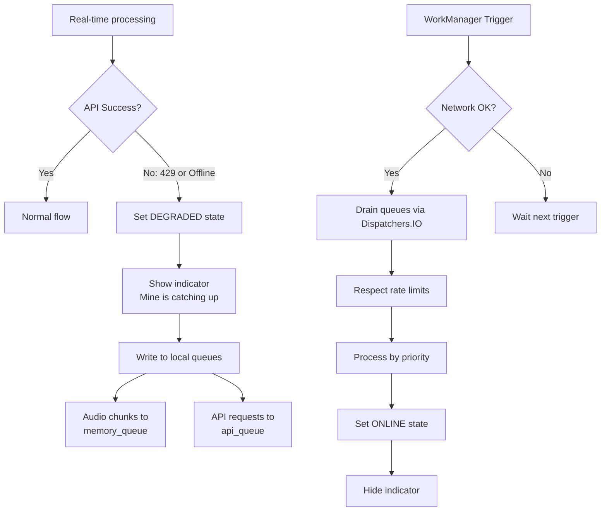

# User Flow: Background Agent & Queue System

## The 4-Stage Pipeline

## SQLite Concurrency & Tool Execution

To prevent `SQLITE_BUSY` crashes when the user is chatting while the background agent is writing, Mine uses **Room with Write-Ahead Logging (WAL)** and **Kotlin Coroutines**.

All tool calls execute within a single SQLite transaction on `Dispatchers.IO`:

## Offline & Rate-Limited Fallback

## Queue Priorities

| Priority | Endpoint | Description |
|----------|----------|-------------|
| 1 | nim_gptoss(120b) | Nudge polish (user-facing, urgent) |
| 2 | groq_whisper | Transcription (blocks downstream) |
| 3 | nim_gptoss(20b) | Background curator |
| 5 | nim_gptoss(20b) | Batch summaries and pruning |