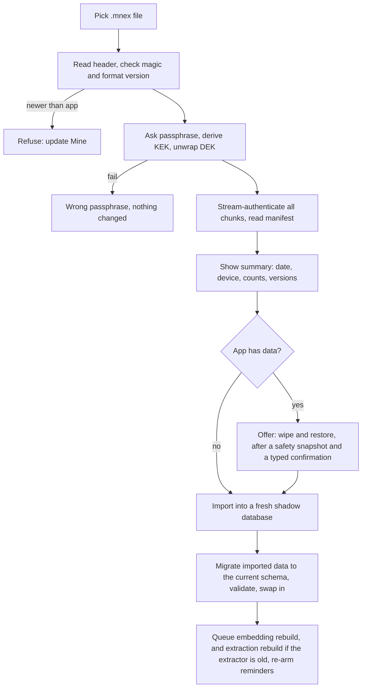

# Export, Import, and Sync Preparation

Status: v1 (export and import), planned (sync)     Version: 0.1     Depends on: 10-storage-encryption, 11-layers-raw-derived, 14-migrations

## 1. Purpose

Two jobs: (1) **now**, move all data between phones with one encrypted file, and keep a backup (there is no cloud);
(2) **later**, support a second full client (a desktop app) with sync. v1 builds only the first, but makes the data model sync-ready
so the second needs no rewrite.

## 2. Behavior (what the user sees)

- **Export everything:** choose a passphrase (confirmed twice, strength shown), pick options, save the `.mnex` file through the system file picker or share sheet.
  The app then **verifies** the file by reading it back and shows the counts.
- **Import:** pick a file, enter the passphrase, see what it contains (date, source device, counts, versions), confirm, and the app restores it into an empty Mine.
- **Backup reminder:** "Your last export was 5 weeks ago", in the system channel, and never nagging more than weekly.
- The wording always says: lose the passphrase and the file cannot be opened, and the app cannot recover it.
- **Later:** pair a desktop client with a QR code, and the two stay in sync.

## 3. Design

### 3.1 Export format (`.mnex`, format version 1)

This section is authoritative and supersedes the sketch in `10-storage-encryption.md`.

```text
HEADER (plain, authenticated as additional data)
  magic            "MNEX"
  format_version   u16 = 1
  flags            u16 (bit0: gzip, bit1: has_embeddings, bit2: has_api_keys)
  kdf_id           u8 (1 = argon2id)
  kdf_params       memory KiB (default 65536), iterations (3), parallelism (1)
  salt             16 bytes
  wrap_nonce       12 bytes
  wrapped_dek      32-byte data key encrypted with the key-encryption key (KEK), plus 16-byte tag
  chunk_size       u32 (default 1 MiB of compressed data)
  nonce_prefix     8 bytes
BODY
  chunks: [ciphertext_len u32][ciphertext + 16-byte tag] ...
  nonce = nonce_prefix || chunk_counter (u32)
  additional data = header hash || chunk_counter || is_final_flag
  the final chunk carries the final flag, so truncation is detected
PLAINTEXT (after decrypt, then gunzip): JSON Lines, one record per line
  {"t":"manifest","v":1,"d":{ app_version, schema_version, extractor_version, embedding_version,
       device_id, created_at, counts:{...}, options:{...} }}
  {"t":"raw_message","v":1,"d":{...}}
  {"t":"raw_event","v":1,"d":{...}} ... node, edge, soul_fact, soul_suppression, summary, learned_pref, signal_log,
  persona, setting, reminder, provider (only with api keys), embedding (optional) ...
  {"t":"footer","d":{ counts, sha256 of all preceding record bytes }}
```

- **KEK** = Argon2id(passphrase, salt, params). **DEK** is a random 256-bit key per export, stored wrapped in the header.
  This lets later versions create scheduled exports using a Keystore-wrapped KEK without asking for the passphrase each time,
  and still produce files that the passphrase alone can open (see 3.5).
- Record types are strings with a record version, so new types and fields never break old readers (`14` 3.7).
- **Compress, then encrypt.** Chunked so large files stream with low memory.
- **Embeddings** are excluded by default and rebuilt on import. **API keys** are excluded by default and need an explicit tick with a warning.
- **Settings** are included, except device-specific ones (notification permission states, alarm registry, limiter state).
- **Operational tables** (outbox, alarms, caches) are never exported.
- **Memory use:** the Argon2 memory setting is stored, so an import device with little RAM can refuse with a clear message instead of crashing.
- File name: `mine-export-YYYYMMDD-HHMM.mnex`.

### 3.2 Export flow

1. Choose options (include API keys: off, include embeddings: off).
2. Enter and confirm the passphrase. A warning explains loss is permanent. The strength meter blocks very weak passphrases but never forbids a choice (the user decides).
3. Stream the database through the writer into a temp file in the app's cache directory.
4. **Verify:** re-open the temp file, authenticate every chunk, compare the footer hash and counts with the database.
5. Hand the file to the system: save to a folder the user picks, or share. Delete the temp file.
6. Record `last_export_at` and show a success sheet ("1,204 messages, 311 items, 42 facts").
   Interrupted exports leave no partial output, since the destination is written only after verification.

### 3.3 Import flow (v1: restore into an empty app)



- All-or-nothing: the shadow database is swapped in only after validation.
- **Device identity:** the importing phone creates its **own new `device_id`**. Imported rows keep their original `device_id`, so authorship stays truthful and a later sync can tell devices apart.
- Reminders are re-armed on the new phone, and past ones are marked missed or expired.
- API keys, if included, are re-encrypted with the new phone's Keystore.
- **Merge** into a non-empty app is not v1 (it belongs with sync).
- A **Test restore** button checks a file (passphrase, integrity, counts) without importing, so the user can trust a backup before needing it.

### 3.4 Readable export (planned, v1.1; see `90` section 3.3)

An optional **unencrypted, human-readable** export (Markdown per day for chats, plus a list of items and facts) for people who want to read or archive their data.
Marked with a loud warning that it is not protected. It is a one-way export, not importable.

### 3.5 Scheduled auto-export (planned, v1.1; see `90` section 3.3)

- The user picks a folder (Storage Access Framework). Every N days, the app writes an encrypted export there, keeping the last K files.
- It uses a **KEK stored under a Keystore key** (set once by entering the passphrase), writing fresh DEKs per file, so no passphrase prompt is needed.
- Files stay openable with the passphrase alone because the header carries the salt and KDF parameters, so a lost phone does not make the backups useless.
- If the Keystore KEK is lost, the next export asks for the passphrase again.

### 3.6 Sync: the plan (planned)

**Goal:** a desktop client (and possibly more phones) that holds the same data, works offline, and merges safely. No Mine server (D-008).

**Sync unit.** The permanent record is already an **append-only operation log** (`raw_event`) plus immutable raw messages. Sync exchanges:

1. **Raw messages and operations** (union by ULID, immutable, trivially mergeable).
2. **Derived rows** (nodes, edges, Soul facts, personas, settings), merged **row by row** using a hybrid logical clock (HLC) per row and per field.
   Derived rows are **not** re-extracted on every device (LLM extraction is not deterministic, and two devices would invent different nodes). Extraction results travel as rows.
   Embeddings, message chunks, summaries' vectors, and limiter state stay **device-local** and are rebuilt from the merged data.

**Conflict policy by table**

| Data                                                                                  | Policy                                                                                                                                                                                                                  |
| ------------------------------------------------------------------------------------- | ----------------------------------------------------------------------------------------------------------------------------------------------------------------------------------------------------------------------- |
| `raw_message`, `raw_event`, `signal_log`                                        | Union by id. Redaction ops win (a redacted message stays redacted everywhere)                                                                                                                                           |
| `node`                                                                              | Field-level last-writer-wins by HLC. If both devices changed `status` within a short window, keep the later one and write a visible `conflict_resolved` op ("closed on desktop, kept active on phone: kept closed") |
| `edge`                                                                              | Union. A tombstone with a later HLC beats an upsert                                                                                                                                                                     |
| `soul_fact`                                                                         | Union, then a duplicate-merge pass (embedding plus text). Supersede chains are preserved. Status by LWW                                                                                                                 |
| `reminder`                                                                          | Synced as a mirror. Each reminder has a **ring device**. Acknowledgments sync as ops, so a reminder handled on the desktop stops ringing on the phone                                                             |
| `persona`, `setting`                                                              | LWW per row or per key. Device-local keys (provider keys, permission states) are excluded                                                                                                                               |
| `summary`                                                                           | Last-writer-wins per (level, period), with `generated_by` noted                                                                                                                                                       |
| `learned_pref`                                                                      | Recomputed from the synced `signal_log`                                                                                                                                                                               |
| `proposal`, `outbox`, `alarm_registry`, `limiter_state`, `context_snapshot` | Device-local, never synced                                                                                                                                                                                              |

**Proactive behavior with several devices.** One device is the **primary** for the nudge engine and check-ins, so the user is not nudged twice.
Other devices show the messages inline, and ring only reminders assigned to them.

**Transport options (in order of plan)**

1. **File bundles:** an encrypted "delta" file (operations since the peer's last cursor) that moves through anything (a synced folder, a chat app).
   Simple, robust, and works even without a shared network. This reuses the export writer.
2. **LAN sync:** direct device to device over the local Wi-Fi after pairing, with a mutually authenticated encrypted channel.
3. **User-hosted relay** (a storage bucket or WebDAV the user already owns, with end-to-end encryption): parked.

**Pairing with QR.** The QR code carries only a device public key, a one-time secret, and the address hint. The devices run a key agreement (for example X25519),
show a short **confirmation code** to compare on both screens, store each other's keys in a trust list, and can revoke each other. **QR is for pairing, never for carrying data.**

**First sync of a new device.** Full snapshot using the export format (decrypted with the pairing key), followed by deltas.

**Tombstones** are kept until every paired device has acknowledged them (or 90 days), then garbage-collected.

**Versions.** A sync handshake exchanges `schema_version`, `format_version`, and a protocol version. If they differ beyond a supported range, sync refuses and asks the lagging device to update.

### 3.7 What v1 must do now so sync is cheap later

Checklist (verified in code review):

- [ ] ULID primary keys on every synced table. No auto-increment ids.
- [ ] `device_id`, `created_at`, `updated_at`, `deleted_at` on every synced table
- [ ] An **`hlc` text column** on derived synced tables (`soul_fact`, `node`, `edge`, `reminder`, `persona`, `setting`), set by the gateway on every write.
- [ ] Every derived change goes through the gateway and writes a complete `raw_event` with before and after
- [ ] No cascading hard deletes: deletes are tombstones
- [ ] Settings stored in a table with `updated_at`, device-local keys marked
- [ ] Device-local and never-synced: `place_signal`, `sensing_event`, `call_event`, `voice_job`, `model_asset`,
      `voiceprint`, and all `ambient_*` staging tables. `place` label and kind sync.
- [ ] Time stored as UTC plus offset, never local time alone
- [ ] Reminders carry `device_id`, and the alarm registry is operational
- [ ] **Core logic in a pure Kotlin module** (gateway, resolver, retrieval math, scheduler decisions, nudge scoring, date parser) with **no Android imports**, and Android code only in adapters (alarms, notifications, sensors, Keystore). This is what lets a desktop client reuse the brain.
- [ ] `Embedder`, `SecureStore`, `Clock`, `Notifier` are interfaces with Android implementations

### 3.8 Desktop client notes (planned)

- A second full client means real sync (3.6), so the desktop is not just a viewer.
- A JVM or Kotlin Multiplatform desktop app can reuse the core module. The embedding model needs a desktop runtime (a different implementation of `Embedder`, with a separate `model_version` that is rebuilt locally).
- The desktop gets its own `device_id`, its own provider settings, and may be the primary device for nudges or not, by the user's choice.
- Notifications, alarms, and sensors are device-specific adapters. The desktop has no phone sensing and no call nudge.

## 4. Data

```sql
CREATE TABLE export_log (                 -- operational
  id TEXT PRIMARY KEY, ts INTEGER NOT NULL, kind TEXT NOT NULL,   -- export | test_restore | import
  options_json TEXT, counts_json TEXT, bytes INTEGER, verified INTEGER, note TEXT
);
-- planned for sync (not created in v1)
-- sync_peer(id, device_id, name, public_key, trusted_at, revoked_at, last_seen_hlc)
-- sync_cursor(peer_id, table_name, hlc)
```

`app_meta` keys: `last_export_at`, `export_reminder_weeks`.

## 5. Settings

| Setting                          | Default              |
| -------------------------------- | -------------------- |
| Export reminder interval         | 4 weeks (can be off) |
| Argon2 memory / iterations       | 64 MiB / 3           |
| Include API keys                 | Off                  |
| Include embeddings               | Off                  |
| Scheduled auto-export (v1.1)     | Off                  |
| Primary device for nudges (sync) | This device          |

## 6. Edge cases and failure modes

- **Wrong passphrase:** fails at unwrapping the key, with no partial work.
- **Truncated or tampered file:** chunk authentication and the final flag catch it, and nothing is imported.
- **Very large file on a low-RAM phone:** streaming keeps memory flat, and Argon2 memory is checked first.
- **Passphrase typos at export:** the double entry plus Test restore reduce the risk.
- **Importing onto a phone that already has a different Mine history:** v1 offers only wipe and restore (with a snapshot).
- **Sync clock skew:** HLC tolerates it, and wall-clock times are never used to order concurrent edits.
- **A device is lost:** revoke it in the trust list from another device, and its keys stop working for future syncs (it keeps the data it already had).
- **Two devices both ring a reminder:** prevented by the ring device setting, and acknowledged-state sync.

## 7. Offline behavior

Export, import, and file-bundle sync are fully offline. LAN sync needs the same local network, not the internet.

## 8. Tests

1. Export then import on a clean install: row counts and hashes of the raw tables match, and reminders are re-armed.
2. Flip one byte in the file: rejected. Truncate the file: rejected.
3. Wrong passphrase: nothing changes.
4. Test restore matches the real import's reported counts.
5. Import of an export from the previous format version works (golden export fixtures per version).
6. Unknown record types are skipped and counted.
7. Verify-after-write catches a deliberately corrupted temp file.
8. (Sync, later) Two devices edit the same node's different fields: both edits survive. The same field: LWW with an HLC, and a conflict op for `status`.
9. (Sync, later) Redaction on one device propagates and is never resurrected by the other.

## 9. Open questions

- Is a desktop reading of the raw chat in the memory viewer enough for the first desktop release, with editing added after sync is stable? Proposed: yes.
- Should the passphrase have a hint option stored in the file header (not the passphrase itself)? Proposed: no, since a hint weakens it.

## 10. Changelog

- 0.1 (2026-10-21): first draft.
