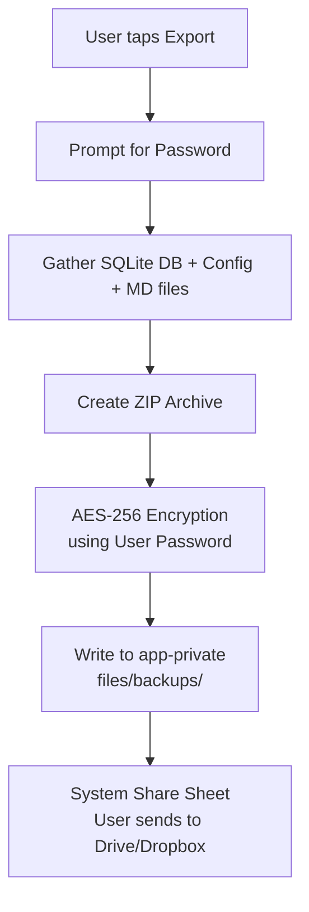

# Security & Privacy

## Threat Model

| Threat | Mitigation |
|--------|------------|
| Physical device theft | Database encrypted at rest |
| Cloud API key exposure | Keys not in code; encrypted storage |
| Backup interception | Backups encrypted with user-provided password |
| Other apps reading data | App-private storage only |

## Encryption Layers

### 1. SQLite Database (SQLCipher)
- Algorithm: AES-256-CBC
- Key: Derived from Android Keystore (hardware-backed). The `MasterKey` never leaves the device.
- Implementation: `net.zetetic:android-database-sqlcipher`

### 2. Configuration Storage
- `EncryptedSharedPreferences` (AndroidX Security)
- Stores: API keys, timestamps, flags, persona text
- Master key in Android Keystore

### 3. Backup Encryption Flow (Export/Import)
*Crucial: The internal Keystore key is NEVER exported. Backups use a user-provided password.*



## Key Management

```kotlin
val masterKey = MasterKey.Builder(context)
  .setKeyScheme(MasterKey.KeyScheme.AES256_GCM)
  .build()

val prefs = EncryptedSharedPreferences.create(
  context,
  "mine_secrets",
  masterKey,
  EncryptedSharedPreferences.PrefKeyEncryptionScheme.AES256_SIV,
  EncryptedSharedPreferences.PrefValueEncryptionScheme.AES256_GCM
)
```

## User Consent & Disclosure

- Onboarding explicitly states: "Mine records audio only when you toggle Ambient Listening ON."
- Persistent notification always visible when listening.
- No data leaves device except to user-configured APIs (Groq, NVIDIA).
- No telemetry. No crash reporting unless user opts in.

## Data Retention Controls

- User can delete individual nodes in Dev Mode
- User can wipe entire database from Settings
- Auto-pruning only archives locally; never sends data externally
- Rejected logs purged automatically after 7 days