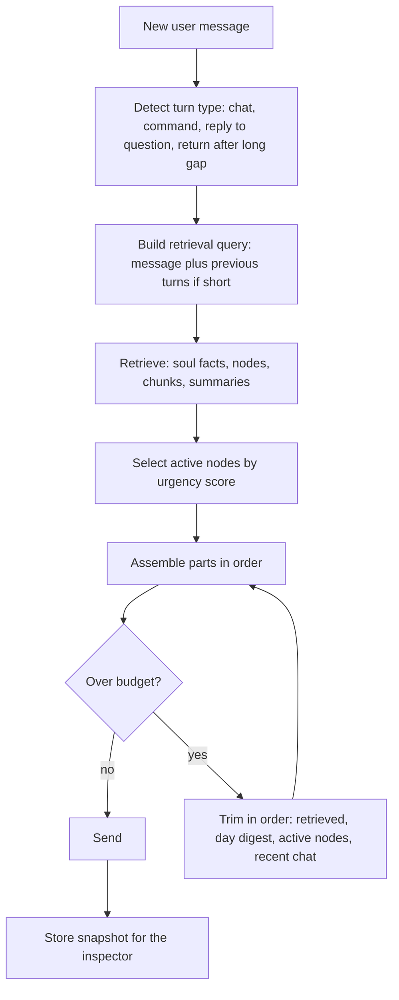

# Context Pack

Status: v1     Version: 0.1     Depends on: 12-soul, 13-nodes-edges-statuses, 21-retrieval-embeddings, 23-tool-contracts, 24-personas

## 1. Purpose

The context pack is everything sent to a model for one call. It is built by code, to a **fixed token budget**,
so the cost of a turn does not grow as history grows (principle 5). This file defines the parts, the budgets,
the order, and what gets dropped first when space runs out.

## 2. Behavior (what the user sees)

- Replies feel informed: the AI knows who you are, what is open today, and what was said earlier.
- Cost and latency stay flat over months of use.
- In Settings, an optional **Memory inspector** shows what the last reply was based on (which Soul facts,
  nodes and past chunks were included). It exists so wrong answers can be traced.

## 3. Design

### 3.1 Parts and default budgets (Chat AI)

| # | Part                  | What it holds                                                                                                   | Budget (tokens)       | Can be dropped?                   |
| - | --------------------- | --------------------------------------------------------------------------------------------------------------- | --------------------- | --------------------------------- |
| 1 | Core rules + persona  | Hard rules (`24-personas.md` section 3.1), persona text                                                       | 500                   | Never                             |
| 2 | Soul core             | Pinned facts (health, constraints, name, strong prefs)                                                          | 600                   | Never (trim to pinned only)       |
| 3 | Now block             | Local date/time, weekday, `day_key`, day-window state, `Context:` line, relevant settings                    | 150                   | Never                             |
| 4 | Pending questions     | Open proposals awaiting an answer (for example "which dinner?")                                                 | 100                   | Never                             |
| 5 | Since-last-seen and topics to raise | Reminders fired, nudges unanswered, items expired since the last chat, due-now reminder items, at most 2 `topics_to_raise` from the nudge engine, and the last nudge's subject aliases | 200 | If empty |
| 6 | Active nodes          | Top items by urgency and relevance (hot tier)                                                                   | 700                   | Shrink                            |
| 7 | Retrieved memory      | Soul facts, nodes, history chunks, summaries matching the current turn                                          | 900                   | Shrink first                      |
| 8 | Day digest            | Summary of earlier parts of today (when the recent window can no longer hold them) and a short yesterday digest | 400                   | Shrink                            |
| 9 | Recent chat           | Last messages of today, verbatim                                                                                | 1500                  | Shrink to a minimum of 6 messages |
|   | **Total input** |                                                                                                                 | **about 5,050** |                                   |

- Tool definitions are counted separately (about 1,000 tokens, see `23-tool-contracts.md`).
- The reply has its own `max_tokens` (default 1,200, more when reasoning is on).
- The numbers are defaults. They are settings (section 5) and are tuned using the test set.

### 3.2 Ordering (prompt-cache friendly)

Providers that cache prompts reuse the **longest unchanged prefix**. So the pack is ordered from stable to volatile:

```text
[1 Core rules + persona]   changes rarely
[2 Soul core]              changes rarely
[tool definitions]         changes only on app update
[8 Day digest]             changes a few times a day
[6 Active nodes]           changes per turn, slowly
[3 Now block, 4 Pending, 5 Since-last-seen and topics to raise]
[7 Retrieved memory]       changes every turn
[9 Recent chat]            changes every turn
[the new user message]
```

The provider layer records `cached_tokens` from usage, so we can see whether caching works. If the time in the
Now block were placed first, it would destroy the cache every minute, which is why it is placed late and rounded to the minute.

The Now block includes one line in the format `Context: at Home, walking (since 14:05)`, omitted when the context
is unknown (`43` 3.4).

### 3.3 Assembly



### 3.4 Recent chat window

- Take today's messages newest-first until the budget is reached, but always keep **at least 6 messages**, and never cut a tool round in half.
- If the day has more messages than fit, the older part is represented by the **day digest** (a rolling summary of today,
  refreshed every 20 messages by the Worker at low priority, and always available as fallback text produced by plain code: the first lines of each time block).
- Day dividers (gaps in time) are included as short markers: `-- 3h later --`. They tell the model that time has passed.
- The messages are sent as normal `user` and `assistant` roles. Reasoning text is never sent back (D, strict history).

### 3.5 Continuity across days

There is no "previous session" to resume. Instead:

- **Yesterday digest**: 3 to 6 lines from the daily summary (what was done, what was left open).
- **Open items** come from the nodes (part 6), not from old chat.
- **Anything older** comes from retrieval (part 7) when relevant, with the original wording available through `search_history`.

### 3.6 Active nodes selection

Score each hot-tier node: `urgency` (time to due, overdue), `severity`, `priority`, `recently_mentioned`,
`blocked_by_dependency` (negative). Include the top items until the budget is full, formatted in the compact
line format of `23-tool-contracts.md`. Titles only for lower-ranked ones. Nodes with `local_only` set are excluded.

### 3.7 Compact mode

If the chosen model's context window is small (8k or less) or the user turns on "Low token mode":
retrieved memory 400, active nodes 300, recent chat 600, day digest 150, no yesterday digest. The pack drops to about 2,700.
Compact mode is also used when a fallback target has a smaller `context_window` (`40-provider-layer.md` 3.8).

### 3.8 Worker pack

The Worker has a different, smaller pack, because its job is extraction:

| Part                                                                                                 | Budget      |
| ---------------------------------------------------------------------------------------------------- | ----------- |
| Worker rules and output contract                                                                     | 600         |
| Soul core titles only                                                                                | 200         |
| The messages to process (a debounced batch)                                                          | up to 1,000 |
| 4 to 6 previous messages for context                                                                 | 500         |
| Candidate matches found by code for each possible target (near-duplicate check, resolver pre-search) | 600         |
| Now block                                                                                            | 100         |

Batching: the Worker waits **30 seconds** after the last user message (and flushes immediately after a Chat turn
that ended with a commit) so several consecutive messages are processed in one request. This respects RPM limits.

### 3.9 Excluded content

- Soul facts and nodes marked `local_only` are never added to any pack or returned in tool results. Every Soul and node query applies `local_only = 0` together with the other filters at query time, so the exclusion cannot be bypassed by a prompt.
- Messages tagged `private` (user marks a message to be hidden from the AI) are skipped. Parked for later UI work.
- Reasoning text of earlier turns, internal IDs, and raw tool errors are never included.

### 3.10 Token counting

Use a fast approximation (characters divided by 3.5 for mixed text), then correct using `prompt_tokens` from provider usage.
Keep a 10 percent safety margin. Counting never calls the network.

## 4. Data

Operational layer only:

```sql
CREATE TABLE context_snapshot (        -- keep the last 20, for the inspector
  id TEXT PRIMARY KEY,
  turn_msg_id TEXT NOT NULL,
  created_at INTEGER NOT NULL,
  parts_json TEXT NOT NULL,            -- which ids went into which part, with token counts
  tokens_total INTEGER NOT NULL
);
```

Snapshots store ids and counts, not copies of private text.

## 5. Settings

| Setting                      | Default                            |
| ---------------------------- | ---------------------------------- |
| Budgets per part             | Table above                        |
| Low token mode               | Auto (on for small context models) |
| Reasoning                    | See the provider and per-slot Reasoning switch |
| Recent chat minimum messages | 6                                  |
| Worker debounce              | 30 s                               |
| Memory inspector             | Off                                |

## 6. Edge cases and failure modes

- **Message is "yes" or "ok".** The retrieval query includes the previous turns, and the pending-question part tells
  the model what "yes" refers to.
- **A very long single message** (user pastes an essay). Truncate for the pack with a marker, keep the full text in raw.
- **Model rejects the length.** Retry once in compact mode, then with the minimum parts.
- **Embedding unavailable.** Retrieval falls back to keywords, so part 7 is smaller but present.
- **The user changes a setting** (for example the min nudge gap). The Now block reads settings live, so the next turn already knows.
- **Clock or timezone change.** The Now block shows the new local time and flags "timezone changed" once.

## 7. Offline behavior

Packs can be built offline, and a message waits in the outbox until a provider is reachable.

## 8. Tests

- Day 1 and day 90 packs for the same kind of message are within 10 percent in token count.
- A 100-message day stays within budget, with the digest covering the earlier part.
- "yes" after a pending question resolves correctly.
- `local_only` items never appear in a captured request.
- The stable prefix is byte-identical across consecutive turns (cache check).

## 9. Open questions

- Should the user be able to pin an arbitrary message into the pack for the rest of the day? Parked.

## 10. Changelog

- 0.1 (2026-10-21): first draft.
