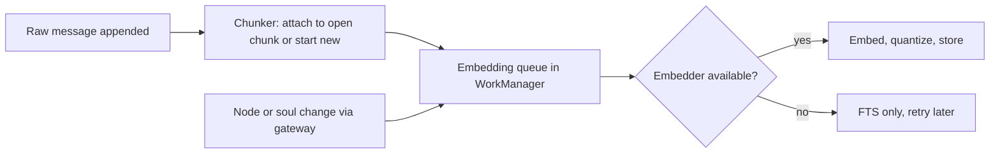
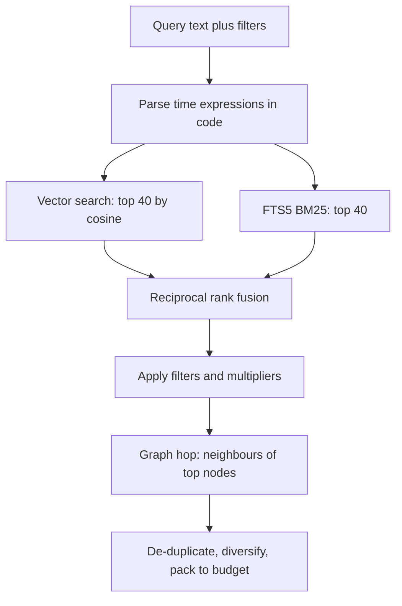

# Retrieval and Embeddings

Status: v1     Version: 0.1     Depends on: 11-layers-raw-derived, 13-nodes-edges-statuses, 20-context-pack

## 1. Purpose

Give MineAI the feeling that it remembers every word, without sending every word. This file defines how memory
is indexed on the device (embeddings, keyword index, summaries), how it is searched, and how the index is kept
in sync and upgraded.

## 2. Behavior (what the user sees)

- Ask "what did I say about the Goa trip a few weeks ago?" and the reply is grounded in the original messages.
- Say "I'm going to a birthday party" and relevant facts (diabetes) surface without being asked.
- Search in the memory viewer works by meaning and by exact words.
- If the embedding model is not installed, search still works with keywords, with a notice.

## 3. Design

### 3.1 The embedding model

- **EmbeddingGemma 2, text-only variant** (D-025). Runs on device through LiteRT. Output vectors are truncated with
  Matryoshka to **256 dimensions** and quantized to int8.
- Because all modalities share one embedding space, adding audio or image search later does not require
  re-embedding stored text.
- The model file is **downloaded on first run** (not bundled), checksum verified, stored in app-private storage.
- The model weights are downloaded, not bundled, and their terms are shown first (`94` section 3.5).
  The download is resumable and Wi-Fi-only by default.
- **Device gate:** during onboarding the app embeds a test text and times it. If it fails or is too slow, vector
  search is disabled for that device and keyword search is used (`vector_enabled = false`). It can be re-enabled later.
- The model is loaded only while embedding work is happening and released after an idle period, since RAM on
  budget phones is limited. Actual memory use must be measured on real devices.
- The model's documented task prefixes (query vs document) are kept in config, not hard-coded.

```kotlin
// the only thing the rest of the app depends on
interface Embedder {
    val version: String      // e.g. "egemma2-text-256-int8-v1"
    val dim: Int
    suspend fun embed(texts: List<String>, kind: Kind): List<QuantVector>   // Kind = QUERY | DOCUMENT
}
```

### 3.2 What gets embedded

| Unit                    | Text embedded                                                                                        | Table         |
| ----------------------- | ---------------------------------------------------------------------------------------------------- | ------------- |
| **Chunk** of chat | Consecutive messages in the same time block, up to about 200 tokens, with `U:` and `A:` prefixes | `msg_chunk` |
| Node                    | `title` plus `body` (not for the ephemeral lane)                                                 | `embedding` |
| Soul fact               | `statement` plus category                                                                          | `embedding` |
| Summary                 | Summary text                                                                                         | `embedding` |

Chunks, not single messages: "yes" or "ok" alone is meaningless, but with the question before it, it is findable.

### 3.3 Storage

```sql
CREATE TABLE msg_chunk (                 -- derived, rebuildable from raw
  id TEXT PRIMARY KEY,
  day_key TEXT NOT NULL,
  ts_start INTEGER NOT NULL,
  ts_end INTEGER NOT NULL,
  msg_ids TEXT NOT NULL,                 -- JSON array of raw_message ids
  text TEXT NOT NULL,
  extractor_version TEXT NOT NULL
);
CREATE VIRTUAL TABLE msg_chunk_fts USING fts5(text, content='msg_chunk', content_rowid='rowid');

CREATE TABLE embedding (
  owner_type TEXT NOT NULL,              -- chunk | node | soul_fact | summary
  owner_id   TEXT NOT NULL,
  model_version TEXT NOT NULL,
  dim        INTEGER NOT NULL,
  scale      REAL NOT NULL,              -- dequantization factor
  vec        BLOB NOT NULL,              -- dim bytes (int8)
  created_at INTEGER NOT NULL,
  PRIMARY KEY (owner_type, owner_id, model_version)
);
CREATE VIRTUAL TABLE node_fts USING fts5(title, body, content='node', content_rowid='rowid');
CREATE VIRTUAL TABLE soul_fts USING fts5(statement, content='soul_fact', content_rowid='rowid');
```

Sizes: 256 bytes per vector. A year of heavy use is tens of MB at most.

### 3.4 Indexing pipeline



- A chunk is closed when a time gap of 10 minutes passes, or it reaches the size limit, and is re-embedded if a late message is appended to it while open.
- All indexing is idempotent and tracked in `extraction_state`-like rows in the operational layer.

### 3.5 Search (hybrid)



1. **Time parsing in code.** Phrases such as "3 weeks ago", "last Friday", "in March" become a date range. A fuzzy
   window is used for "N units ago" (plus or minus half a unit). Results inside the window get a boost, and an explicit
   range acts as a filter. The LLM may pass a range, but code verifies it.
2. **Vector search** is a brute-force scan of int8 vectors held in memory (lazy loaded, sharded by recency if
   the set grows past about 500k). 100k vectors at 256 dimensions is a few tens of milliseconds.
3. **Keyword search** uses FTS5 BM25 and catches names, numbers and exact phrases that embeddings blur.
4. **Fusion:** reciprocal rank fusion with k = 60. It needs no score calibration between the two searches.
5. **Multipliers:** status (active 1.0, recently closed 0.8, archived excluded unless asked), recency (gentle
   decay for chunks, with a floor so old facts are never zero), type boosts when the caller asks for a type.
6. **Graph hop:** one hop along edges from top nodes, small fan-out cap. Two hops only for "why" and "what depends on this".
7. **Packing:** greedy by score into the token budget, with a light diversity rule (do not return five chunks from the same minute).
8. **Filters** always applied: `deleted_at IS NULL`, `local_only` excluded for context packs (included for the user's own viewer).

### 3.6 Automatic retrieval each turn

Before each Chat call the code runs one retrieval using the new user message. If it is short (under about 8 words),
the previous user and assistant messages are added to the query. Soul facts are retrieved separately (top 5)
so a flood of chunks cannot crowd them out. The Chat AI can also call `search_memory` and `search_history`
for a second, targeted look.

### 3.7 Summaries (the table of contents)

| Level | Created when                                                   | Built from                       | Target size       |
| ----- | -------------------------------------------------------------- | -------------------------------- | ----------------- |
| Day   | At day rollover (or first open after), low-priority Worker job | The day's messages, node changes | 250 to 350 tokens |
| Week  | After the week start day                                       | The seven daily summaries        | 250 tokens        |
| Month | After month end                                                | The weekly summaries             | 250 tokens        |

- Each summary stores key points, **open loops**, and the `msg_ids` ranges it covers, so the original words can be fetched.
- Summaries are **never the only copy**. They are indexes. Everything is in raw.
- They are derived: regenerated if the extractor version changes or after an erase (status `stale`).
- Cost: one provider call per day, plus occasionally weekly and monthly.
- Fallback when no provider is available for a long time: a plain-code digest (first lines per time block) so there is always something.

### 3.8 Versioning and re-embedding

- Every vector is stamped with `model_version`. The query embedder and stored vectors must match.
- On a model change, a background job re-embeds everything (on device, free, resumable). Until it finishes,
  searching the old vectors with the old model is not possible, so search falls back to keywords and vectors that are already migrated, with a notice.
- Old vectors are deleted after the new set is complete.

## 5. Settings

| Setting                    | Default                      |
| -------------------------- | ---------------------------- |
| Vector search              | On if the device gate passes |
| Embedding model download   | Wi-Fi only                   |
| Chunk gap                  | 10 min                       |
| Retrieval top-k per search | 40 (before fusion)           |
| Fusion k                   | 60                           |
| Graph hop fan-out          | 3 per node                   |

## 6. Edge cases and failure modes

- **Model download fails or is declined.** Keyword search. The settings screen offers a retry.
- **Embedding is slow on an old phone.** Queue is processed only while charging or idle if the gate says so.
- **Different languages or mixed languages** (for example English mixed with another language). The model is multilingual to some degree. Keyword search is the backstop. Quality for specific languages must be tested with real data (`93-test-scenarios.md`).
- **Near-duplicate chunks** (the user repeats themselves). De-duplicated at packing time.
- **Redaction of a message.** Its chunk is rebuilt from remaining messages, or removed, and its summary marked stale.
- **Index drift** (a row without a vector). A consistency check job finds and fills it.

## 7. Offline behavior

Embedding, indexing and searching are fully on device. Only summaries need a provider, and they queue.

## 8. Tests

- A retrieval test set of about 50 hand-written questions about the author's own history. Goal: the right chunk in the top 8 for at least 90 percent of them.
- "3 weeks ago" returns chunks from the right window.
- A name or number that appears once is found by keyword even when the vector search misses it.
- Disable the embedder: search still works, and the UI says so.
- Re-embed after changing the model version: results are equivalent or better and no row is left without a vector.

## 9. Open questions

- Whether to store int8 vectors at 128 dimensions for very low-end devices. Decide after measuring recall at 256 vs 128.

## 10. Changelog

- 0.1 (2026-10-21): first draft.
