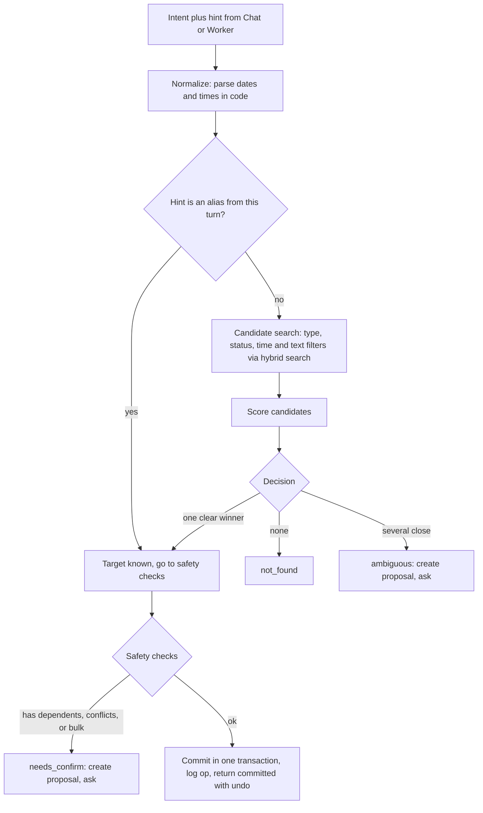
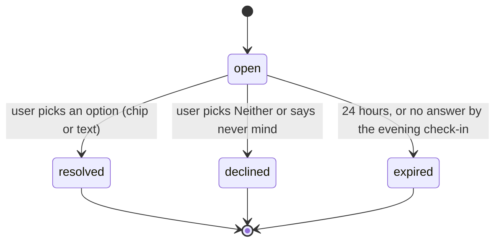

# Resolver (Ambiguity, Confirmation, Undo)

Status: v1     Version: 0.1     Depends on: 13-nodes-edges-statuses, 21-retrieval-embeddings, 23-tool-contracts

## 1. Purpose

Turn a vague human reference ("cancel the dinner") into one specific change, or into a question. The resolver
exists so that **the LLM never edits or deletes by similarity** (D-001). It is plain code. The model states an
intent and a hint, and the resolver decides what is safe.

## 2. Behavior (what the user sees)

- Clear case: "cancel the dinner tomorrow" is applied immediately, MineAI says *"Cancelled: Dinner, Wed 21 Oct 20:00"* and shows an **Undo** chip.
- Unclear case: two matches. MineAI asks naturally ("Which dinner, tomorrow's or Thursday next week?") with
  tappable chips: `Wed 21 Oct dinner`, `Thu 29 Oct dinner`, `Both`, `Neither`.
- Nothing found: MineAI says it could not find it and offers to create it or look under another name.
- The user can type an answer instead of tapping ("the first one", "tomorrow's", "the one with Raj").
- Nothing is applied while a question is open.

## 3. Design

### 3.1 Intents

`create`, `update`, `complete`, `cancel`, `reschedule`, `pause`, `resume`, `reopen`, `progress` (log progress), `link`, `unlink`.

Risk classes:

| Class            | Intents                                                                           | Rule                                                        |
| ---------------- | --------------------------------------------------------------------------------- | ----------------------------------------------------------- |
| Reversible-light | `update`, `progress`, `pause`, `resume`, `reopen`, `link`, `unlink` | Apply on clear winner, show Undo                            |
| Closing          | `complete`, `cancel`, `reschedule`                                          | Stricter thresholds, always Undo, echo exact title and date |
| Bulk             | Anything affecting more than one node ("cancel everything this week")             | Always ask, listing every item                              |

### 3.2 Pipeline



### 3.3 Candidate search

- Filter by node type implied by the intent (a "dinner" is an `event` or a `task`, not a `person`).
- Filter by status: closing and updating intents look at open states first. `reopen` looks at closed states.
- Use the hybrid search of `21-retrieval-embeddings.md` over node text, plus time constraints parsed from the hint.
- Keep the top 5.

### 3.4 Scoring

Weighted sum (weights are config, tuned on the test set):

| Feature                                                          | Weight (default) | Notes                                                                         |
| ---------------------------------------------------------------- | ---------------- | ----------------------------------------------------------------------------- |
| Text match (fused retrieval score, normalized)                   | 0.35             |                                                                               |
| Time match (hint time vs `due_at` or `start_at`)             | 0.25             | 1.0 same day, decays with distance, 0 if the hint has a time and it conflicts |
| Recently discussed (in the last 6 turns, or referred to by "it") | 0.20             | Strongest coreference signal                                                  |
| Status fit                                                       | 0.10             | Open for closing intents                                                      |
| Type fit                                                         | 0.10             |                                                                               |

Decision rules (defaults):

- **Clear winner:** top score at least 0.75 **and** margin over the second at least 0.20.
- **Closing intents:** top score at least 0.85 and margin at least 0.25.
- Otherwise **ambiguous** (two or more candidates), or **not_found** (no candidate above 0.40).
- If the user's own words contain a time or distinguishing detail that matches exactly one candidate, that candidate wins regardless of margin.

### 3.5 Safety checks before commit

- The target has **dependents** (`depends_on` edges pointing at it): confirm, naming them.
- The target is `in_progress` and the intent is `cancel`: confirm.
- The change would create a **conflict edge** (two events at the same time): commit, then warn (not a block).
- The target's `origin` is `user_edit` and the intent comes from the Worker rather than an explicit user command in this turn: propose instead of commit.
- The intent came from an ambient source: always propose (see `61-ambient-listening.md`).

### 3.6 Proposals (open questions)

When the result is `ambiguous` or `needs_confirm`, the gateway stores a **proposal** (operational layer) and returns `p1`.



- Chip taps call the gateway directly (no model call), so they are instant and deterministic. The Chat AI is
  informed through a `system_event` message so the conversation stays coherent.
- A typed answer goes through the Chat AI, which calls `confirm_change(proposal, choice)`. The Chat AI cannot
  invent choices: it picks from the options in the proposal or passes extra text hints for a re-resolve.
- If the answer is still unclear, ask once more with different wording, then leave everything unchanged.
- An expired proposal changes nothing. It is mentioned once in the evening check-in ("Still unsure which dinner you meant").
- Several proposals can be open at once, each with its own chips, ordered by recency.

### 3.7 Dates and times (code decides)

- All relative expressions ("tomorrow", "next Thursday", "in 2 hours", "end of the week") are parsed by code using the
  user's timezone, current time, **day rollover rule** (so "tomorrow" at 1 a.m. means the right day for a night owl) and week start.
- The model may send its own ISO guess. If it disagrees with the code's parse, the code wins and the discrepancy is logged for tuning.
- Every committed change echoes the **absolute date**: "Wed 21 Oct".
- Ambiguous phrases ("Friday" when today is Friday, "next week") follow written rules in the parser and are echoed so the user can correct them. Phrases that cannot be parsed trigger a question.

### 3.8 Creation and duplicates

- `create` runs a duplicate check: similar title and overlapping time. If a close match exists, the result is
  `needs_confirm` with `duplicate_candidate`, and the Chat AI asks "You already have dinner tomorrow at 8. Update that one, or add another?".
- Two events with similar names at different times are not duplicates.

### 3.9 Undo

- Every commit creates a `raw_event` with before and after JSON, and returns an `undo` token.
- Undo is available through the chip for 24 hours, and from the memory viewer's history afterwards.
- Undo restores the `before` state **if the target has not changed since**. If it has, the app shows what changed and asks.
- Undo is itself a logged op (`undo_of` references the original).

### 3.10 Multiple intents in one message

"Cancel the dinner and move the meeting to 5" becomes two intents, resolved independently. One may commit while the other is asked. Both results are summarized in one reply.

## 4. Data

```sql
CREATE TABLE proposal (                  -- operational layer
  id           TEXT PRIMARY KEY,
  kind         TEXT NOT NULL,            -- ambiguous | needs_confirm | duplicate | soul | ambient
  intent_json  TEXT NOT NULL,
  options_json TEXT NOT NULL,            -- candidate ids, labels, extra options (both, neither)
  cause_msg_id TEXT,
  created_at   INTEGER NOT NULL,
  expires_at   INTEGER NOT NULL,
  status       TEXT NOT NULL DEFAULT 'open',
  resolved_option TEXT
);
```

Resolutions and commits are logged in `raw_event`, which is the permanent record.

## 5. Settings

| Setting                                | Default                                                                                 |
| -------------------------------------- | --------------------------------------------------------------------------------------- |
| Accept score / margin                  | 0.75 / 0.20                                                                             |
| Closing intents: accept score / margin | 0.85 / 0.25                                                                             |
| Proposal expiry                        | 24 h                                                                                    |
| Undo window (chip)                     | 24 h                                                                                    |
| Always confirm closing intents         | Off (Undo chip instead). Turning it on adds a confirmation to every cancel or complete. |

Thresholds live in config and are not shown in the normal settings UI.

## 6. Edge cases and failure modes

- **"Cancel it" with no recent context.** Not found, so the AI asks what "it" is.
- **User answers a different question than asked.** The answer is processed as a normal message, the proposal stays open.
- **Candidate disappears between the question and the answer** (it changed). The resolver re-validates at commit time and re-asks if needed.
- **Duplicate commits from retries.** Idempotency key (computed by code from the cause message, intent and target) makes a second commit a no-op.
- **Wrong auto-pick.** Undo, and the correction is recorded as a learning signal (`25-learning.md`).
- **Very vague hint** ("cancel that thing"). Ask rather than guess.
- **Two devices later.** Proposals are device-local, and commits sync as ops.

## 7. Offline behavior

The resolver is pure local code. Intents come from the Chat AI or the Worker, which need a provider. The
**memory viewer** and the chips work fully offline.

## 8. Tests (see also `93-test-scenarios.md`)

1. Two dinners, "cancel the dinner": ambiguous, nothing changed, chips shown.
2. Same, user taps the first: only that one is cancelled, Undo works.
3. One dinner, "cancel it": cancelled with echo and Undo.
4. Dinners tomorrow and next Thursday, "cancel tomorrow's dinner": clear winner by time.
5. "I'll cancel the dinner" right after discussing dinner A: A wins by recency.
6. Cancel an item that other tasks depend on: confirmation names them.
7. "Cancel all meetings this week": bulk confirmation with the list.
8. Retry of the same extraction twice: one change only.
9. Typed answer "both": both cancelled, one Undo for each, or a combined Undo.
10. Proposal ignored for a day: expires, nothing changed, mentioned once.

## 9. Open questions

- Should "Both" produce one combined Undo token? Proposed: yes, as a single grouped op.

## 10. Changelog

- 0.1 (2026-10-21): first draft.
