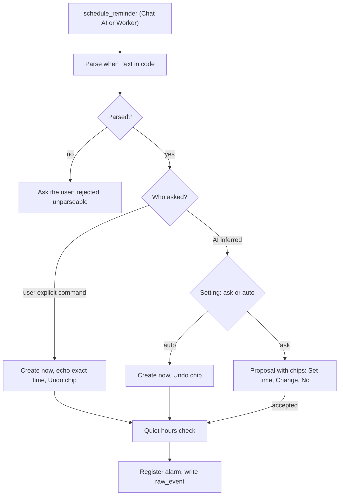
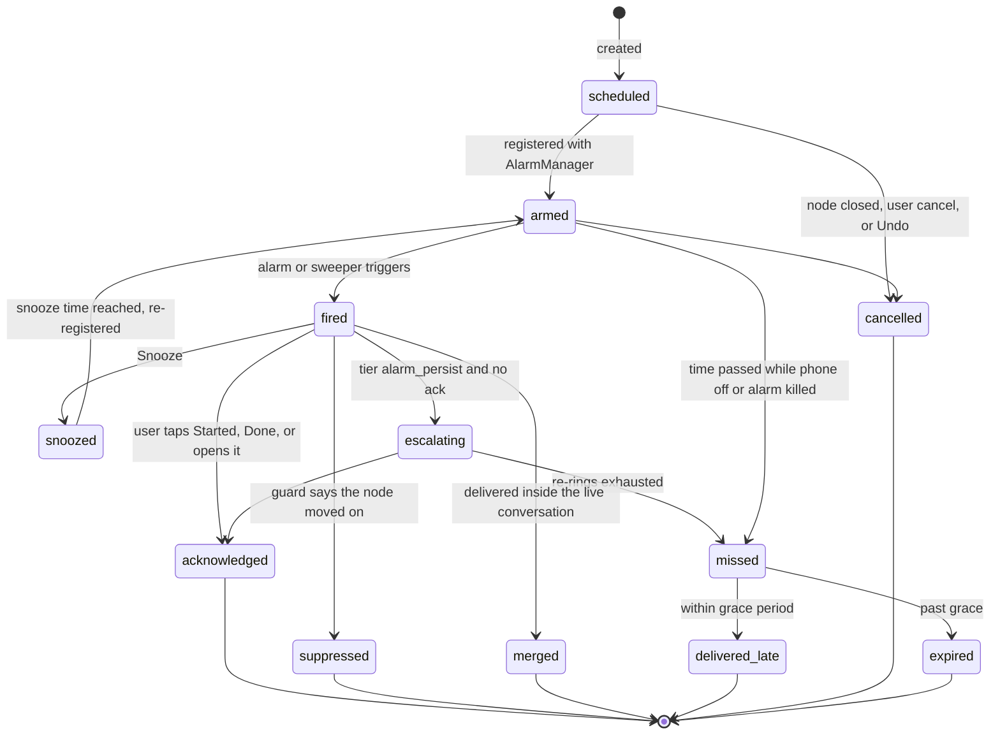
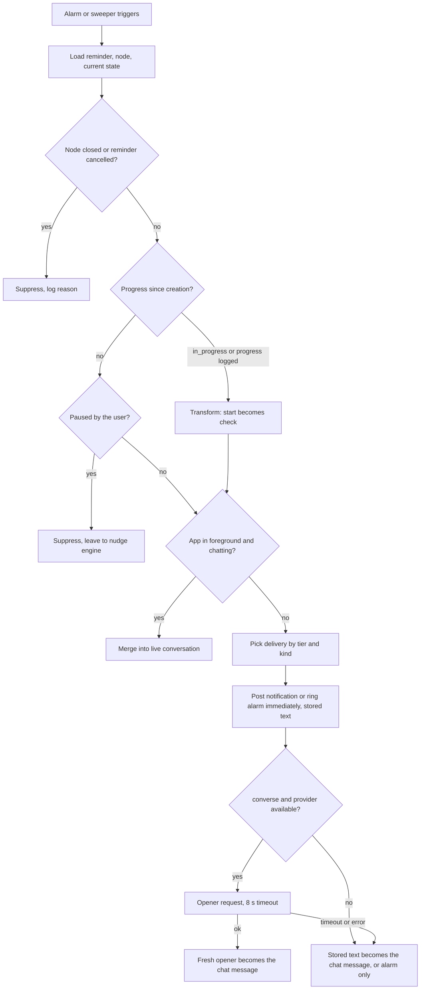

# Reminder Engine

Status: v1     Version: 0.1     Depends on: 13-nodes-edges-statuses, 22-resolver, 23-tool-contracts, 31-nudge-engine, 41-offline-fallback, 42-android-reliability

## 1. Purpose

A reminder in Mine is not a timer. It is a **scheduled intention with conditions**, owned by code (D-006).
It rings like an alarm, then continues as a conversation when that makes sense, and it checks reality before it
fires: if the user already started the task, finished it, or is talking to MineAI right now, the reminder adapts
instead of blasting a stale message. The LLM never keeps time. It only writes words.

## 2. Behavior (what the user sees)

- "Remind me at 6" creates a reminder immediately, with an echo: *"Reminder set: Wed 21 Oct, 18:00."*
- "I'll start the homework this evening" lets MineAI **suggest** a reminder (chips: `Set 17:30` / `Change` / `No`),
  or create it automatically if the user chose auto mode (with an Undo chip).
- At fire time:
  - **Online, app closed:** the alarm rings with actions `Started` / `Done` / `Snooze`, and a chat message from
    MineAI appears in today's session, in the persona's voice, aware of the task's current state.
  - **App open and the user is mid-chat:** no ring, no extra bubble. MineAI weaves it into the next reply
    ("it's evening now, want to start the homework?").
  - **User already started:** the "start" reminder becomes a gentle progress check.
  - **Task already done or cancelled:** silence.
  - **Offline:** the alarm rings with its pre-written text. No conversation. Taps on `Started` / `Done` / `Snooze` still work.
- If the phone was off or the alarm was killed, a missed reminder is delivered late and labelled, never silently dropped.

## 3. Design

### 3.1 Reminder vs nudge

|                                                                                                                                                                                                      | Reminder                                                                         | Nudge                                                            |
| ---------------------------------------------------------------------------------------------------------------------------------------------------------------------------------------------------- | -------------------------------------------------------------------------------- | ---------------------------------------------------------------- |
| Who asked for it                                                                                                                                                                                     | The user (explicit), or the user accepted it                                     | MineAI decided                                                   |
| Stored as                                                                                                                                                                                            | A row with `fire_at`                                                           | No row. A candidate computed at runtime (`31-nudge-engine.md`) |
| Subject to open thread, backoff, gap                                                                                                                                                                 | **No** (requested class)                                                   | Yes                                                              |
| Rings an alarm                                                                                                                                                                                       | Yes (by tier)                                                                    | Never                                                            |
| Respects day window (quiet hours)                                                                                                                                                                    | Explicit ones **ring anyway**. AI-suggested ones are moved into the window | Never outside the window                                         |
| Counts toward the hidden fuse                                                                                                                                                                        | No                                                                               | Yes                                                              |

Both share one delivery pipeline (section 3.8). **Reminder precedence:** if an armed reminder exists for the same node within 30 minutes of a nudge candidate, the nudge candidate is dropped.

### 3.2 Anatomy of a reminder

| Field          | Meaning                                                                                                                                                        |
| -------------- | -------------------------------------------------------------------------------------------------------------------------------------------------------------- |
| `kind`       | `start` (begin the task), `check` (progress), `deadline` (at or near due), `followup` (after an event), `custom` (free text, no node)                |
| `node_id`    | The item it belongs to (nullable for `custom`)                                                                                                               |
| `fire_at`    | Absolute UTC time                                                                                                                                              |
| `anchor`     | `absolute`, `wall_clock` (keeps the local clock time if the timezone changes), or `relative_due` (offset from `due_at`, moves when the due date moves) |
| `tier`       | `notify` (heads-up notification), `alarm` (rings once), `alarm_persist` (rings, re-rings until acknowledged, limited)                                    |
| `converse`   | Whether a chat message follows (online only)                                                                                                                   |
| `guards`     | Conditions re-checked at fire time (section 3.7)                                                                                                               |
| `text`       | Opener text written at creation time (for offline use) and `text_tone`                                                                                       |
| `created_by` | `user` (explicit), `ai_accepted`, `ai_auto`                                                                                                              |
| `state`      | See 3.5                                                                                                                                                        |

Default tier follows the node's severity unless the user or an accepted suggestion explicitly overrides it.

Style shortcuts used by the tool contract: `alarm_then_chat` = tier by severity, converse on. `alarm_only` = tier `alarm`, converse off.
`chat_only` = tier `notify`, converse on.

### 3.3 Creation flow



- **Explicit commands** ("remind me", "ping me at 6") are always created directly (a user command needs an in-turn result).
- **AI-inferred** reminders follow the user's setting (`ask` is the default).
- The reminder text is written by the model at creation time (`text` parameter) and stored, so it exists offline.
  If the model omits it, a persona template is used.
- If a similar reminder already exists for the node (same kind, within 30 minutes), the gateway returns `duplicate` and asks to update it instead.
- Quiet hours (outside the day window): an explicit reminder is kept as requested, since the user chose that time on purpose.
  An AI-suggested or auto-created one is moved to `day_start + 30 min`, and the echo says so.

### 3.4 Time resolution (code decides)

Absolute and relative phrases ("at 6", "in 2 hours", "tomorrow 9am") go through the shared date parser (`22-resolver.md` 3.7).
**Vague day-parts** use a window plus severity:

| Phrase    | Window (default)                              |
| --------- | --------------------------------------------- |
| morning   | 07:00 to 11:00                                |
| afternoon | 12:00 to 16:00                                |
| evening   | 17:00 to 20:00                                |
| night     | 20:00 to 23:00, clamped to end at `day_end` |
| soon      | now + 30 min                                  |
| later     | now + 2 hours (inside the day window)         |

**Position inside the window depends on severity** (your "earlier evening for a more important task"):
severity 3 means 10 percent into the window, severity 2 means 35 percent, severity 1 means 60 percent, severity 0 means 75 percent.
After at least 8 observed samples for "start after promising this part of the day" (`25-learning.md`), the engine
switches to `learned_median_start - lead`, where lead is 90 / 45 / 15 / 0 minutes for severity 3 / 2 / 1 / 0, clamped to the window.
Anything the parser cannot resolve is asked about, never guessed. Every created reminder echoes the **exact** time.

### 3.5 Lifecycle



Every transition writes a `reminder_fire` row (state, reason, latency) and, for user-visible changes, a `raw_event`.

### 3.6 Arming and reliability

Android can silently drop alarms (reboot, OEM battery managers, time changes), so the design has layers.

1. **Primary:** each reminder is registered with AlarmManager. `tier alarm` and `alarm_persist` use `setAlarmClock()` (the type OEMs are least willing to kill; it needs no special permission but shows in the system "next alarm" UI).
   `tier notify` uses `setExactAndAllowWhileIdle()` where the exact-alarm permission is granted, and falls back to `setAlarmClock()` or a short inexact window if not. *(Verify permission behavior per Android version during implementation.)*
2. **Windowed registration.** Only the next 20 reminders (or those within 14 days) are registered individually, because Android limits the number of alarms per app (about 500). Each fire or sweep refills the window.
3. **Re-arm triggers:** boot completed, app update (package replaced), time set, timezone changed, exact-alarm permission change, app start, and the sweeper.
4. **Sweeper:** a periodic WorkManager job (about every 15 to 30 minutes, best effort) that finds `armed` reminders with `fire_at` in the past and handles them as **missed**, plus refills the alarm window. It is the safety net, not the primary mechanism.
5. **Missed handling:** within the grace period (default 60 minutes, and never past the node's `due_at` plus the grace) the reminder is delivered late with a label
   ("Missed 18:00 reminder: Write the report"). Beyond grace, it becomes a line in the **since-last-seen** part of the next chat context, and the state is `expired`.
6. **Self-test and drift telemetry.** The settings screen has "Test reminders now" (schedules an alarm one minute ahead and reports whether it fired and how late).
   Real fires record `fired_at - fire_at`. If the p95 delay exceeds 2 minutes, or any miss was detected, the app shows a reliability warning with the OEM guide from `42-android-reliability.md`.
7. **Direct-boot safety net (candidate for v1.1; see `90` section 3.3).** After a reboot, credential-encrypted storage is unavailable until the first unlock, so the database (and alarms) cannot be restored before then.
   A tiny device-protected table (`fire_at` plus a generic label, no private text) could re-register alarms before unlock. This leaks nothing sensitive, but costs complexity, so it is marked for v1.1.

### 3.7 Fire pipeline (guards and transformation)



What the guards decide:

| State at fire time                                                        | Result                                                                                                                                                                          |
| ------------------------------------------------------------------------- | ------------------------------------------------------------------------------------------------------------------------------------------------------------------------------- |
| Node `done`, `cancelled`, `expired`, `superseded`                 | Suppress (reminder `suppressed`, reason logged)                                                                                                                               |
| Node `in_progress`, or progress logged after the reminder was created   | `start` becomes `check`: no ring, gentle notification or inline, text "You started at 17:40, how is it going?" For severity 3, schedule a second `check` 45 minutes later |
| Node `paused` by the user                                               | Suppress. The nudge engine handles paused items in its own way                                                                                                                  |
| `due_at` has moved                                                      | `relative_due` reminders were already shifted. Absolute ones fire, and the text uses the *current* due date                                                                 |
| App in foreground and the user's last message was less than 2 minutes ago | **Merge** (3.8)                                                                                                                                                           |
| The user snoozed this reminder three times                                | Fire, and create a low-priority `snooze_pattern` nudge candidate (`31-nudge-engine.md`)                                                                                     |
| Several reminders due within the same minute                              | **Coalesce** into one alarm: "3 reminders" with a list                                                                                                                    |

Everything above is code. The text always uses the node's **live** title and dates, so an edit after creation cannot produce a stale message.

### 3.8 Delivery

| Delivery                | When                                                       | Behavior                                                                                                                                                                                                                                                                   |
| ----------------------- | ---------------------------------------------------------- | -------------------------------------------------------------------------------------------------------------------------------------------------------------------------------------------------------------------------------------------------------------------------- |
| **Alarm**         | tier `alarm` or `alarm_persist`, app not in foreground | Full-screen alarm notification where the system allows it (otherwise a heads-up notification), alarm sound on the alarm stream, vibration. Rings for up to 60 s, then stays as a silent persistent notification. Actions: `Started`, `Done`, `Snooze`, `Open chat` |
| **Notification**  | tier `notify`, or progress checks                        | Heads-up notification on the messages channel, with quick reply and the same action chips                                                                                                                                                                                  |
| **Merged inline** | app open and the user is actively chatting                 | No ring, no standalone bubble. The reminder is passed to the next Chat turn as a "due now" item, so MineAI mentions it naturally. If no turn happens within 90 seconds, a small inline message is posted without sound                                                     |
| **Inline idle**   | app open but the user is idle (more than 2 minutes)        | Inline message with a subtle in-app alert. A ring only if "Ring even when the app is open" is on                                                                                                                                                                           |
| **Late**          | missed but within grace                                    | Notification labelled with the original time                                                                                                                                                                                                                               |

Action behavior (all handled by code, no model call, so they work offline):

- `Started`: node to `in_progress` through the gateway, reminder `acknowledged`, a `system_event` message is written to the day session ("Alarm 18:00: you tapped Started"). The Chat AI sees it on the next turn.
- `Done`: complete through the gateway (the target is known, so no resolver needed), with an Undo chip in the chat.
- `Open chat`: opens the timeline at the reminder's message and flashes it (`50` section 3.12).
- `Snooze`: re-arm at the snooze time (default 10 minutes, long-press for 30 minutes, 1 hour, tonight, tomorrow). The default adapts to the user's habits (`25-learning.md`).
- Notification **quick reply** goes into the day session as a normal user message and is processed like any other.
- The notification text respects the lock-screen privacy setting (generic "Reminder" text when content is hidden).

### 3.9 Escalation and snooze limits

| Tier                                                                                                                                  | Behavior                                                                                                                                                                                                |
| ------------------------------------------------------------------------------------------------------------------------------------- | ------------------------------------------------------------------------------------------------------------------------------------------------------------------------------------------------------- |
| `notify`                                                                                                                            | One notification. If ignored, nothing more from the reminder engine (the nudge engine may follow up as a nudge)                                                                                         |
| `alarm`                                                                                                                             | Rings once, then persistent notification                                                                                                                                                                |
| `alarm_persist`                                                                                                                     | Re-rings every 5 minutes until acknowledged, at most 3 re-rings. Then it stays as a persistent notification. For severity 3, a `missed_reminder` critical nudge candidate is created 30 minutes later |

Default tier follows the node's severity: 0 to 1 `notify`, 2 `alarm`, 3 `alarm_persist`. The user can override it per reminder.

### 3.10 Online opener versus offline text

- The alarm and notification are posted **immediately** with the stored text. Nothing waits for a model.
- When the reminder has `converse` and a provider is available, an opener is requested with an **8-second timeout** (priority just under live chat, counted against RPM).
  It receives a small brief: kind, live node data, recent progress, the persona, and "one or two sentences, at most one question".
  The opener becomes the chat message (and replaces the notification text if the notification is still showing).
- If the request is rate-limited, in provider cooldown, or times out, the **stored text** becomes the chat message. Offline, there is no chat message, only the alarm.
- Every assistant message created this way is tagged `reminder:<id>` in `raw_message.tags`.

### 3.11 After an offline alarm: one follow-up

When connectivity returns and a `converse` reminder fired while offline and was acknowledged (or ignored) without a conversation,
MineAI sends **one** follow-up in the chat (not a notification), for example *"You had the 18:00 alarm for the report. Did you get started?"*.
It is a requested-class message (no backoff effect), it happens at most once per reminder, and it is skipped if the node has since progressed or closed.

### 3.12 When the node changes

The gateway tells the reminder engine about every node change:

- Node closed (`done`, `cancelled`, `expired`, `superseded`): armed reminders are cancelled with reason `node_closed`.
- `due_at` changed: `relative_due` reminders move automatically. Absolute reminders stay, and MineAI mentions it in the reply ("The 18:00 reminder is still on, want it moved?").
- Node moved to `in_progress`: pending `start` reminders are marked "will transform" (the fire pipeline handles it, so no database change is needed).
- Node reopened: previously cancelled reminders are **not** revived. MineAI offers to set a new one.
- Undo of a cancel restores the node's reminders that were cancelled by that same op (`undo_of` link).

### 3.13 Worked scenarios

1. **Homework, started early.** The user says at 11:00, "I'll start it this evening". Severity 2 means a suggestion for 17:35 (window rule). The user accepts. At 17:20 they say "starting now". Worker logs progress, node `in_progress`.
   At 17:35 the guard transforms the reminder: a quiet check-in at 18:20 ("How's the homework going?") if severity at least 2, or nothing otherwise.
2. **Two minutes before.** The reminder is due at 17:35 and the user has been chatting since 17:31. It is merged. MineAI says, within its normal reply, that it's evening now and asks if they want to start. No alarm sound.
3. **Offline evening.** The phone is on airplane mode at 17:35. The alarm rings with the stored text. The user taps `Started`. It is applied locally. At reconnect, the system event is synced into context, and no follow-up is needed because the node already moved on.
4. **Phone was off.** Fire time 17:35, the phone powers on at 17:50. Boot receiver re-arms, the sweeper finds it missed, it is delivered late: "Missed 17:35: Start the homework".
5. **User snoozes three times.** The third fire still rings, then the nudge engine later offers to reschedule or split the task.

## 4. Data

```sql
CREATE TABLE reminder (                  -- derived layer (origin tells who made it)
  id             TEXT PRIMARY KEY,
  device_id      TEXT NOT NULL,
  node_id        TEXT,
  kind           TEXT NOT NULL,           -- start | check | deadline | followup | custom
  fire_at        INTEGER NOT NULL,        -- UTC ms
  anchor         TEXT NOT NULL DEFAULT 'absolute',   -- absolute | wall_clock | relative_due
  anchor_offset_min INTEGER,              -- for relative_due
  tz_id          TEXT,                    -- for wall_clock
  tier           TEXT NOT NULL,           -- notify | alarm | alarm_persist
  converse       INTEGER NOT NULL DEFAULT 1,
  guards         TEXT,                    -- JSON
  text           TEXT,                    -- stored opener
  text_tone      TEXT,
  state          TEXT NOT NULL,           -- scheduled | armed | fired | snoozed | acknowledged | suppressed | merged | missed | expired | cancelled
  snooze_count   INTEGER NOT NULL DEFAULT 0,
  rering_count   INTEGER NOT NULL DEFAULT 0,
  snooze_until   INTEGER,
  created_by     TEXT NOT NULL,           -- user | ai_accepted | ai_auto
  origin         TEXT NOT NULL,
  source_msg_ids TEXT,
  attrs          TEXT,                    -- reserved: recurrence rule (not used in v1)
  hlc            TEXT NOT NULL,
  created_at     INTEGER NOT NULL,
  updated_at     INTEGER NOT NULL,
  deleted_at     INTEGER
);
CREATE INDEX idx_reminder_fire ON reminder(state, fire_at);
CREATE INDEX idx_reminder_node ON reminder(node_id);

CREATE TABLE reminder_fire (              -- operational, kept 90 days; permanent facts are in raw_event
  id           TEXT PRIMARY KEY,
  reminder_id  TEXT NOT NULL,
  fired_at     INTEGER NOT NULL,
  scheduled_for INTEGER NOT NULL,
  latency_ms   INTEGER NOT NULL,
  outcome      TEXT NOT NULL,             -- delivered | suppressed | transformed | merged | late | missed
  delivery     TEXT,                      -- alarm | notification | inline | merged
  reason_json  TEXT,
  opener_source TEXT                      -- llm | stored | none
);

CREATE TABLE alarm_registry (             -- operational
  reminder_id  TEXT PRIMARY KEY,
  request_code INTEGER NOT NULL,
  api          TEXT NOT NULL,             -- alarm_clock | exact_idle | inexact
  registered_for INTEGER NOT NULL,
  registered_at INTEGER NOT NULL
);
```

## 5. Settings

| Setting                                  | Default                        |
| ---------------------------------------- | ------------------------------ |
| AI-suggested reminders                   | Ask (switchable to Auto)       |
| Default snooze                           | 10 min (adapts)                |
| Ring even when the app is open           | Off                            |
| Day-part windows                         | Table in 3.4                   |
| Re-ring interval and max (alarm_persist) | 5 min, 3 times                 |
| Missed grace period                      | 60 min                         |
| Alarm sound and vibration                | System alarm sound, vibrate on |
| Hide notification content on lock screen | Off                            |
| Test reminders now                       | Button                         |

## 6. Edge cases and failure modes

- **Timezone change while a wall-clock reminder is armed.** Recomputed from `tz_id` and the new zone, with a one-time message.
- **Clock set backwards or forwards.** Time-set receiver re-arms everything from the database.
- **Alarm fires but the process was killed.** The receiver is self-contained: it reads the reminder, posts the notification, and needs no UI process. The database opens with the Keystore-wrapped key even when the phone is locked after the first unlock.
- **Database unavailable at fire time** (rare corruption). A generic notification "Reminder" fires with whatever label was kept in the alarm's extras. The extras hold the reminder id only, never private text.
- **Do Not Disturb.** Alarm-category sounds usually pass through. If the user's DND blocks alarms, the test screen reports it.
- **Exact alarm permission revoked.** The app falls back to `setAlarmClock` for everything and shows a banner.
- **Reminder created for a past time.** Rejected with a question ("That time has passed. Today at 18:00 or tomorrow?").
- **Two devices (future).** Reminders are device-scoped by `device_id`, and only the owning device arms them.
- **Notification permission denied (Android 13 and later).** The test screen blocks "all good" and explains.
- **Opener contradicts reality** (the model hallucinates progress). The brief contains only facts from the database, and the system persona rule 4 forbids invented dates.

## 7. Offline behavior

Fully functional as alarm only (section 3.10). Reminder creation by the user via chat needs the Chat AI, but a **manual "Set reminder" action** on any item in the memory viewer works offline.
Snooze, Started and Done work offline. One follow-up is sent after reconnection (3.11).

## 8. Tests (see also `93-test-scenarios.md`)

1. Create, fire, acknowledge: the state sequence and logs are correct.
2. Reboot the phone with 5 armed reminders: all are re-armed and fire within 1 minute of schedule.
3. Force-stop the app with an OEM-like kill: the sweeper catches missed reminders at its next run.
4. Started before the alarm: the start reminder becomes a progress check, and no ring occurs.
5. Done before the alarm: suppressed, and nothing is delivered.
6. Mid-chat fire: no ring, the next reply mentions it, and a 90 s fallback bubble appears if there is no next turn.
7. Airplane mode: stored text rings, the actions work, and the follow-up arrives after reconnect (once).
8. Opener provider delay of 12 s: stored text is used and the alarm is not delayed.
9. 5 reminders in the same minute: one coalesced alarm.
10. Due date moved: the `relative_due` reminder moves, the absolute one stays and MineAI mentions it.
11. Undo of a cancel restores that cancel's reminders.
12. Vague "this evening" for severity 3 versus severity 0 gives different times inside the window.
13. A 30-reminder stress case stays under the platform alarm limit through windowed registration.

## 9. Open questions

- Direct-boot safety net in v1 or v1.1? Proposed: v1.1 (see `90` section 3.3).
- Recurring reminders: the `attrs` field is reserved, and the feature is parked with habits (`91-parking-lot.md`).

## 10. Changelog

- 0.1 (2026-10-21): first draft.
