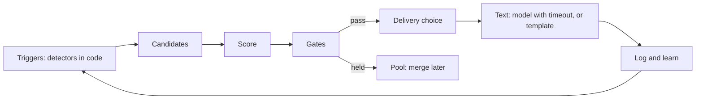
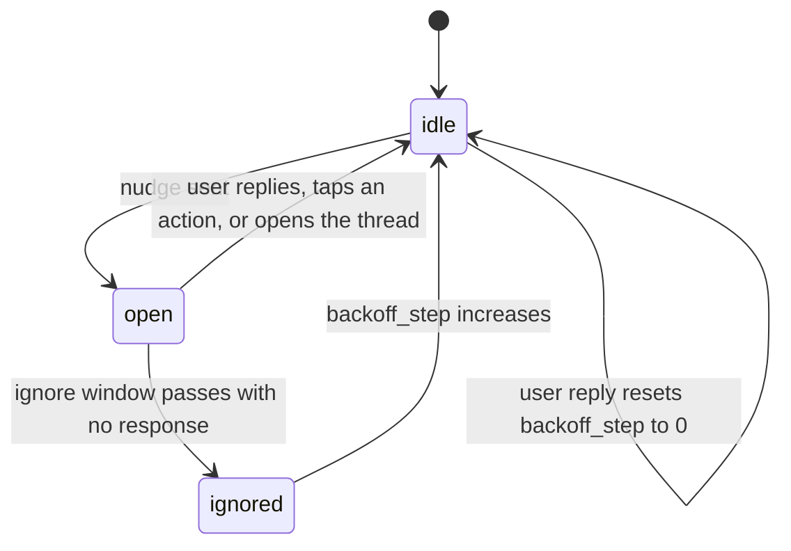

# Nudge Engine

Status: v1     Version: 0.1     Depends on: 13-nodes-edges-statuses, 25-learning, 30-reminder-engine, 32-briefings-checkins, 24-personas

## 1. Purpose

A companion that only speaks when spoken to feels dead, and one that speaks constantly gets uninstalled. The
nudge engine decides **whether, when and how** MineAI starts a conversation. It is plain code (D-006):
candidates, scores, gates, delivery, then a model writes the words with a template as fallback.
There is **no user-facing daily cap** (D-017). Restraint comes from structure: one open thread, ignore-backoff, a minimum gap, the day window, and a hidden safety fuse.

## 2. Behavior (what the user sees)

- At 09:00, with no message since the 06:00 day start, MineAI opens the day: carry-overs from yesterday, or a light question.
- Before a deadline with no progress, it checks in, earlier for more important things.
- If the user ignores a message, the next one waits longer. Replying resets everything.
- While the user is chatting, MineAI brings up pending things **naturally in the conversation** instead of sending separate notifications.
- Every nudge can be explained (**Why?**) and rated (thumbs up or down).
- A **Pause nudges** control (1 hour, 3 hours, until tomorrow) silences MineAI's own initiative. Reminders the user asked for still ring.
- Occasionally it asks a small, silly or getting-to-know-you question. Rarely, and only at a good moment.

## 3. Design

### 3.1 Pipeline



The engine evaluates on three occasions: **(a) scheduled ticks** (a WorkManager job at a few anchors per day plus exact alarms for time-based triggers),
**(b) events** (a node changed, a reminder fired or was ignored, a conflict was created), and **(c) app open** (the user is present, so inline delivery is cheap).
It never polls continuously, so it costs almost no battery.

### 3.2 Triggers (all become candidates)

| Trigger                 | Fires when                                                                                                                | Base value     | Notes                                                                                            |
| ----------------------- | ------------------------------------------------------------------------------------------------------------------------- | -------------- | ------------------------------------------------------------------------------------------------ |
| `first_contact`       | No user message yet today and the wait since day start has passed (default 3 h, adapts to the user's first-activity time) | medium         | Delivered as the morning check-in (`32-briefings-checkins.md`)                                 |
| `deadline_pressure`   | An open node approaches `due_at` with no progress, using the ladder below                                               | high           | Never repeats a rung once sent, unless the situation changed                                     |
| `commitment_followup` | A promised start part-of-day arrives ("this evening") and no reminder exists for it                                       | high           | Reminder precedence applies                                                                      |
| `post_task`           | An `in_progress` node passes its expected time, or a started task goes quiet                                            | medium         | Estimated from learned durations when known                                                      |
| `daily_review_item`   | The most important open or stale items (ranked in 3.6), at a good moment or the next day                                  | medium         | Handled in the evening check-in when possible                                                    |
| `stall`               | A node has been untouched for N days (priority at least 2: 5 days, otherwise 10 days)                                     | low            | At most one stall question per day. Goals are asked weekly                                       |
| `conflict`            | Two commitments overlap, or a new item conflicts with an existing one                                                     | high near time | Delivered inline immediately if the user is present                                              |
| `snooze_pattern`      | A reminder was snoozed 3 times                                                                                            | low            | "Want to move it, or split it into smaller steps?"                                               |
| `missed_reminder`     | An `alarm_persist` reminder ended without acknowledgment (severity 3)                                                   | critical       | 30 minutes after the last re-ring                                                                |
| `soul_gap`            | An important Soul category is empty or stale                                                                              | low            | One question, at most once a day                                                                 |
| `playful`             | A random, light question ("Pineapple on pizza: crime or genius?")                                                         | very low       | Shares the **getting-to-know-you slot** with `soul_gap` (at most one such message a day) |
| `checkin_evening`     | The configured late-evening time                                                                                          | scheduled      | Exempt from min gap and backoff (3.5)                                                            |
| `weekly_review`       | The configured week-end slot                                                                                              | scheduled      | Same exemption                                                                                   |
| `context_left_home` (v2)  | Place home to away is confirmed (`43` 3.5)                                                                            | medium         | Only when relevant open items exist                                                               |
| `context_arrived` (v2)    | The user arrives at a saved place (`43` 3.5)                                                                           | medium         | Only when relevant open items exist                                                               |
| `context_home_again` (v2) | The user returns home after at least 2 h away (`43` 3.5)                                                               | low            | Only when relevant open items exist                                                               |
| `call_nudge` (v2)   | A phone call ends and a relevant follow-up is available (`44` 3.3)                                                       | medium         | Post-call question or voice note                                                                  |

**Deadline ladder** (rungs relative to `due_at`, per severity). Severity 3: 3 days, 1 day, 3 hours. Severity 2: 1 day, 3 hours.
Severity 1: 3 hours (or covered by the day's morning and evening check-ins). Severity 0: none by default.
A rung is **skipped** if progress has been logged since the previous rung, or the node is `in_progress` and recently touched.

### 3.3 Scoring

For each candidate:

```text
raw      = base_value + urgency + severity_weight + staleness
fit      = clamp(learned_reply_rate(trigger, hour) / average_reply_rate, 0.5, 1.5)
fatigue  = 1 / (1 + 0.15 * ai_initiated_messages_today)        # floor 0.4
score    = raw * fit * fatigue
```

- `urgency` rises as `due_at` approaches (0 to 40 points), `severity_weight` is 0, 8, 16, 30 for severity 0 to 3, `staleness` grows with days untouched (0 to 15).
- Base values (starting points, tuned in the test set): critical 100, high 60, medium 35, low 20, very low 10.
- A candidate is eligible when `score >= threshold(t)`, where the threshold **falls with silence**:

```text
threshold(t) = T0 * max(0.3, 1 - hours_since_last_contact / 4)        # T0 = 30
```

This produces the behavior in your example without special cases. Right after the day starts the bar is high, so only urgent things pass.
After about 3 hours of silence the bar is low enough that a medium-value `first_contact` passes. After a recent conversation the bar is high again, so MineAI does not chatter.
Because it uses fatigue and the silence term together, "how many nudges per day" is an *outcome*, not a rule.

### 3.4 Priority classes

| Class               | Meaning                                                                                                  | Gate behavior                                                                        |
| ------------------- | -------------------------------------------------------------------------------------------------------- | ------------------------------------------------------------------------------------ |
| **Critical**  | Severity 3 and due in under 3 hours with no progress, a missed severity 3 reminder, an imminent conflict | Bypasses the open thread and backoff. Still obeys the day window and the hidden fuse |
| **Normal**    | Everything else                                                                                          | All gates apply                                                                      |
| **Scheduled** | Morning and evening check-ins and the weekly review                                                      | Bypass min gap and backoff, but not the day window or Pause                          |

### 3.5 Gates (in this order)

1. **Paused.** "Pause nudges" is active. Everything held except critical items inside the day window. *(Critical items still break through a pause, since the user can pause but not forget a severity 3 deadline. This is stated in the pause UI.)*
2. **Vehicle hold.** Context-triggered conversations are held while the user is in a vehicle; they may be reconsidered after the vehicle state ends.
3. **Day window.** Outside the user's day (start to end), nothing is initiated. Eligible candidates wait for the start of the next window, and critical ones are delivered at `day_start`.
4. **Present user.** If the app is in the foreground, the delivery becomes **inline** (3.8) and the remaining gates are relaxed to the min gap only.
5. **Open thread.** If an earlier nudge is unanswered, normal candidates go to the **pool** (they are merged into the next message when the thread closes). Critical ones pass.
6. **Minimum gap.** Time since the last AI-initiated message must be at least `min_gap x multiplier^backoff_step` (defaults below). Critical items ignore the backoff part but respect the hidden fuse.
7. **Hidden safety fuse** (3.9).
8. **Quality gate.** The candidate's score must still beat the threshold, and a candidate must not repeat what was already said (dedupe by `(trigger, node, rung)`).

### 3.6 Open thread, ignoring, and backoff



- **Open thread:** the time between sending a nudge and the user's first response (any chat message, an action chip tap, or a notification reply).
  Opening the notification and reading it counts as engagement only if the user also acts.
- **Ignore window:** 3 hours by default. After it, the thread is `ignored`, `backoff_step` increases by 1, and `signal_log` records it.
- **Gap formula:** `gap = min(min_gap * multiplier^backoff_step, ceiling)`. Defaults: min gap 60 minutes, multiplier 2.0, ceiling 6 hours.
  So the gaps go 60, 120, 240, 360, 360 minutes. Any reply resets the step to 0.
- **Pool:** candidates held by an open thread or gap are scored again when the thread closes. They are merged ("three things are waiting: ...") instead of sent as separate messages. Stale ones (the situation changed) are dropped.
- **Long silence mode:** if the user did not respond to any nudge for 3 consecutive days, the engine sends at most the first-contact message once a day and adds a line offering to pause nudges. It resumes normally on the first reply.
- **Day rollover:** `backoff_step` is halved (rounded down) at day start. A new day is a fresh chance, but not a full reset after a day of being ignored.
- **Reminder interplay:** a reminder delivery updates `last_sent_at` (so a nudge does not follow it immediately) but never increases the backoff.

### 3.7 Learning hooks

Reply or ignore for each `(trigger, time bucket)` feeds `25-learning.md`. `fit` uses the learned rates after 8 samples, with 10 percent exploration.
Thumbs down on a nudge lowers the base value of that trigger type for that persona. Learned values only tune inside the user's settings.

### 3.8 Delivery

| Situation                  | Channel                                                                                                                                                                                                                                                           |
| -------------------------- | ----------------------------------------------------------------------------------------------------------------------------------------------------------------------------------------------------------------------------------------------------------------- |
| App in the foreground      | **Inline.** Pooled items are offered through the Chat AI as `topics_to_raise` in context (at most 2), so MineAI mentions them when it fits. If the conversation is idle and an item is valuable, a normal inline message is posted without a notification |
| App closed or backgrounded | **Notification** on the messages channel (never an alarm sound), with quick reply and action chips                                                                                                                                                          |
| Critical                   | Notification at high priority, still without alarm sound. If a reminder exists, the reminder engine handles the ring                                                                                                                                              |
| Offline                    | Template text via notification. Nothing needing the model is attempted                                                                                                                                                                                            |

Inline delivery shows a top banner and a light haptic when the user is looking at another part of the timeline,
never a forced scroll (`50` section 3.9).

**Action chips** reduce friction and give clean signals: depending on the trigger, `Done`, `Started`, `Later`, `Not now`, `Reschedule`, `Drop it`.
Chips call the gateway directly (D-033). Tapping `Later` sets a hold (`nudge_hold`) for that node (default 1 day, or until the next day's check-in).
The nudge records its subject (`subject_refs`), and the **next Chat turn** gets those as aliases, so "I'll do it tomorrow" binds to the right item without ambiguity.

### 3.9 Text generation

- Written by the Chat AI (persona voice) from a **nudge brief** built by code: trigger, subject facts, recent progress, time, learned tone hints, and the instructions "one or two sentences, at most one question, no system talk".
- Time budget: 8 seconds. On timeout, rate limit, provider cooldown, or any error, a **template** is used immediately (templates exist per trigger, per persona tone, and per supported language).
- Proactive calls use the lowest interactive priority and count against RPM (D-019). During a 429 cooldown they go straight to templates.
- The message is stored in the raw log as an assistant message with `tags = nudge:<trigger>` and `subject_refs` in `attrs`.

### 3.10 The hidden safety fuse

Not shown in normal settings. It prevents a bug, a loop, or a chatty provider from spamming the user or burning their budget.

- At most 1 AI-initiated delivery every 5 minutes (critical items too).
- At most 8 per rolling hour and 40 per rolling day.
- A proactive-LLM ceiling: at most 60 proactive model calls per day. Beyond it, templates only.
- Requested reminders are exempt.
- If the fuse trips, the engine logs `fuse_tripped`, shows a small status note in a diagnostics screen (and one line in the next chat, "I paused my own nudges for a bit, something looked off"), and resumes when the window rolls.

### 3.11 First contact in detail

1. The day starts. No message from the user yet.
2. Wait is `day_start + offset`. The default offset is 3 hours, and once there are 8 or more days of data it becomes `learned_median_first_activity + 30 minutes`, clamped between 1 and 5 hours.
3. At that time, the engine builds the **morning check-in** (32) if there is any content (open loops, today's agenda, a getting-to-know-you slot). If the day is genuinely empty, it sends a short hello or nothing, according to the persona.
4. If the user opens the app earlier, the check-in is shown **inline on first open** instead, and counts as delivered.

### 3.12 Post-task and daily review items

- **Good moment:** the post-task question for a started task is sent after its expected duration plus a buffer, or in the next evening check-in if that is sooner.
  A "how did it go?" for something finished at 23:30 waits for tomorrow's morning.
- **Ranking** for the review list: `rank = severity*3 + priority*2 + overdue_days + stall_days/2 - recently_asked_penalty`, with `in_progress` items first, then `paused` ("resume or drop?"), then untouched `active` ones. At most 3 per check-in, and an item asked about is held for 2 days.
- Answers are handled by the normal Chat AI and resolver, with the item aliases attached to the nudge.

### 3.13 The getting-to-know-you slot

- Shared by `soul_gap` and `playful`, at most **one per day**, and never inside 2 hours of a critical or deadline message.
- Only when there is no open thread and the previous slot message was answered. Two unanswered slot messages in a row pause the slot for a week.
- `soul_gap` chooses the category with the fewest or oldest facts (the gap map). `playful` is drawn from a persona-flavored pool plus model-generated questions.
- Answers to `soul_gap` become normal Soul proposals. Playful answers can become low-confidence proposals, never auto-added.
- Learned engagement (replies to slot messages) controls the frequency, with a floor of once a week unless the user disables the slot.

## 4. Data

```sql
CREATE TABLE proactive_state (             -- operational, single row
  id                  INTEGER PRIMARY KEY CHECK (id = 1),
  open_thread_msg_id  TEXT,
  thread_opened_at    INTEGER,
  backoff_step        INTEGER NOT NULL DEFAULT 0,
  last_sent_at        INTEGER,
  last_contact_at     INTEGER,               -- last user or AI message
  paused_until        INTEGER,
  silent_days         INTEGER NOT NULL DEFAULT 0,
  sent_today          INTEGER NOT NULL DEFAULT 0,
  fuse_tripped_at     INTEGER,
  day_key             TEXT
);

CREATE TABLE nudge_log (                   -- operational, kept 90 days; outcomes also feed signal_log
  id            TEXT PRIMARY KEY,
  ts_utc        INTEGER NOT NULL,
  trigger_type  TEXT NOT NULL,
  subject_refs  TEXT,                       -- JSON: node ids
  score         REAL, threshold REAL,
  gates_json    TEXT,                       -- which gates passed or held
  decision      TEXT NOT NULL,              -- sent | held | pooled | dropped | merged | suppressed
  delivery      TEXT,                       -- inline | notification | topics_to_raise
  msg_id        TEXT,
  text_source   TEXT,                       -- llm | template
  outcome       TEXT,                       -- replied | actioned | ignored | expired | feedback_up | feedback_down
  latency_ms    INTEGER,
  reason_json   TEXT                        -- full explanation for the Why? screen
);

CREATE TABLE nudge_pool (
  id TEXT PRIMARY KEY, trigger_type TEXT NOT NULL, subject_refs TEXT,
  score REAL NOT NULL, created_at INTEGER NOT NULL, expires_at INTEGER NOT NULL
);

CREATE TABLE nudge_hold (
  node_id TEXT NOT NULL, trigger_type TEXT NOT NULL,
  until_ts INTEGER NOT NULL, PRIMARY KEY (node_id, trigger_type)
);
```

## 5. Settings

| Setting                                   | Default                          |
| ----------------------------------------- | -------------------------------- |
| Proactive messages                        | On                               |
| Minimum gap between AI-initiated messages | 60 min                           |
| Backoff multiplier when ignored           | 2.0                              |
| Maximum gap (ceiling)                     | 6 h                              |
| Ignore window                             | 3 h                              |
| Pause nudges                              | Off (1 h / 3 h / until tomorrow) |
| First contact wait after day start        | 3 h (adapts)                     |
| Getting-to-know-you questions             | On (at most once a day)          |
| Stall check-ins                           | On                               |
| Morning and evening check-ins             | See `32-briefings-checkins.md` |
| Show "Why?" on nudges                     | On                               |

The hidden fuse and the critical-class rules are not user settings.

## 6. Edge cases and failure modes

- **User replies hours later to an old nudge.** The thread had been marked ignored. The reply still resets backoff and is processed with the nudge's subject refs (the nudge is found by `reply_to` or by recency).
- **User is asleep but inside their configured window** (set window too wide). The engine cannot know. The learned daily rhythm suggests a narrower window after 2 weeks (`25-learning.md`).
- **Timezone change.** Day window and "hours since" use the new local time, and a one-time note is shown.
- **Many candidates at once** (after a day offline). Pool and merge into one message, ranked, with at most 3 items.
- **Provider unavailable.** Templates only, and no repeated retries for nudge text.
- **Nudge for something the user just resolved** (race). Candidates are re-validated against current state right before delivery.
- **Persona too pushy.** Persona changes only the words. Frequency does not depend on it.
- **Notifications disabled.** Detected, and a banner explains that proactive features are inactive.
- **App open and the user is typing a long message.** Inline delivery waits until typing stops or the message is sent.

## 7. Offline behavior

Detectors, scoring and gates are local and work offline. Delivery uses templates. Notifications work offline. When connectivity returns, the engine may replace pending template text with a fresh message only if the situation is still relevant, otherwise it drops it.

## 8. Tests (see also `93-test-scenarios.md`)

1. Silent day: no first-contact until about 3 hours after the day start, then exactly one.
2. Ignore twice: gaps follow 60, 120, 240 minutes and stop at the ceiling.
3. A reply after three ignored nudges resets the step to 0.
4. Critical item (severity 3, due in 2 hours, no progress) passes an open thread, but not the fuse and not the day window.
5. Pause on: normal candidates are held, a critical one still passes, and reminders still ring.
6. In-app: pooled items appear as natural mentions in Chat replies and not as notifications.
7. Reminder precedence: a reminder exists for the node, and the commitment follow-up is dropped.
8. A burst of 10 candidates after being offline produces one merged message of 3 items.
9. Fuse: a simulated loop is stopped at 1 per 5 minutes and logged.
10. Three silent days trigger long silence mode and an offer to pause.
11. The Why? text equals the logged `reason_json`.
12. Playful and soul-gap together never exceed 1 per day.

## 9. Open questions

- Should critical items be allowed to bypass Pause? Proposed: yes (clearly stated in the pause UI). Confirm.
- Should the first-contact fallback ever send nothing on an empty day? Proposed: persona decides, default is a short hello at most every 2 days.

## 10. Changelog

- 0.1 (2026-10-21): first draft.
