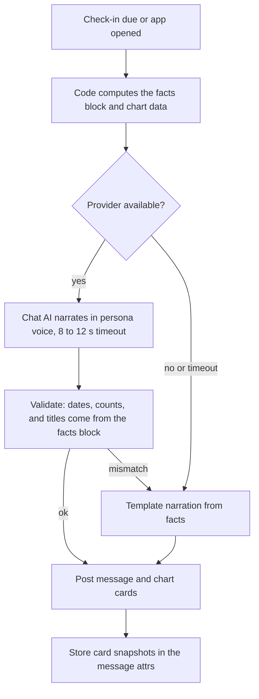

# Briefings and Check-ins

Status: v1     Version: 0.1     Depends on: 31-nudge-engine, 21-retrieval-embeddings, 13-nodes-edges-statuses, 25-learning

## 1. Purpose

Scheduled moments where MineAI looks at the whole day with the user: a **morning check-in** to set up the day, a **late-evening check-in** to close it,
and a **weekly review**. They are cheap once the engine exists and make the app feel alive. Their facts and charts come from code, and the model only narrates (D-045).

## 2. Behavior (what the user sees)

- **Morning:** at the configured time (default 3 hours after day start), or the first time the app is opened that day, a message with today's plan,
  overdue and carried-over items, upcoming reminders, one suggested focus, and (some days) a getting-to-know-you question. A small chart card shows the plan.
- **Late evening** (default 90 minutes before day end): what got done, what is still open, in progress or paused, a preview of tomorrow, and one to three questions about the most important unfinished items.
  It also invites a quick reflection ("How was the day, in a word or two?").
- **Weekly review** (default: the evening before the week start day): completed versus created, goals progress, stalled items, and one suggestion for next week, with charts.
- Each check-in can be turned off or moved, and the user can ask for one at any time ("brief me", "how did my day go?").

## 3. Design

### 3.1 Schedule

| Check-in     | Default                                                        | Notes                                                                                                   |
| ------------ | -------------------------------------------------------------- | ------------------------------------------------------------------------------------------------------- |
| Morning      | `day_start + 3 h`, adapts to the learned first-activity time | It is the delivery form of `first_contact` (31). Shown inline on first open if the user comes earlier |
| Late evening | `day_end - 90 min`                                           | Skipped when the user already said goodnight or is mid-conversation (then merged)                       |
| Weekly       | The evening before the user-set week start                     | Replaces the evening check-in that day (one message, longer)                                            |

- Times are editable in settings, and "pause" works per check-in.
- Scheduled check-ins are exempt from min gap and backoff, but obey the day window and Pause (31 section 3.4).
- If the user has not responded to the evening check-in for 3 days in a row, MineAI **suggests** a new time or turning it off. It never disables it by itself.
- Exact-time triggering uses the scheduler (an exact alarm for the check-in moment that posts a notification, like any other nudge, and no ring).

### 3.2 Generation pipeline



- The **facts block** is built by code: counts, items with exact dates, statuses, overdue days, progress. The model is told to use only these facts.
- **Validation:** a cheap check that every item title and date the reply mentions exists in the facts block. A mismatch triggers the template fallback and is logged.
- **Offline:** the template narration is deterministic and composed from the facts, with persona-flavored phrases from `24-personas.md`. It contains the same cards.

### 3.3 Morning content

1. A greeting that fits the persona and the time since the last contact.
2. **Today**: events and tasks due today, in time order, with their reminders (e.g. "Report due 18:00, reminder at 16:30").
3. **Carry-over**: unfinished items from yesterday and overdue ones, ranked (31 section 3.12), at most 3 shown with a count of the rest.
4. **Focus suggestion**: one item chosen by the ranking, with a one-line reason.
5. **Conflicts**: any overlap detected today.
6. **Getting-to-know-you slot** on some days (31 section 3.13), appended as a single light question.
7. **Chart card:** the day plan (3.6).
   Length target: five to ten lines, shorter on quiet days. On a day with nothing scheduled, the message is a hello and one open question.

### 3.4 Evening content

1. **Done today**: count, and the titles (up to 5), plus "ephemeral" things done (from `daily_stat`).
2. **Still open**, split into `in_progress`, `paused`, and untouched `active`, ranked.
3. **Questions:** the top one to three items by rank, each with action chips (`Done`, `Started`, `Tomorrow`, `Drop`). Items asked about are held for 2 days.
4. **Tomorrow preview**: first events, deadlines, and reminders.
5. **Reflection prompt**: "How did the day feel?". Answers are normal chat (they land in the daily summary and can become Soul proposals about patterns, with the normal flow).
6. **Chart card:** done versus planned today (3.6).
   After the evening check-in conversation ends, or at day rollover at the latest, the **day summary job** runs (`21-retrieval-embeddings.md` 3.7).

### 3.5 Weekly review content

1. **Numbers** (code): created, completed, cancelled, expired; completion rate; carried-over count.
2. **Goals:** progress from `part_of` rollups (done sub-tasks over total), with items that moved and items that did not.
3. **Stalled and repeatedly snoozed items**, with a suggestion for each (drop, split, schedule).
4. **Wins:** up to 3 specific completions, so the praise is concrete.
5. **Suggestion for next week:** one proposed focus (a goal or a stalled important item).
6. **Chart cards:** week bars and goal progress (3.6).
7. Optional learning note: "You usually finish things between 8 and 10 pm" (from `learned_pref`, user-visible).

### 3.6 Chart cards (native, rendered from the database)

Cards are drawn by app code in Compose from queries. The model never produces chart data.

| Card               | Shows                                                        | Source                                       | Status                |
| ------------------ | ------------------------------------------------------------ | -------------------------------------------- | --------------------- |
| `today_plan`     | A ring and list: done, in progress, left, for today's items  | `node` (due or planned today), statuses    | v1                    |
| `week_bars`      | Seven bars: completed per day, with created as a thin marker | `raw_event` status changes, `daily_stat` | v1                    |
| `goal_progress`  | Horizontal bars per active goal (done sub-tasks over total)  | `node` + `part_of` edges                 | v1                    |
| `activity_strip` | When in the day the user is active (heat strip)              | `raw_message` timestamps, signal log       | planned               |
| `streaks`        | Habit streaks                                                | `habit` nodes                              | planned (with habits) |
| `mood_line`      | Self-reported day feel over time                             | Reflection answers, opt-in                   | parked                |

Rules:

- Each card is rendered from a **data snapshot** saved in the assistant message's `attrs` JSON, so an old day shows what it showed then, even if items changed since. The snapshot contains ids, titles, and numbers only.
- Cards are tappable. A segment opens the matching items in the memory viewer.
- Cards respect the lock-screen privacy setting (no card in notifications, only in the app).
- Accessibility: every chart has a text equivalent (the narration lists the same numbers).

### 3.7 Behavior around the live conversation

- If the user is mid-conversation when a check-in is due, it is **merged**: MineAI says it naturally in its next reply and attaches the card, instead of posting a separate message. After 3 minutes of quiet it is posted inline.
- If the user says goodnight, it does not send the evening check-in, and the morning one picks up the open items.
- If the user asks "brief me" at any time, the same pipeline runs on demand, labelled "briefing". It does not count as the scheduled check-in unless it is within 30 minutes of one (then the scheduled one is cancelled for that slot).

### 3.8 Interactions with other systems

- Check-in questions use item aliases (as in 31), so answers bind to the right items without ambiguity.
- Answers update items through the normal gateway and resolver. Reflection text is stored in the raw log like any chat.
- The check-in's own delivery is logged in `nudge_log` with `trigger_type = checkin_morning | checkin_evening | weekly_review` and feeds learning (reply rate, preferred times).
- The reminder engine is unaffected: reminders listed in the morning briefing are only mentioned, not duplicated.
- The evening check-in may include the call recap line (`44`) and the ambient report card (`61` 3.8).
- Inline delivery shows a top banner and a light haptic when the user is looking at another part of the timeline,
  never a forced scroll (`50` section 3.9).

## 4. Data

No new core tables. Additions:

```sql
CREATE TABLE checkin_state (               -- operational
  kind           TEXT NOT NULL,            -- morning | evening | weekly
  day_key        TEXT NOT NULL,
  status         TEXT NOT NULL,            -- scheduled | delivered_inline | delivered_notification | merged | skipped | disabled
  msg_id         TEXT,
  scheduled_for  INTEGER,
  delivered_at   INTEGER,
  PRIMARY KEY (kind, day_key)
);
```

Message attachments are stored in `raw_message.attrs`, for example `{"cards":[{"type":"today_plan","data":{...}}],"facts_hash":"..."}`.
Facts blocks are not stored as copies of private text: they are recomputed from the database when needed, and only the card snapshot and a hash are saved.

## 5. Settings

| Setting                            | Default                           |
| ---------------------------------- | --------------------------------- |
| Morning check-in                   | On, `day_start + 3 h` (adapts)  |
| Morning briefing on first app open | On                                |
| Late-evening check-in              | On, `day_end - 90 min`          |
| Weekly review                      | On, evening before the week start |
| Charts in check-ins                | On                                |
| Items asked per evening check-in   | 3                                 |
| Reflection prompt in the evening   | On                                |

## 6. Edge cases and failure modes

- **Empty day or empty week.** Short and honest ("Nothing on the plate today, want to plan something?"). No filler stats.
- **A day with 40 open items.** Show the top 3, with a count and a link to the viewer.
- **User travels across timezones.** The check-ins follow the local clock and the day window, with a one-time note.
- **Day window shorter than 10 hours or crossing midnight.** Times are computed from `day_start` and `day_end` as offsets, so they work across midnight.
- **Narration disagrees with the facts.** Validation falls back to the template, and the mismatch is logged for prompt tuning.
- **User dismisses the notification and never opens the app.** It counts as ignored (31 backoff does not apply to scheduled items, but the learning signal is recorded).
- **Rate-limited provider at the exact check-in time.** The template version is posted at once. A narrated version is not posted afterwards, to avoid duplicates.
- **Week start changed mid-week.** The next weekly review follows the new setting, and the current week is not double-counted.

## 7. Offline behavior

Fully functional with template narration and native charts. When back online, nothing is re-sent.

## 8. Tests (see also `93-test-scenarios.md`)

1. A day with 5 tasks (3 done, 1 in progress, 1 left): the facts, the `today_plan` card and the narration agree.
2. App opened at 07:10 on a 06:00 day: the morning briefing appears inline once, and the 09:00 notification is not sent.
3. The narration mentions a task that does not exist: the validator falls back to the template.
4. Offline evening check-in: template text and cards, with working action chips.
5. The user says goodnight at 21:00: no 21:30 evening check-in, and the next morning mentions the open items.
6. Weekly review across a week with only 2 active days: the numbers are right and the tone is not preachy.
7. Three ignored evening check-ins: a suggestion to change the time appears once.
8. An old day's card shows the same data after the underlying items changed.

## 9. Open questions

- Should the weekly review include a month-to-date view at month end? Proposed: parked.
- Mood tracking from the reflection prompt as a chart: parked, opt-in only.

## 10. Changelog

- 0.1 (2026-10-21): first draft.
