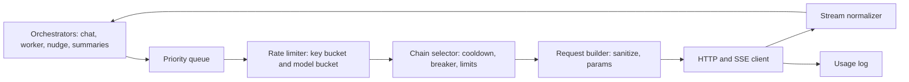

# Provider Layer

Status: v1     Version: 0.1     Depends on: 23-tool-contracts, 41-offline-fallback, 20-context-pack, 16-security-privacy

## 1. Purpose

The provider layer is the only code that talks to AI endpoints. It hides every difference between OpenAI-compatible
providers behind one clean interface, enforces rate limits, survives failures, and records usage. Nothing else in the
app knows about HTTP, SSE chunks, vendor quirks, or API keys. The user brings every endpoint (D-008): the app ships
with no preset providers.

## 2. Behavior (what the user sees)

- **Setup wizard:** paste a base URL and an API key, pick a model (from the provider's model list, or type its name),
  and press **Test**. The wizard runs a short capability probe and shows green ticks (chat, streaming, tools, reasoning).
- **Two slots:** *Chat* (talks to the user) and *Worker* (extraction, summaries). The Worker slot can be "same as Chat",
  a different model on the same key, a different key, or a fully different provider.
- **Optional fallbacks** per slot: a fallback model, then a fallback endpoint (which may have its own fallback model).
- **Limits per provider and per model:** requests per minute (RPM), concurrent requests, and the 429 cooldown time.
- **Status chip** in the chat when something is off: "Cooling down until 14:35", "Using fallback model", "Offline, message queued".
- **Usage screen:** requests, tokens, and (optional) estimated cost by day, slot, and priority class, plus live RPM headroom.
- **Reasoning switch** in the chat settings (on or off per slot). Reasoning text is shown collapsed above the reply when present.

## 3. Design

### 3.1 Concepts

| Term                     | Meaning                                                                                                                                   |
| ------------------------ | ----------------------------------------------------------------------------------------------------------------------------------------- |
| **Provider**       | Base URL, API key (encrypted), custom headers, limits (RPM, concurrency, cooldown), notes                                                 |
| **Model profile**  | A model name on a provider, with capability flags, context window, optional RPM override, extra request params, pricing (optional)        |
| **Target**         | One (provider, model profile) pair that can serve requests                                                                                |
| **Slot**           | Chat, Worker, or STT. Each has an ordered **chain** of up to 4 targets (primary, fallback model, fallback endpoint, its fallback model) |
| **Priority class** | P0 live chat and voice messages, P1 time-boxed proactive text, P2 worker extraction, P3 maintenance (summaries, rebuilds), P4 ambient batches and probes |

The STT slot uses cloud and on-device STT adapters; the on-device adapter is the fallback.



### 3.2 Setup wizard and capability probe

Steps (each request counts against the limiter, about 5 to 6 in total):

1. Normalize the base URL: strip a trailing `/chat/completions`, ensure a single trailing path (`/v1` is kept when present), trim spaces from the key.
2. `GET {base}/models` (optional). On success, offer a picker. On 404 or error, the user types the model name.
3. Minimal non-streaming chat ("Reply with OK").
4. Streaming chat. Detect keepalive comments, usage in the last chunk, and the shape of reasoning.
5. **Tool test:** a dummy `get_time` tool. Detect native tool calls and fragmented arguments.
6. **Round-trip test:** send the tool result back as a `tool` message, then continue. This catches providers that reject extra
   message fields (the HTTP 422 case seen on the GLM endpoint) and sets `strict_history`.
7. Optional JSON-mode test.
8. For the STT slot, run the speech-to-text probe defined in `60` section 3.2 and record the STT adapter capability.

Result: capability flags stored on the model profile.

| Flag                                                                                                                        | Values                                        | Effect                                                                                           |
| --------------------------------------------------------------------------------------------------------------------------- | --------------------------------------------- | ------------------------------------------------------------------------------------------------ |
| `stream`                                                                                                                  | yes/no                                        | Falls back to non-streaming                                                                      |
| `stream_usage`                                                                                                            | yes/no                                        | Whether to send `stream_options.include_usage`                                                 |
| `tool_mode`                                                                                                               | native / envelope / off                       | See `23-tool-contracts.md` section 7                                                           |
| `reasoning_format`                                                                                                        | parts / reasoning_content / think_tags / none | Which reasoning shape to parse                                                                   |
| `strict_history`                                                                                                          | yes/no                                        | Send only the allowed fields in message history                                                  |
| `system_role`                                                                                                             | system / developer / user_prefix              | How the system prompt is sent                                                                    |
| `max_tokens_param`                                                                                                        | max_tokens / max_completion_tokens            | Name of the token limit field                                                                    |
| `context_window`                                                                                                          | number                                        | Drives compact mode (`20-context-pack.md` 3.7). User-entered or from model metadata if offered |

Flags are editable in an "Advanced" screen, and a model that fails a probe step still saves with a warning.
| A non-technical user sees only the ticks and a plain sentence ("This model can't use tools, Mine will use a simpler mode"). |                                               |                                                                                                  |

### 3.3 Request building

- Body: `model`, `messages`, `stream: true`, `stream_options.include_usage` (if supported), `temperature` (default 0.7, Worker 0.2),
  token limit (field name per flag), `tools` plus `tool_choice: auto` (when native), plus the profile's `extra_params` JSON merged last.
- **Message sanitizer** (always on, strictest when `strict_history`): per role, only allowed keys.
  `system`/`user`: `role`, `content` (a plain string, parts flattened). `assistant`: `role`, `content`, `tool_calls` (id, type, function.name, function.arguments as a string).
  `tool`: `role`, `tool_call_id`, `content`. **Never** send reasoning text, `cot_*` fields, provider telemetry, or internal ids back.
- **Reasoning switch:** each model profile has `reasoning_on_params` and `reasoning_off_params` (JSON snippets, for example an effort level or a thinking flag).
  The slot setting picks which snippet is merged. Unknown providers simply have none, and the switch is hidden.
- **Raising the timeout with reasoning:** time-to-first-token timeout is longer when reasoning is on (section 3.7).
- **Custom headers** (name and value pairs) are allowed per provider for gateways that need them. Values are stored encrypted like keys.
- The `Authorization: Bearer` header is added at the last moment and is never logged.

### 3.4 Stream normalizer

Every provider's output is converted into one internal event stream:

```kotlin
sealed interface StreamEvent {
  data class TextDelta(val text: String)
  data class ReasoningDelta(val text: String)
  data class ToolCallStart(val index: Int, val id: String?, val name: String)
  data class ToolCallArgs(val index: Int, val fragment: String)
  data class Usage(val promptTokens: Int, val completionTokens: Int, val cachedTokens: Int?)
  data class Finish(val reason: String)          // stop | tool_calls | length | content_filter | other
  data class Note(val kind: String, val json: String)   // provider telemetry, logged only
}
```

Parsing rules (derived from the real GLM-5.3 sample plus common variants):

| #   | Rule                                                                                                                                                                                                                                                                                                                                                                                                 |
| --- | ---------------------------------------------------------------------------------------------------------------------------------------------------------------------------------------------------------------------------------------------------------------------------------------------------------------------------------------------------------------------------------------------------- |
| R1  | Read SSE lines starting with `data:`. Ignore blank lines and `:` keepalive comments. `[DONE]` ends the stream. A line may be split across network chunks, so buffer until a newline                                                                                                                                                                                                            |
| R2  | Use `choices[0]` only. Ignore unknown keys everywhere (for example a stray `delta.index`, `logprobs`, `response_error`)                                                                                                                                                                                                                                                                      |
| R3  | `delta.content` may be a **string**, **null**, or an **array of typed parts**. String: `TextDelta` (skip empty). Null: ignore. Array: for each part, `type: "thinking"` flattens its nested `thinking` array (parts with `type: "text"` and `text`) into `ReasoningDelta`. `type: "text"` goes to `TextDelta`. Unknown part types are ignored and counted        |
| R4  | `delta.reasoning_content` or `delta.reasoning` (string) becomes `ReasoningDelta`                                                                                                                                                                                                                                                                                                               |
| R5  | If the profile says `think_tags` (or auto-detected on first sight), split inline `<think>...</think>` out of text with a stateful splitter that handles tags cut across chunks                                                                                                                                                                                                                   |
| R6  | `delta.tool_calls[]`: group fragments by the element's own `index` (if missing, a fragment with an `id` starts a new call, and one without an `id` continues the latest call). A **non-empty** `name` sets the call name and an empty `name` never overwrites it. `arguments` fragments are concatenated as strings. If `arguments` arrives as an object, serialize it to JSON |
| R7  | The call `id` may appear only in the first fragment. If it never appears, synthesize `call_<n>`                                                                                                                                                                                                                                                                                                  |
| R8  | The stray `content: ""` that accompanies tool-call chunks is ignored                                                                                                                                                                                                                                                                                                                               |
| R9  | `finish_reason` and `usage` may arrive in the same final chunk, or `usage` may arrive in a later chunk with empty `choices`. Handle both                                                                                                                                                                                                                                                     |
| R10 | A non-null `response_error.format_error` (or similar provider validation fields) is logged as a `Note` and counted as a soft failure for the circuit breaker, but does not by itself abort the stream                                                                                                                                                                                            |
| R11 | After the stream: parse each tool call's arguments as JSON. If invalid, try cheap repair (trim whitespace, close an unterminated string or brace only when `finish_reason = length`). If still invalid, mark the call invalid and let `23-tool-contracts.md` section 8 handle the single retry                                                                                                   |
| R12 | Empty reply (no text, no tool calls, `finish_reason` stop) is treated as `empty_response`: retry once on the same target, then fall through the chain                                                                                                                                                                                                                                            |
| R13 | `finish_reason = length` marks the reply truncated and tells the orchestrator                                                                                                                                                                                                                                                                                                                      |
| R14 | Non-streaming responses use the same mapping from `message.content` (string or parts), `message.reasoning_content`, and `message.tool_calls`                                                                                                                                                                                                                                                   |

Reasoning text is stored in `raw_message.reasoning` for display and is never sent back (D-049).

### 3.5 Rate limiting

Two **sliding-window** buckets guard every request:

| Bucket                                                                                                              | Scope                          | Limit                                                   |
| ------------------------------------------------------------------------------------------------------------------- | ------------------------------ | ------------------------------------------------------- |
| Key bucket                                                                                                          | all models on one provider key | the provider's RPM (default 20 if the user set nothing) |
| Model bucket                                                                                                        | one (key, model)               | the model's RPM override, else the provider RPM         |

Every limit is clamped to the **hard ceiling of 50 RPM** (D-019). A request must pass **both** buckets.

Rules:

1. **Count at send time.** Every HTTP request counts: first attempts, retries, tool-loop rounds, wizard probes, and requests that end in 429.
2. Sliding window of the last 60 seconds, stored as request timestamps. It is persisted (`limiter_state`) so a process restart does not forget the recent history.
3. **Acquire** is a function: if the count in the window is below the limit, record and go. Otherwise compute the wait until the oldest request leaves the window and schedule a wake-up.
4. **Interactive reserve:** classes P2 to P4 may use at most 80 percent of the limit inside any window (at least one slot is always left, even at small limits), so a busy Worker cannot starve live chat.
   STT requests use the same limiter, count toward the 50 RPM ceiling, and obey the per-key 429 cooldown.
5. **Concurrency:** at most 2 in-flight requests per key (setting). P0 is served first from the queue. Nothing is preempted.
6. **Wait versus fall through:** P0 waits for a slot if the wait is under 3 seconds, otherwise the chain selector tries another target. P1 has an 8-second deadline, after which the caller uses its template.
7. Optional `min_interval_ms` spacing for providers that also limit per second.

### 3.6 HTTP 429 and cooldown

- On a 429 (or a provider's equivalent explicit rate-limit signal), the **key** enters cooldown: no further requests of any class go to that key.
  Cooldown length = `max(cooldown setting, Retry-After if present)`. Default setting is **15 minutes** (D-020).
- **Escalation (setting, default on):** if the first request after a cooldown gets another 429, the next cooldown doubles (15, 30, 60, 120 minutes at most). One success resets it.
- **Quota exhaustion:** if the error body indicates a quota or billing problem (for example an `insufficient_quota` style code, **verify per provider**),
  the key is marked `quota_exhausted` with a long cooldown (default 6 hours), and a banner explains it in the provider's own words (sanitized).
- Cooldown state is persisted, so it survives the app being killed.
- During cooldown, requests go to the next target in the chain (if it uses a different key) or to the queue (`41-offline-fallback.md`).
- The chat shows a status chip with the end time. A **Retry now** button exists for P0 only, once per cooldown, with a plain warning that it may extend the cooldown.

### 3.7 Priority queue, timeouts, retries

Queue ordering: priority class first, then age. Items live in the `outbox` (operational layer), so they survive process death.

| Class | Use                                          | Deadline             | If not served                          |
| ----- | -------------------------------------------- | -------------------- | -------------------------------------- |
| P0    | Live chat turn, voice messages              | 120 s total          | Show failure chip, keep message queued |
| P1    | Opener text for reminders, nudges, check-ins | 8 s (check-ins 12 s) | Use template                           |
| P2    | Worker extraction                            | none (batched)       | Wait                                   |
| P3    | Day, week, month summaries; rebuilds         | none                 | Wait                                   |
| P4    | Ambient batches (v3), probes                 | none                 | Wait                                   |

Timeouts:

| Timer                                                                                      | Default      |
| ------------------------------------------------------------------------------------------ | ------------ |
| Connect                                                                                    | 10 s         |
| Time to first token, reasoning off                                                         | 20 s         |
| Time to first token, reasoning on                                                          | 60 s         |
| Idle gap between stream chunks                                                             | 30 s         |
| Total per request, P0 / others                                                             | 120 s / 90 s |

Values are profile settings with these defaults. Slow free providers may need larger ones.

Errors and what happens:

| Error                                      | Action                                                                                            |
| ------------------------------------------ | ------------------------------------------------------------------------------------------------- |
| Network failure, timeout                   | Retry once on the same target (after 1 s), then the next target. Counts for the circuit breaker   |
| HTTP 5xx, 408, 529                         | Backoff 1 s then 3 s with jitter, at most 2 retries, then the next target. Counts for the breaker |
| HTTP 429                                   | Cooldown (3.6). No retry on the same key                                                          |
| HTTP 400, context too long                 | Rebuild the pack in compact mode and retry once                                                   |
| HTTP 400, unknown or unsupported parameter | Add the parameter to the profile's strip list, retry once, and remember it                        |
| HTTP 401, 403                              | Mark the target `key_rejected`, stop using it, show a banner. No retry                          |
| HTTP 404, model not found                  | Mark the target `model_missing`, show a banner                                                  |
| HTTP 422                                   | If `strict_history` is off, turn it on and retry once. Otherwise surface                        |
| `finish_reason = content_filter`         | Tell the user neutrally, no retry                                                                 |
| `empty_response`, malformed stream       | Retry once, then the next target                                                                  |

### 3.8 Fallback chain and circuit breaker

- Chain order is fixed by the user: primary, fallback model (same endpoint), fallback endpoint, its fallback model. Up to 4 targets.
- A target is skipped when it is disabled, in cooldown, in an open breaker, or the wait for a limiter slot exceeds the class deadline.
- **Circuit breaker per target:** 3 consecutive hard failures (network, timeout, 5xx, stream abort) within 5 minutes opens it for 5 minutes.
  After that, one half-open probe request decides. A 429 is **not** a breaker failure (it has its own cooldown).
- When a fallback with a **smaller context window** serves a request, the pack is rebuilt for it (compact mode).
- A reply served by a non-primary target stores `model_ref` accordingly, and the UI shows a small "via fallback" marker.
- When every target is unavailable, the request stays in the queue and the user sees "Message saved. I'll answer when the AI is reachable."

### 3.9 Usage metering

Every request writes a `usage_log` row. Token counts come from the provider's `usage`, and if missing, from an estimate flagged `estimated`.
The Usage screen shows today and the last 7 days by slot and class, cached tokens (to see whether prompt caching works), average latency, and error rates.
Optional per-model prices (per million input and output tokens) turn tokens into an estimated cost. An optional **daily background token budget** (P2 to P4)
pauses background work when reached (default off).

### 3.10 Security and logging (see also `16-security-privacy.md`)

- API keys and custom header values are encrypted with a Keystore-wrapped key. They are decrypted only in memory when sending.
- HTTPS is required. Plain `http` is accepted only for `localhost` and private LAN addresses, after an explicit warning (see section 9).
- Release builds never log request or response bodies, keys, or prompts. A user-enabled **debug capture** keeps the last 20 redacted requests
  (keys removed, optional content masking) for tuning, and is cleared on demand.
- No telemetry leaves the device. The only network traffic Mine makes is to the user's providers, the embedding model download, and (user-initiated) the update check.

## 4. Data

```sql
CREATE TABLE provider (
  id TEXT PRIMARY KEY, name TEXT NOT NULL, base_url TEXT NOT NULL,
  key_enc BLOB, headers_enc BLOB,
  rpm INTEGER, concurrency INTEGER NOT NULL DEFAULT 2,
  cooldown_min INTEGER NOT NULL DEFAULT 15, escalate_cooldown INTEGER NOT NULL DEFAULT 1,
  allow_cleartext INTEGER NOT NULL DEFAULT 0, notes TEXT,
  created_at INTEGER NOT NULL, updated_at INTEGER NOT NULL, deleted_at INTEGER
);
CREATE TABLE model_profile (
  id TEXT PRIMARY KEY, provider_id TEXT NOT NULL, model TEXT NOT NULL,
  rpm INTEGER, context_window INTEGER,
  caps_json TEXT NOT NULL,            -- stream, tool_mode, reasoning_format, strict_history, system_role, ...
  extra_params TEXT, strip_params TEXT,
  reasoning_on_params TEXT, reasoning_off_params TEXT,
  price_in REAL, price_out REAL,
  probed_at INTEGER, enabled INTEGER NOT NULL DEFAULT 1,
  created_at INTEGER NOT NULL, updated_at INTEGER NOT NULL, deleted_at INTEGER
);
CREATE TABLE slot (
  slot TEXT PRIMARY KEY,              -- chat | worker
  same_as_chat INTEGER NOT NULL DEFAULT 0,
  chain_json TEXT NOT NULL,           -- ordered model_profile ids (max 4)
  reasoning INTEGER NOT NULL DEFAULT 0,
  temperature REAL, max_tokens INTEGER
);
-- operational layer
CREATE TABLE limiter_state (
  bucket TEXT NOT NULL, ts INTEGER NOT NULL, PRIMARY KEY (bucket, ts)    -- request timestamps, pruned after 60 s
);
CREATE TABLE target_state (
  profile_id TEXT PRIMARY KEY, cooldown_until INTEGER, cooldown_step INTEGER NOT NULL DEFAULT 0,
  breaker_state TEXT NOT NULL DEFAULT 'closed', breaker_until INTEGER, fail_count INTEGER NOT NULL DEFAULT 0,
  status TEXT NOT NULL DEFAULT 'ok'   -- ok | key_rejected | model_missing | quota_exhausted
);
CREATE TABLE usage_log (
  id TEXT PRIMARY KEY, ts INTEGER NOT NULL, slot TEXT, profile_id TEXT, class TEXT,
  tokens_in INTEGER, tokens_out INTEGER, tokens_cached INTEGER, estimated INTEGER,
  latency_ms INTEGER, ttft_ms INTEGER, http_status INTEGER, outcome TEXT, retries INTEGER
);
```

Provider and slot rows are device-local configuration (not synced, see `15-export-sync-prep.md`). `usage_log` is kept 90 days.

## 5. Settings

| Setting                           | Default                         |
| --------------------------------- | ------------------------------- |
| Provider RPM (when unset)         | 20                              |
| Model RPM override                | none                            |
| Hard ceiling                      | 50 RPM (constant, not editable) |
| Concurrency per key               | 2                               |
| 429 cooldown                      | 15 min                          |
| Escalate cooldown on repeated 429 | On                              |
| Interactive reserve               | 20 percent                      |
| Reasoning per slot                | Off                             |
| Temperature (Chat / Worker)       | 0.7 / 0.2                       |
| Timeouts                          | Table in 3.7                    |
| Background token budget per day   | Off                             |
| Debug capture                     | Off                             |
| Show fallback marker in chat      | On                              |

## 6. Edge cases and failure modes

- **HTTP 200 with an error object in the body.** Detected by shape and treated as the matching failure.
- **Proxies that buffer SSE** (the whole answer arrives at once). Works, and the UI just shows it all at once.
- **Provider sends usage only on the last chunk, or never.** Estimate and flag.
- **Two slots on one key.** They share the key bucket and the 429 cooldown.
- **Base URL typos** (`/v1/chat/completions` pasted, trailing slashes). Normalized, and the wizard shows the final URL it will call.
- **Model list missing or huge.** Typing the model name always works, and the picker is searchable.
- **A provider changes behavior later.** The profile can be re-probed ("Test again"), and failures auto-adjust flags where safe (strict history, stripped params).
- **Clock changes.** Windows use a monotonic clock for waits and wall time only for display.
- **Key pasted with hidden characters.** Trimmed, and the wizard test reveals a rejection quickly.
- **User deletes a provider in use.** Slots referencing it fall back to the next target, or show "Set up a provider".
- **Reasoning on but the model ignores it.** The profile flag `reasoning_format` becomes `none`, and the switch greys out.
- **Streaming aborted by app going to background.** The request continues if the process lives, otherwise the outbox retries the whole turn (idempotent).

## 7. Offline behavior

No provider means requests wait in the outbox. See `41-offline-fallback.md` for the full behavior.

## 8. Tests

1. **Fixture replay:** the recorded GLM-5.3 streams (thinking parts, tool call in two fragments, final chunk with `response_error` and usage) produce the expected event sequence. Keep them as files in the test resources.
2. **Chunk-splitting property test:** split every fixture at random byte offsets, and the events must be identical.
3. Think-tag splitting across chunk boundaries.
4. The same logical answer in the standard shape (`reasoning_content`, flat content) gives the same events as the GLM shape.
5. Sanitizer: a history with reasoning fields and extra keys is sent with none of them under `strict_history`.
6. Limiter with a fake clock: exactly L requests pass per window, retries and 429s count, and the 80 percent background cap holds.
7. Both buckets: a key limit of 40 and a model limit of 10 cap that model at 10 and the key at 40.
8. 429 cooldown: persists across a simulated process kill, honors the larger of the setting and `Retry-After`, escalates, resets on success.
9. Circuit breaker: opens after 3 failures, half-open probe, closes on success. A 429 does not count.
10. Chain: primary in cooldown moves to the fallback, with the pack rebuilt for a smaller context window.
11. 422 with `strict_history` off turns it on and succeeds on the retry.
12. Invalid tool-call arguments are repaired or rejected once.
13. Probe wizard against a fake server for each capability combination.

## 9. Open questions

- Allow `http` to LAN or localhost endpoints (for example a local Ollama)? Android blocks cleartext by default, so it needs a network security
  config entry or a global allowance (**verify** the current mechanism). Proposed: allow with an explicit warning.
- Tokens-per-minute limiting for providers that enforce it. Parked, since RPM is what the user asked for.

## 10. Changelog

- 0.1 (2026-10-21): first draft.
