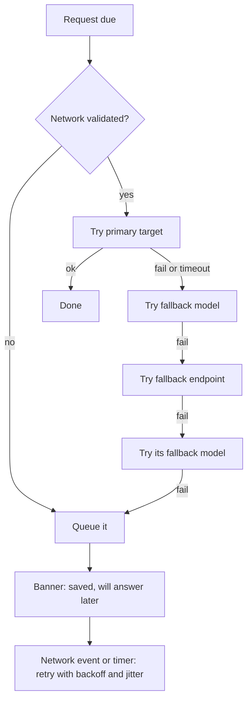

# Offline and Fallback

Status: v1     Version: 0.1     Depends on: 40-provider-layer, 30-reminder-engine, 31-nudge-engine, 11-layers-raw-derived

## 1. Purpose

Internet is never guaranteed. Capture, viewing, reminders, and alarms must work with no network, and AI features must
degrade clearly and recover gracefully. This file defines connectivity states, the offline queue, per-feature offline
behavior, and how the app catches up.

## 2. Behavior (what the user sees)

- Messages typed offline are saved instantly and shown with a small **queued** mark. A short banner says "Offline: your messages are saved."
- Alarms and reminders ring as normal. Their stored text is used. No conversation follows while offline.
- The memory viewer, agenda, Soul view, and quick actions (Done, Snooze, Add item manually) work fully offline.
- When the network returns, queued messages are answered together in one reply that knows they were written earlier.
- If only the AI provider is down (the phone has internet), the banner says so and the app behaves the same way.

## 3. Design

### 3.1 Connectivity states

| State                                                                                                                                 | Meaning                                                           | How detected                                                  |
| ------------------------------------------------------------------------------------------------------------------------------------- | ----------------------------------------------------------------- | ------------------------------------------------------------- |
| `online`                                                                                                                            | Network validated and the provider answers                        | Recent successful request, or a validated network             |
| `no_network`                                                                                                                        | No validated network (airplane mode, no signal, captive portal)   | `ConnectivityManager` network capabilities (validated flag) |
| `provider_down`                                                                                                                     | Network fine, but all targets fail (breakers open, 5xx, timeouts) | Provider layer outcomes (`40`)                              |
| `cooling`                                                                                                                           | All targets in 429 cooldown                                       | `target_state`                                              |
| `degraded`                                                                                                                          | Primary failing, a fallback is serving                            | Chain selector                                                |

The UI shows one calm status, not four technical ones: Online, Offline, "AI unavailable", "Cooling down until HH:MM", "Using backup".
| State is derived from facts, never stored as truth. A network-callback event only triggers a re-evaluation and a catch-up attempt.    |                                                                   |                                                               |

### 3.2 Capture is always local

Every message is written to the raw log first (`11-layers-raw-derived.md`), with a `client_msg_id` for idempotency.
Sending to a provider is a separate operation in the `outbox`. Losing the network never loses a message.

### 3.3 The outbox (operational layer)

| Job type                                                                                                                          | Created by                                        | Priority           | Expiry                                             |
| --------------------------------------------------------------------------------------------------------------------------------- | ------------------------------------------------- | ------------------ | -------------------------------------------------- |
| `chat_turn`                                                                                                                     | A user message                                    | P0                 | Never (user content), but see 3.5                  |
| `worker_batch`                                                                                                                  | Debounced extraction (`20-context-pack.md` 3.8) | P2                 | Never                                              |
| `opener_text`                                                                                                                   | Reminder fire, nudge, check-in                    | P1                 | Dropped after its deadline (template already used) |
| `summary`                                                                                                                       | Day rollover, week, month                         | P3                 | Never                                              |
| `rebuild`                                                                                                                       | User-started                                      | P3                 | Never                                              |
| `embed`                                                                                                                         | New messages and nodes                            | local, no provider | n/a                                                |
Jobs are idempotent: each has a deterministic key (cause message, kind, target), so replays after a crash never duplicate work.                                                    |
| The outbox survives process death and reboots. WorkManager (network constraint) wakes the app to drain it when a network appears. |                                                   |                    |                                                    |

### 3.4 Timeouts and the fallback ladder



Timeouts and breakers come from `40-provider-layer.md`. The queue retry schedule for a stuck outbox: 1, 2, 5, 10, 30 minutes, then every 30 minutes,
plus an immediate attempt on any "network available" event and whenever the user opens the app.

### 3.5 Catch-up when connectivity returns

1. **Order:** user chat first, then worker batches (oldest first), then summaries, then other jobs. The limiter and the interactive reserve still apply.
2. **Offline batch turn:** all queued user messages become **one** turn. The pack lists them in order with their original times
   ("sent offline, 14:02, 14:05, 14:20"), and the Chat AI answers them together. This saves RPM and avoids three stale replies in a row.
3. **Age guard:** if the oldest queued message is more than 12 hours old, the Chat AI is told so and starts with a brief acknowledgment.
   Replies about time-sensitive things use the *current* time from the Now block.
4. **Worker backlog:** processed in batches (several messages per request) at a gentle pace (at most 3 requests per minute) so it does not use the whole RPM budget.
5. **Stale nudge text:** `opener_text` jobs past their deadline are dropped, and a nudge is re-evaluated against current state instead of sending old text.
6. **One follow-up per offline reminder** (`30-reminder-engine.md` 3.11) runs at this stage.
7. **Jitter:** a random delay of up to 20 seconds before the first request, so a returning network does not produce a burst.

### 3.6 Offline matrix

| Feature                                                   | Offline behavior                                                                       |
| --------------------------------------------------------- | -------------------------------------------------------------------------------------- |
| Capture messages                                          | Works, queued                                                                          |
| Chat replies                                              | Not available (queued)                                                                 |
| Reminders and alarms                                      | Fully work, stored text, no conversation                                               |
| Alarm actions (Started, Done, Snooze)                     | Work, applied locally via the gateway                                                  |
| Nudges and check-ins                                      | Detectors run locally, **template** text, notification posted                    |
| Briefing cards and charts                                 | Work (native from the database), template narration                                    |
| Memory viewer, Soul view, agenda                          | Fully work                                                                             |
| Manual add or edit of items and reminders                 | Works (form with the date parser)                                                      |
| Resolver chips and Undo                                   | Work (no model needed)                                                                 |
| Search (keyword and vector)                               | Works on device. Embeddings need the local model                                       |
| Soul proposals                                            | Created later by the Worker. Existing ones can be accepted or rejected                 |
| Export and import                                         | Work                                                                                   |
| Summaries                                                 | Wait for a provider. A plain-code digest is used meanwhile                             |
| Embedding model download                                  | Waits for Wi-Fi                                                                        |
| Natural-language quick add ("remind me at 6 to call mom") | **Not in v1.** Candidate for v1.1 as a small rule-based parser (see `90` section 3.3) |

### 3.7 Templates

Offline text comes from templates, never from nowhere.

- Per **trigger type** (reminder start, check, deadline, nudge types, check-ins) and per **persona tone**, 3 to 5 variants each, with slots (`{title}`, `{due}`, `{count}`, `{name}`).
- Chosen with light randomness so the app does not repeat itself, and recorded with `text_source = template` in the logs.
- Reminders store their opener text at creation time (written by the model then), so that text is personal even when sent offline.
- Languages: English first. Other languages are added as template packs (`91-parking-lot.md`).

### 3.8 Network policy

- **Metered data:** AI requests are small, so they are allowed on mobile data by default (setting "Use mobile data for AI"). The embedding model download and large export or import jobs are Wi-Fi only by default.
- **Data Saver or restricted background data:** detected, and a banner explains that background AI work may be delayed.
- **Doze and standby:** network access can be deferred while the phone idles. The outbox and WorkManager account for this (`42-android-reliability.md`).
- **Captive portals:** a network without validation is treated as `no_network`.
- **VPN or proxy:** work normally, and failures look like network errors.

### 3.9 On-device LLM as the last fallback

A small local model for basic replies when everything else fails is **parked** (v3 or later, `91-parking-lot.md`). The `Provider` interface is designed so a local target can be added as one more chain entry.

## 4. Data

Uses `outbox`, `target_state`, `limiter_state` (operational), plus:

```sql
CREATE TABLE outbox (
  id TEXT PRIMARY KEY,
  job_type TEXT NOT NULL,              -- chat_turn | worker_batch | opener_text | summary | rebuild
  priority INTEGER NOT NULL,           -- 0 to 4
  payload_json TEXT NOT NULL,          -- ids and parameters, never copies of private text beyond what the raw log holds
  idem_key TEXT NOT NULL UNIQUE,
  status TEXT NOT NULL DEFAULT 'pending',   -- pending | running | done | failed | dropped
  attempts INTEGER NOT NULL DEFAULT 0,
  next_try_at INTEGER NOT NULL,
  deadline_at INTEGER,
  created_at INTEGER NOT NULL, updated_at INTEGER NOT NULL,
  last_error TEXT
);
CREATE INDEX idx_outbox_due ON outbox(status, priority, next_try_at);
```

## 5. Settings

| Setting                        | Default               |
| ------------------------------ | --------------------- |
| Use mobile data for AI         | On                    |
| Wi-Fi only for large downloads | On                    |
| Offline batch turn             | On                    |
| Queue retry schedule           | 1, 2, 5, 10, 30 min   |
| Stale queued message threshold | 12 h                  |
| Worker catch-up pace           | 3 requests per minute |

## 6. Edge cases and failure modes

- **App killed with jobs running.** The status goes back to `pending` on the next start (lease timeout of 2 minutes), and idempotency prevents duplicates.
- **User edits or deletes a queued message.** Not allowed in v1 after it is sent. Redaction (`11`) applies to the raw log, and the job uses the current content.
- **Hundreds of queued items.** The worker backlog is capped per batch, and the chat turn is built with a normal pack.
- **Network flaps.** Backoff and jitter. Each attempt costs a limiter slot, so retries are paced.
- **Provider recovers during cooldown.** Cooldown is respected until it ends. The banner shows the end time.
- **Reminder fires while the provider is down but the phone is online.** The alarm and notification use stored text immediately. The opener times out at 8 seconds and falls back to the stored text.
- **User sends many messages offline, then opens the app online.** They are batched, and one reply covers them.
- **Clock jump during the offline period.** The raw log has UTC and offset, so ordering is stable.

## 7. Offline behavior

This whole file.

## 8. Tests

1. Airplane mode: send 3 messages, they appear with queued marks, then restoring the network produces one reply that references all three.
2. Kill the process mid-request: after restart there is exactly one reply and no duplicate worker output.
3. All targets fail: the banner shows, the queue holds, retries follow the schedule.
4. A reminder fires offline: alarm rings, stored text, actions work, and one follow-up arrives on reconnect.
5. A nudge generated offline with a template is not replaced by a stale model text after reconnect.
6. A 14-hour backlog: the Chat AI acknowledges the delay, and time references are correct.
7. 429 cooldown: the status shows the end time, and requests resume only after it.
8. Template coverage test: every trigger and every persona tone has at least 3 variants.

## 9. Open questions

- Should offline-queued messages be editable until sent? Proposed: no for v1.

## 10. Changelog

- 0.1 (2026-10-21): first draft.
