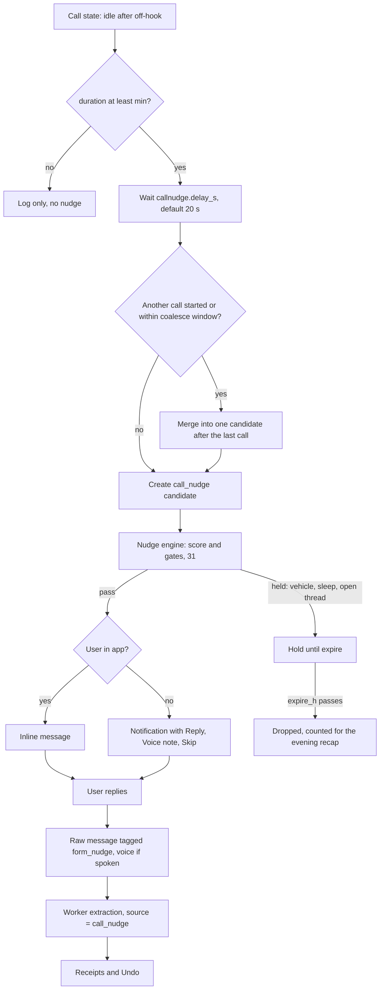

# Call Nudge

Status: planned (v2)     Version: 0.1     Depends on: 11-layers-raw-derived, 13-nodes-edges-statuses, 22-resolver, 23-tool-contracts, 31-nudge-engine, 41-offline-fallback, 60-voice-stt-tts, 16-security-privacy

## 1. Purpose

Phone calls are where promises are made ("I'll send it tomorrow", "see you Friday") and where memory usually
fails. Mine cannot and will not listen to calls. Instead, when a call ends, MineAI asks one light question and
lets the user answer by typing or by a short voice note. The answer goes through the normal extraction path.

## 2. Behavior (what the user sees)

- Off by default. Settings > Calls. It needs the phone-state permission, explained in plain words: "Mine learns only when a call starts and ends. It never hears or reads the call."
- A short time after a call ends, a notification appears: "Call done. Anything worth remembering?" with **Reply**, **Voice note**, and **Skip**.
- **Reply** is an inline text reply, and the text is saved into today's chat as the user's message.
- **Voice note** opens a small recording sheet (`60`). The user speaks for a few seconds, and sees the transcript. They edit it if needed, and send.
- **Skip** drops the nudge. No guilt.
- If the app is open, the nudge shows up as an inline message in the chat instead of a notification.
- After the reply, MineAI does what it does with any message: proposes or creates tasks, commitments and notes, with receipts and Undo.
- The evening check-in may add one line: "You had 2 calls today I did not hear about." It is optional (`callnudge.evening_recap`).
- Optional, off by default: **"Know who I was talking to"**. With extra permissions, the notification and a timeline decoration show the contact's name. See 3.5.

## 3. Design

### 3.1 Detecting a call

- Only call **state** is used: ringing, off-hook, idle, with timestamps. Content is never accessed, and the call audio is never captured (Android blocks it, and Mine would not anyway).
- A call counts as "ended" on the off-hook to idle transition, with `duration_s = end - start`.
- Calls shorter than `callnudge.min_duration_s` (default 45 s) are ignored. This also filters out unanswered outgoing calls, because off-hook can begin while dialing (**verify** on real devices).
- **Missed and rejected calls** never produce a nudge.
- **VoIP calls** (WhatsApp, Telegram, Meet) are not visible to phone state, so they get no nudge in v2. The launcher shortcut and quick-capture notification ("Log a call") cover them by hand. Reading app notifications is possible only with a special permission that is restricted for sideloaded apps on newer Android (**verify**, see `42`), so it is parked.

### 3.2 Flow



### 3.3 Gates and timing

- The candidate goes through the nudge engine (`31`) as trigger `call_nudge`, medium priority. It is subject to the same gates: sleep window, one open AI-initiated thread, backoff, vehicle hold (`43`), and the hidden fuse.
- **Expiry:** if it cannot be delivered within `callnudge.expire_h` (default 3 h), it is dropped. A late "how was your call?" at 6 am is worse than nothing.
- **Coalescing:** calls within `callnudge.coalesce_min` (default 10 min) of each other produce one nudge.
- **Learning stop:** after 3 call nudges in a row are ignored, MineAI asks once with chips: "Stop asking after calls", "Only long calls", "Keep asking". The answer sets the settings.
- Offline: the notification and the inline message use templates (`41`). A reply is queued in the outbox like any message.

### 3.4 The reply path

- The nudge message carries the hidden tag `form_nudge` (`01`, `11`). The user's reply is a normal `raw_message` (tag `quick_reply`, or `voice`), linked to the nudge by `attrs.reply_to`.
- The worker's brief says: "this is a note the user wrote right after a phone call". It extracts as usual. Items it creates carry `source = call_nudge` (`13`).
- It is the user's own words, so extracted items follow the user's normal Soul and reminder settings (manual or auto-accept). They are **not** forced into `proposed` the way ambient content is.
- A voice note always shows its transcript before sending (`60` 3.2), so a bad transcription cannot silently create a promise.

### 3.5 Optional contact name

- With `callnudge.know_contact` on, the app asks for the call-log and contacts permissions and reads only the **most recent entry** after a call, to get a display name.
- The name is stored in `call_event` (local). It appears in the notification (with a public version on the lock screen that omits it) and as a small decoration on the nudge in the timeline, drawn from `call_event`, not stored in the message text.
- The name is **not** put into the context pack or the nudge brief. If the user's own reply mentions the person, that is their words.
- The setting explains this trade-off in two sentences.

## 4. Data

```sql
CREATE TABLE call_event (                  -- operational, device-local
  id          TEXT PRIMARY KEY,
  started_at  INTEGER NOT NULL, ended_at INTEGER NOT NULL, duration_s INTEGER NOT NULL,
  direction   TEXT,                        -- in | out | unknown
  contact_ref TEXT,                        -- display name, only if know_contact is on
  nudge_id    TEXT,                        -- the message or notification created
  state       TEXT NOT NULL,               -- pending | nudged | answered | skipped | expired | ignored
  created_at  INTEGER NOT NULL
);
CREATE INDEX idx_call_event_ended ON call_event(ended_at);
```

- No call number is stored. `call_event` rows are pruned after 30 days. The accepted notes live on in the raw chat and the graph.

## 5. Settings

| Key                          | Default            | Scope | Notes                                     |
| ---------------------------- | ------------------ | ----- | ----------------------------------------- |
| `flag.call_nudge`          | off (shipped dark) | D     |                                           |
| `callnudge.enabled`        | off                | D     | Needs the phone-state permission          |
| `callnudge.min_duration_s` | 45                 | S     |                                           |
| `callnudge.delay_s`        | 20                 | S     |                                           |
| `callnudge.expire_h`       | 3                  | S     |                                           |
| `callnudge.coalesce_min`   | 10                 | S     |                                           |
| `callnudge.voice_action`   | on                 | S     | Shown only when voice (`60`) is enabled |
| `callnudge.evening_recap`  | on                 | S     |                                           |
| `callnudge.know_contact`   | off                | D     | Extra permissions                         |

## 6. Edge cases and failure modes

- **Emergency or sensitive calls:** with no number access, the app cannot tell. The nudge text is always neutral and never jokey, and the `sensitive_moment` suppression (`16` 3.7) applies if the user's reply signals distress.
- **A call in the middle of the night:** held, and dropped at expiry. It is counted in the recap.
- **Two calls back to back:** one nudge.
- **The user is on another call, or the mic is busy:** the voice action is disabled and the sheet says why.
- **Permission denied or revoked:** the feature turns itself off with a calm chip, and nothing else is affected.
- **OEM kills the receiver:** calls may be missed silently. The reliability score reports "Call detection unverified". A missed nudge costs nothing.
- **Dual-SIM or work profiles:** whatever the system reports is accepted. **Verify** on dual-SIM devices.
- **Reply arrives after the nudge expired:** it is still saved as a normal message, linked by `reply_to`.

## 7. Offline behavior

Detection is local. The nudge appears with a template. Replies are queued and processed when a provider is reachable. Voice notes are transcribed on-device if a model is downloaded, otherwise queued (`60`).

## 8. Tests

1. A 3-minute call ends: one nudge after about 20 s, with the three actions.
2. A missed call, a rejected call and a 10-second call: no nudge.
3. Two calls 5 minutes apart: one nudge.
4. A call at 02:00 with sleep hours: held, then dropped at expiry, and counted in the recap.
5. Typed reply "I'll send the invoice tomorrow": a commitment is created with `source = call_nudge`, a receipt, and Undo.
6. Voice note: the transcript is shown first, and editing it changes what is saved.
7. Three ignored nudges: the one-time question appears, and each chip changes the settings.
8. Airplane mode: template nudge, reply queued, and exactly one extraction after reconnecting.
9. Revoke the permission: the feature disables itself and the rest of the app is unchanged.
10. With `know_contact` off, nothing about the other party appears in any stored table or request.
11. Lock-screen notification does not show the contact name.

## 9. Open questions

- Should `callnudge.know_contact` exist in v2.0, or wait for v2.1 once the main flow has proven itself? Proposed: v2.1.
- Should the notification offer "Remind me later" (a 1-hour snooze)? Proposed: no, since `Skip` and the evening recap cover it.

## 10. Changelog

- 0.1 (2026-10-21): first draft.
