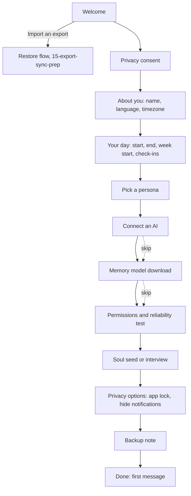

# Onboarding and Settings

Status: v1     Version: 0.1     Depends on: 12-soul, 24-personas, 30-reminder-engine, 31-nudge-engine, 40-provider-layer, 42-android-reliability, 16-security-privacy, 14-migrations

## 1. Purpose

Two jobs. **Onboarding** turns a fresh install into a working Mine in a few minutes, for a tinkerer and for someone who has never seen an API key.
**Settings** is the single, complete list of everything the user can change, with defaults. Every other blueprint refers here for the full catalog.

## 2. Behavior (what the user sees)

- First launch shows a short guided flow with a progress indicator. Every step explains why it asks.
- Only two things are mandatory: **accepting the privacy consent** and **confirming the day setup** (which has sensible defaults). Everything else can be skipped and finished later.
- Closing the app mid-way resumes at the same step.
- Without a connected AI, the app still works as a local notebook with manual items, reminders and alarms. A calm banner offers to connect one.
- Settings are grouped into twelve sections with a search box. A switch **Show advanced settings** reveals the technical ones.
- Settings that touch time or reliability explain themselves in one sentence and show their default.

## 3. Design

### 3.1 Onboarding flow



| Step                         | What happens                                                                                                                                                                                                                                                                                                                       | Skippable                                                         |
| ---------------------------- | ---------------------------------------------------------------------------------------------------------------------------------------------------------------------------------------------------------------------------------------------------------------------------------------------------------------------------------- | ----------------------------------------------------------------- |
| **1 Welcome**          | Three cards: you own your data, the AI reads your words, backup is yours. A secondary link "I already use Mine on another phone" opens import                                                                                                                                                                                      | n/a                                                               |
| **2 Consent**          | The text from `16` 3.3, version-stamped (`consent_version_accepted`). Cannot continue without accepting                                                                                                                                                                                                                        | No                                                                |
| **3 About you**        | What should I call you, languages you write in (affects templates and retrieval notes), timezone (auto-detected, editable)                                                                                                                                                                                                         | Name skippable                                                    |
| **4 Your day**         | Day start, day end (shown as a duration with the 10 to 20 hour recommendation), week start, morning and evening check-in times (defaults shown, with "adapts over time"). Output creates the first `day_rule`                                                                                                                    | No (defaults are prefilled, one tap to confirm)                   |
| **5 Persona**          | Cards for each preset with a sample reply in that voice, a preview button (`24` 3.4), and "write your own later"                                                                                                                                                                                                                 | Yes (default Companion)                                           |
| **6 Connect an AI**    | The provider wizard (`40` 3.2). Plain-language help: what a base URL, key, and model are. A link opens the repository guide that lists example OpenAI-compatible hosts (this is documentation, not built-in presets). Default is **one setup for everything**. "Use a different one for background work" is under Advanced | Yes, with a warning that chat will be unavailable                 |
| **7 Memory model**     | Explains the on-device model, its download size, Wi-Fi only, runs the device gate test. If declined or failed: keyword-only search, retry later                                                                                                                                                                                    | Yes                                                               |
| **8 Permissions**      | Notifications (with rationale), alarms (exact alarm and full-screen guidance by Android version), battery optimization exemption, vendor guide for the detected brand (`42` 3.7), and a **Test reminders now** button that sets an alarm one minute ahead and reports the result                                           | Each is skippable. The Reliability screen stays amber until fixed |
| **9 Soul seed**        | About six light, optional questions (3.2). Or **Interview me in chat**: MineAI asks them conversationally in the first conversation                                                                                                                                                                                          | Yes                                                               |
| **10 Privacy options** | App lock (default off), hide notification content on the lock screen (default off), block screenshots (default off)                                                                                                                                                                                                                | Yes                                                               |
| **11 Backup**          | One paragraph on exports and the passphrase, optional first export later, and the export reminder interval                                                                                                                                                                                                                         | Yes                                                               |
| **12 Done**            | MineAI's first message appears in today's session in the persona's voice (template if no AI is connected), with three tappable suggestions                                                                                                                                                                                         | n/a                                                               |

Rules:

- Progress is saved after every step in `onboarding_state`, and the flow resumes where it stopped.
- Every step has Back. Skipped steps appear in a **Finish setup** card on the Chat screen until done or dismissed. The card is shown at most once a week after the first day.
- Provider keys entered during onboarding are encrypted immediately (`40` 3.10).
- **Author shortcut:** a long press on the Welcome logo (or a setting in a debug build) fast-forwards with defaults. This is a convenience for repeated testing, not a user feature.
- **Reinstalls:** since there is no cloud, a fresh install starts onboarding, and the import link is on the first card.

### 3.2 Soul seed questions (defaults)

Answers become Soul facts with `source = onboarding`, `origin = approved`, status `active` (the user typed them, so no approval step).

| #                                                                                                                            | Question                                                            | Category                | Notes                                                                                                                                |
| ---------------------------------------------------------------------------------------------------------------------------- | ------------------------------------------------------------------- | ----------------------- | ------------------------------------------------------------------------------------------------------------------------------------ |
| 1                                                                                                                            | What do you do most days (study, work, both, something else)?       | `identity`            | Free text or chips                                                                                                                   |
| 2                                                                                                                            | When do you usually wake up and go to sleep?                        | `habits_routines`     | Also suggests the day window if it disagrees with step 4                                                                             |
| 3                                                                                                                            | Anything about your health I should always keep in mind? (optional) | `health`              | Marked `sensitive`. A switch beside it: "Keep this on this phone only" (`local_only`), with the trade-off sentence from `16` 6 |
| 4                                                                                                                            | How do you like replies: short, balanced, or detailed?              | `communication_style` | Chips                                                                                                                                |
| 5                                                                                                                            | Things you dislike or that annoy you?                               | `dislikes`            | Free text                                                                                                                            |
| 6                                                                                                                            | What do you most want Mine to help with?                            | `goals_longterm`      | Chips plus free text                                                                                                                 |

Each question has a **Skip** button. The interview mode asks the same list in chat, one at a time, over the first day.

### 3.3 Day setup copy and limits

- The day window can be any length from **1 to 24 hours** (a technical sanity range, the app does not use harder limits). The window may cross midnight. A 24 hour window means no quiet period.
- **Recommended range: 10 to 20 hours.** Outside it, a light message appears (in the chosen persona's voice, with a built-in fallback), and the user can still save.

| Choice         | Message (fallback wording)                                                                                                                                               |
| -------------- | ------------------------------------------------------------------------------------------------------------------------------------------------------------------------ |
| Under 10 hours | "That is a short day. I will fit my check-ins in, but things may pile up. Your call." (sarcastic personas: "Under 10 hours? Bold. Do not blame me when things pile up.") |
| Over 20 hours  | "That leaves me very little quiet time. Fine, but please sleep sometime." (sarcastic personas: "Over 20 hours awake? Impressive stamina, questionable decisions.")       |
| 24 hours       | "Always on. I will never go quiet on my own, so use Pause nudges when you need peace."                                                                                   |


- The setting also shows the derived times: first-contact wait, morning check-in, evening check-in (`31`, `32`), so the effect is visible.
- Changing the day rule later takes effect at the next rollover (`50` 3.13), and the screen says so.

### 3.4 Settings structure and behavior

- **Twelve sections**, one search box over all settings, and **Show advanced settings** (off by default) for technical keys.
- Each setting: title, one-line description, current value, a "default" label when changed with a **Reset** action, and (where relevant) a short warning.
- **Scope:** *S* = synced between the user's devices (later), *D* = device-local. Provider keys, permissions, notification state, and display preferences are device-local.
- Settings are stored in the `setting` table (`14` 3.8). Validation lives with the definition: type, range, and dependent warnings.
- Changes apply **immediately** and are read live by the Now block (`20`), so a changed gap or time is known on the next turn.
- Changes to day or time rules re-plan check-ins and AI-suggested reminders for future days, and nothing in the past.
- A section-level **Reset to defaults** exists for sections 4 to 8 only, with a confirmation. Account-like data (providers, Soul, items) is never reset by it.

### 3.5 Settings catalog (authoritative)

`Adv` = advanced. Defaults are the values shipped.

**1. Profile and day**

| Key                   | Default         | Scope | Notes                                           |
| --------------------- | --------------- | ----- | ----------------------------------------------- |
| `profile.name`      | (blank)         | S     | Used by personas when allowed                   |
| `profile.languages` | Device language | S     |                                                 |
| `day.timezone`      | Auto            | D     | Auto follows the device                         |
| `day.start`         | 06:00           | S     | Creates a new `day_rule` at the next rollover |
| `day.end`           | 22:00           | S     | Window 1 to 24 h, recommended 10 to 20 h        |
| `day.week_start`    | Monday          | S     |                                                 |
| `ui.time_format`    | System          | D     | 12 or 24 hour                                   |

**2. AI and providers**

| Key                                        | Default        | Scope | Notes                                              |
| ------------------------------------------ | -------------- | ----- | -------------------------------------------------- |
| Providers (list)                           | none           | D     | Base URL, key, headers, RPM, concurrency, cooldown |
| `slot.chat.chain`, `slot.worker.chain` | none           | D     | Up to 4 targets each                               |
| `slot.worker.same_as_chat`               | On             | D     |                                                    |
| `slot.*.reasoning`                       | Off            | D     |                                                    |
| `ai.temperature.chat` / `.worker`      | 0.7 / 0.2      | D     | Adv                                                |
| `ai.max_tokens`                          | 1200           | D     | Adv                                                |
| `provider.rpm_default`                   | 20             | D     | Hard ceiling 50 (constant)                         |
| `provider.cooldown_min`                  | 15             | D     |                                                    |
| `provider.cooldown_escalate`             | On             | D     |                                                    |
| `provider.interactive_reserve`           | 20%            | D     | Adv                                                |
| `ai.timeouts.*`                          | See `40` 3.7 | D     | Adv                                                |
| `ai.background_token_budget`             | Off            | D     | Adv                                                |
| `ai.debug_capture`                       | Off            | D     | Adv                                                |
| `ai.mobile_data`                         | On             | D     |                                                    |

**3. Persona**

| Key                    | Default              | Scope |
| ---------------------- | -------------------- | ----- |
| `persona.active`     | Chosen in onboarding | S     |
| `persona.intensity`  | Medium               | S     |
| `persona.use_name`   | On                   | S     |
| Custom personas (list) | none                 | S     |

**4. Memory and Soul**

| Key                                       | Default                | Scope | Notes              |
| ----------------------------------------- | ---------------------- | ----- | ------------------ |
| `soul.mode`                             | Manual approve         | S     | Switchable to Auto |
| `soul.auto_min_confidence`              | 0.75                   | S     | Adv                |
| `soul.core_budget`                      | 600 tokens             | S     | Adv                |
| `soul.questions`                        | On (at most 1 per day) | S     |                    |
| `memory.default_local_only`             | Off                    | S     |                    |
| `node.ephemeral_minutes`                | 90                     | S     |                    |
| `node.hot_days` / `node.archive_days` | 14 / 180               | S     | Adv                |
| `node.conflict_warnings`                | On                     | S     |                    |
| `ctx.budgets.*`                         | See `20`             | S     | Adv                |
| `ctx.low_token_mode`                    | Auto                   | D     |                    |
| `ctx.recent_min_messages`               | 6                      | S     | Adv                |
| `worker.debounce_s`                     | 30                     | S     | Adv                |
| `ctx.inspector`                         | Off                    | D     |                    |
| `retrieval.*`                           | See `21` 5           | S     | Adv                |
| `embed.auto_rebuild_charging`           | On                     | D     |                    |
| `rebuild.show_cards`                    | On                     | D     |                    |

**5. Reminders**

| Key                                                | Default                              | Scope |
| -------------------------------------------------- | ------------------------------------ | ----- |
| `reminder.ai_suggest`                            | Ask (or Auto)                        | S     |
| `reminder.snooze_min`                            | 10 (adapts)                          | S     |
| `reminder.ring_in_app`                           | Off                                  | S     |
| `reminder.dayparts.*`                            | See `30` 3.4                       | S     |
| `reminder.rering_interval_min` / `.rering_max` | 5 / 3                                | S     |
| `reminder.grace_min`                             | 60                                   | S     |
| `reminder.tier_by_severity`                      | 0-1 notify, 2 alarm, 3 alarm_persist | S     |
| `reminder.sound` / `.vibrate`                  | System alarm / On                    | D     |

**6. Nudges and check-ins**

| Key                                           | Default                        | Scope |
| --------------------------------------------- | ------------------------------ | ----- |
| `nudge.enabled`                             | On                             | S     |
| `nudge.min_gap_min`                         | 60                             | S     |
| `nudge.backoff_multiplier`                  | 2.0                            | S     |
| `nudge.gap_ceiling_h`                       | 6                              | S     |
| `nudge.ignore_window_h`                     | 3                              | S     |
| `nudge.first_contact_wait_h`                | 3 (adapts)                     | S     |
| `nudge.slot_questions`                      | On                             | S     |
| `nudge.stall`                               | On                             | S     |
| `nudge.show_why`                            | On                             | S     |
| `nudge.paused_until`                        | (none)                         | D     |
| `checkin.morning.on` / `.time`            | On / day start + 3 h           | S     |
| `checkin.morning.on_open`                   | On                             | S     |
| `checkin.evening.on` / `.time`            | On / day end - 90 min          | S     |
| `checkin.weekly.on` / `.slot`             | On / evening before week start | S     |
| `checkin.charts`                            | On                             | S     |
| `checkin.evening_items`                     | 3                              | S     |
| `checkin.reflection`                        | On                             | S     |
| `privacy.sensitive_quiet_h`                 | 24                             | S     |

The hidden fuse (`31` 3.10) has no setting.

**7. Chat display**

| Key                      | Default                                | Scope |
| ------------------------ | -------------------------------------- | ----- |
| `ui.divider_gap_min`   | 45                                     | D     |
| `ui.divider_gap_text`  | On                                     | D     |
| `ui.reasoning_display` | Collapsed                              | D     |
| `ui.enter_sends`       | Off                                    | D     |
| `ui.font_scale`        | System                                 | D     |
| `ui.haptics`           | On                                     | D     |
| `ui.reduced_motion`    | System                                 | D     |
| `ui.fallback_marker`   | On                                     | D     |
| `ui.open_at_unseen`    | On                                     | D     |
| `ui.theme`             | System (dynamic color where available) | D     |

**8. Offline and network**

| Key                          | Default             | Scope   |
| ---------------------------- | ------------------- | ------- |
| `net.wifi_only_downloads`  | On                  | D       |
| `net.offline_batch_turn`   | On                  | D       |
| `net.queue_retry_schedule` | 1, 2, 5, 10, 30 min | D (Adv) |
| `net.stale_threshold_h`    | 12                  | D (Adv) |
| `net.worker_catchup_rpm`   | 3                   | D (Adv) |

**9. Privacy and security**

| Key                             | Default                              | Scope |
| ------------------------------- | ------------------------------------ | ----- |
| `sec.app_lock`                | Off                                  | D     |
| `sec.relock_timeout`          | 1 min                                | D     |
| `sec.hide_lockscreen_content` | Off                                  | D     |
| `sec.flag_secure`             | Off                                  | D     |
| `sec.hide_recents_preview`    | Off                                  | D     |
| Consent (view)                  | Accepted version                     | D     |
| Erase tools                     | Message, day, fact, item, everything | n/a   |

**10. Backup and data**

| Key                          | Default              | Scope   |
| ---------------------------- | -------------------- | ------- |
| Export, Import, Test restore | Actions              | n/a     |
| `backup.reminder_weeks`    | 4 (can be Off)       | D       |
| `backup.argon2`            | 64 MiB, 3 iterations | D (Adv) |
| `migrate.snapshot_days`    | 7                    | D (Adv) |
| Trash (view)                 | 30 days              | n/a     |
| Auto-export folder (v1.1)    | Off                  | D       |

**11. Reliability and notifications**

| Key                                    | Default                  | Scope |
| -------------------------------------- | ------------------------ | ----- |
| Reliability screen, Test reminders now | Actions                  | n/a   |
| Notification channels                  | Links to system settings | D     |
| `diag.log`                           | On (local, 7 days)       | D     |
| Share diagnostics                      | Action                   | n/a   |
| `reliability.warnings`               | On                       | D     |

**12. Quick capture and about**

| Key                                                                                          | Default | Scope |
| -------------------------------------------------------------------------------------------- | ------- | ----- |
| `capture.notification`                                                                     | Off     | D     |
| `capture.shortcut`                                                                         | On      | D     |
| About: version, blueprint version, signing fingerprint, SHA-256, check for updates, licenses | Info    | n/a   |
| License name, source link, Open-source licenses, and version stamps (app, build, blueprint, schema, export, embedding model, template pack) from `92` | Info | n/a |
| Developer options (tap version 7 times)                                                      | Hidden  | D     |

Developer options (hidden): feature flags (`flag.*`), tool mode override, log levels, context snapshots, forced fuse trip (for testing), and fixture import.

**Feature settings from v2 and v3 (all behind `flag.*`)**

| Area | Settings catalog |
| ---- | ---------------- |
| Context sensing (`43` section 5) | `flag.sensing`, `sensing.enabled`, `sensing.use_wifi`, `sensing.use_geofence`, `sensing.away_confirm_min`, `sensing.home_confirm_min`, `sensing.motion_min_s`, `sensing.context_nudges`, `sensing.hold_while_vehicle`, `sensing.show_chip`, `sensing.keep_events_days` |
| Call nudge (`44` section 5) | `flag.call_nudge`, `callnudge.enabled`, `callnudge.min_duration_s`, `callnudge.delay_s`, `callnudge.expire_h`, `callnudge.coalesce_min`, `callnudge.voice_action`, `callnudge.evening_recap`, `callnudge.know_contact` |
| Voice (`60` section 5) | `flag.voice`, `voice.enabled`, `voice.stt.mode`, `voice.stt.slot`, `voice.review_before_send`, `voice.hold_to_talk`, `voice.max_record_s`, `voice.language_hint`, `voice.tts.engine`, `voice.tts.after_voice`, `voice.tts.voice`, `voice.tts.speed`, `voice.tts.max_chars`, `voice.tts.speak_with_screen_reader`, `voice.models.wifi_only` |
| Ambient (`61` section 5) | `flag.ambient`, `ambient.enabled`, `ambient.consent_version`, `ambient.stt.mode`, `ambient.window`, `ambient.charging_only`, `ambient.min_battery_pct`, `ambient.thermal_pause`, `ambient.gate_user_presence`, `ambient.pause_places`, `ambient.report_time`, `ambient.transcript_ttl_h`, `ambient.proposal_ttl_d`, `ambient.daily_stt_cap_min`, `ambient.daily_listen_cap_h`, `ambient.batch_s`, `ambient.ring_s`, `ambient.window_gap_s`, `ambient.max_proposals_per_window`, `ambient.scrub_numbers`, `ambient.t_hi`, `ambient.t_lo` |

Ambient enrollment is not part of onboarding. It lives in **Settings > Ambient** and requires separate consent.

### 3.6 Feature flags

Features that ship dark (for example sensing in v2) are controlled by `flag.*` keys in `app_meta` (`14` 3.1). A flag is enabled by an app update or in Developer options.
Flags are the way to land a half-finished feature without exposing it, and they carry no user data.

### 3.7 Resilience of onboarding and settings

- Onboarding never blocks on the network. Each network step (provider test, model download) has Skip and Retry.
- Settings read through a typed layer with defaults, so a missing or unknown key can never crash the app (`14` 3.2 rule 5).
- Importing an export brings settings across (device-local ones excluded) and then asks to re-grant permissions and re-enter provider keys (unless keys were exported).

## 4. Data

```sql
CREATE TABLE setting (                     -- derived layer, synced where scope is S
  key        TEXT PRIMARY KEY,
  value_json TEXT NOT NULL,
  scope      TEXT NOT NULL,                -- synced | device
  hlc        TEXT,
  updated_at INTEGER NOT NULL,
  deleted_at INTEGER
);

CREATE TABLE onboarding_state (            -- operational, single row
  id INTEGER PRIMARY KEY CHECK (id = 1),
  step TEXT NOT NULL, completed_steps TEXT, skipped_steps TEXT,
  data_json TEXT, started_at INTEGER, finished_at INTEGER
);
```

`app_meta`: `consent_version_accepted`, `consent_at`, `onboarding_done_at`, `flag.*`.
Soul seed answers are normal `soul_fact` rows. The day setup is a `day_rule` row (`50` 4).

## 5. Settings

This file is the settings catalog (3.5).

## 6. Edge cases and failure modes

- **User quits during the provider test.** The partially entered provider is saved as a draft (key encrypted) and the step resumes.
- **User skips everything.** The app works in local-notebook mode: manual items, reminders, alarms, the memory viewer. Chat messages are queued until an AI is connected, and a banner offers setup.
- **Weak or no internet during onboarding.** Skippable steps, and "Finish setup" later.
- **Day window set to under 1 hour or end equal to start.** Rejected with an explanation. 24 hours is entered by the explicit "Always on" option.
- **Timezone changes after onboarding.** Handled by the day rule at the next rollover (`50` 3.13).
- **User denies notifications in onboarding.** The reliability score is red, and the chat shows the "Notifications off" chip.
- **Re-running onboarding.** Possible from Settings (About > Run setup again). It only edits, and never wipes data.
- **Settings imported from a newer version.** Unknown keys are preserved and ignored.
- **A user picks Auto for Soul or reminders without understanding.** The switch shows one sentence of what auto does, and the Undo chips plus the weekly digest remain.
- **App language not English.** Persona presets and templates are English first. A banner explains that replies follow the user's language but built-in texts may be English until packs exist.

## 7. Offline behavior

Onboarding and settings work offline. Only the provider test, model download, and persona preview need a network.

## 8. Tests

1. Fresh install: consent and day confirmation are the only blocking steps. Everything else can be skipped, and the app is usable.
2. Quit at each step and relaunch: resumes at the same step.
3. Day window 08:00 to 02:00 (crosses midnight) is accepted, and the derived check-in times are right.
4. Window of 8 hours shows the message but saves. Window of 30 minutes is rejected. 24 hours via "Always on" works.
5. Changing a setting in the middle of a conversation is reflected on the next turn (Now block).
6. Search finds each catalog setting by its name and by a synonym.
7. Reset section defaults leaves providers, Soul and items untouched.
8. Import an export: synced settings arrive, device-local ones do not, and the user is prompted for permissions.
9. Unknown setting key in the database does not crash the app.
10. Soul seed health answer with "keep on this phone only" never appears in a captured request.
11. Skipping the provider step and then connecting one later processes the queued messages.
12. Run setup again does not delete any data.

## 9. Open questions

- A **provider setup import** (a file or QR created by a tech-savvy friend that fills in base URL and model, optionally the key) is a v1.1 item (`90` section 3.3).
- The Welcome screen offers a "Quick setup" that applies all defaults except the AI connection.

## 10. Changelog

- 0.1 (2026-10-21): first draft.
