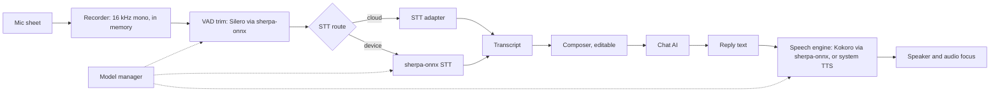

# Voice: Speech Input and Speech Output

Status: planned (v2)     Version: 0.1     Depends on: 40-provider-layer, 41-offline-fallback, 50-daily-session, 52-onboarding-settings, 16-security-privacy, 94-licensing

## 1. Purpose

Typing is the slow path. Voice lets the user talk to MineAI, and lets MineAI read an answer out loud when
the user wants it. This file also defines the **shared voice parts** (model manager, STT adapter, VAD, speech
engine) that ambient listening (`61`) reuses, so they are built once.

## 2. Behavior (what the user sees)

- A **mic button** appears in the composer (the slot reserved in `50`).
- **Tap to record, tap to stop.** (Hold-to-talk is a setting.) A small sheet shows a level meter, the elapsed time and the provider in use ("Sent to <provider></provider> to transcribe").
- The transcript lands in the composer, editable, with a **Send** button. A setting can send it automatically.
- If the user spoke their message, MineAI's reply is **spoken** after it arrives (default on). Every MineAI message also has a **Speak** action, and while speaking, a **Stop** button.
- Text-only users never hear anything. No voice, no sound, unless asked.
- The first time voice is used, a short sheet explains where the audio goes (the chosen STT provider, or the phone only), and links to the settings.
- Models for on-device speech are **downloaded on demand**, with size and terms shown first, never bundled (`94`).

## 3. Design

### 3.1 Parts



### 3.2 Speech input (STT)

**Recording.** Done in the foreground (the activity is visible), so no foreground service is needed. Audio is
captured as 16 kHz mono and kept in memory, encoded to a compressed or WAV format for upload (measure and
pick one in implementation). Maximum length: `voice.max_record_s` (default 180 s).

**Routing.** `voice.stt.mode`:

- `auto` (default): the cloud STT slot if configured and online, else on-device if downloaded, else the mic button explains what is missing.
- `cloud`: cloud only. `device`: on-device only.

**The STT slot** is a third provider slot beside Chat and Worker (`40`): base URL, model, key (or "same as Chat"). Adapters:

| Adapter                   | For                                                                                 | Note                                                                                 |
| ------------------------- | ----------------------------------------------------------------------------------- | ------------------------------------------------------------------------------------ |
| `openai_transcriptions` | `POST /v1/audio/transcriptions` with multipart upload                             | Common shape. **Verify** each provider, for example Mistral's speech models    |
| `chat_audio`            | Audio passed as a message part to a chat model                                      | Some hosts only. **Verify**                                                    |
| Others                    | Provider-specific (for example NIM's Whisper offering may use a different protocol) | **Verify** before promising. Added as adapters only if the shape can be probed |

The **probe wizard** (`40`) gets an STT step: send a one-second test tone, check the response shape, and
record `supports_timestamps` and `max_upload_mb`.

**Limits.** STT requests count in the same limiter. The model key limit is respected, and the 50 RPM ceiling
applies per model (D-018). A user voice message is priority P0 (the user is waiting). On a 429 cooldown the
route falls to on-device if available, otherwise the audio job is queued.

**Transcript review.** By default the transcript is shown for editing before sending (`voice.review_before_send`,
default on), since a misheard word is cheaper to fix before it reaches memory. The saved message has the tag
`voice` and `attrs = {input: "voice", stt: {provider, model, lang, confidence?}, duration_ms}`.

**Audio is never part of the raw layer.** The audio buffer lives in memory and in an app-private temporary file
only while a transcription is pending. It is wiped after success, or after 24 hours if the job is still
waiting (the user is told). Only text is kept.

**Language.** Hint from onboarding languages (`52`), otherwise auto-detect. Translation, if the user wants it,
is done later by the Chat AI on the text, so it does not depend on a Whisper-style feature.

### 3.3 Speech output (TTS)

**On demand only.** Two triggers: (1) the user's input was voice and `voice.tts.after_voice` is on, (2) the
user taps Speak on a message. There is no always-on speaking and no wake word.

**Engine.** Kokoro (82M parameters) running through sherpa-onnx, on-device. It is a good fit for size.
Honest limits:

- Voice and language coverage must be **checked against the languages the user's onboarding lists** before the settings offer them. If the reply language has no good voice, the app falls back to the system TTS, or skips with a notice.
- "Emotion" is limited. The persona (`24`) maps to a chosen voice and a speed, not to acted emotion. No promise of emotional range is made in the UI.
- If the Kokoro model is not downloaded, the Android system TTS is used.

**What is spoken.** Only the final reply text, with markdown, chips, receipts, and code stripped. Never the
model's reasoning. Long replies are spoken sentence by sentence, starting after the first sentence is ready,
and capped at `voice.tts.max_chars` (default 1200), with "The rest is in the chat." at the end.

**Behavior.** Respects audio focus (pauses or ducks other media), silent mode, and headphones. A phone call
interrupts and stops it. Auto-speak is off when a screen reader (TalkBack) is active, unless the user turns it on.

### 3.4 Model manager (shared with `21`, `61`)

- Lists model assets: embedding (v1), VAD, STT, TTS, speaker (v3). Each has name, version, size, SHA-256, license reference (`94`), and state (`absent`, `downloading`, `ready`, `failed`).
- Downloads are resumable, Wi-Fi only by default, verified by checksum, and show size and terms first. Deleting is one tap, with the space it frees.
- Licensing: weights are never bundled or committed (D-078). The terms of each model are shown before download, and listed in `THIRD_PARTY_LICENSES.md`.
- If `21` already tracks the embedding model in a table, extend it. Otherwise create `model_asset` and move that row into it.

## 4. Data

```sql
CREATE TABLE voice_job (                   -- operational, device-local
  id          TEXT PRIMARY KEY,
  kind        TEXT NOT NULL,               -- stt | tts
  state       TEXT NOT NULL,               -- queued | running | done | failed | expired
  msg_id      TEXT,                        -- raw_message for TTS, or the draft for STT
  audio_path  TEXT,                        -- temporary, wiped after success or 24 h
  target_ref  TEXT,                        -- provider and model, or "device"
  attempts    INTEGER DEFAULT 0,
  created_at  INTEGER NOT NULL, updated_at INTEGER NOT NULL, error TEXT
);
CREATE TABLE model_asset (                 -- device-local
  id TEXT PRIMARY KEY, kind TEXT NOT NULL,         -- embed | vad | stt | tts | speaker
  name TEXT NOT NULL, version TEXT, size_bytes INTEGER, sha256 TEXT,
  license_ref TEXT, path TEXT, state TEXT NOT NULL, updated_at INTEGER
);
```

- Voice input adds no raw-layer columns. Its metadata goes in `raw_message.attrs` and the tag `voice` (`11`, `50`).

## 5. Settings

| Key                                    | Default                           | Scope | Notes                                   |
| -------------------------------------- | --------------------------------- | ----- | --------------------------------------- |
| `flag.voice`                         | off (shipped dark)                | D     |                                         |
| `voice.enabled`                      | on once the flag is on            | S     | The mic button appears                  |
| `voice.stt.mode`                     | auto                              | D     | auto, cloud, device                     |
| `voice.stt.slot`                     | not set                           | D     | Provider, model, key, or "same as Chat" |
| `voice.review_before_send`           | on                                | S     |                                         |
| `voice.hold_to_talk`                 | off                               | S     |                                         |
| `voice.max_record_s`                 | 180                               | S     |                                         |
| `voice.language_hint`                | auto                              | S     |                                         |
| `voice.tts.engine`                   | kokoro if downloaded, else system | D     |                                         |
| `voice.tts.after_voice`              | on                                | S     |                                         |
| `voice.tts.voice`                    | per persona                       | S     |                                         |
| `voice.tts.speed`                    | 1.0                               | S     |                                         |
| `voice.tts.max_chars`                | 1200                              | S     |                                         |
| `voice.tts.speak_with_screen_reader` | off                               | S     |                                         |
| `voice.models.wifi_only`             | on                                | D     |                                         |

## 6. Edge cases and failure modes

- **Mic permission denied:** the mic button explains once and offers the settings link. Typing is unaffected.
- **Mic busy** (a call or another app): "Mic in use" and no recording.
- **Silence or noise only:** "I didn't hear anything." Nothing is sent.
- **STT returns empty or garbage:** the user sees it in the composer and can discard. Nothing reaches memory without a Send.
- **Offline with no on-device model:** the recording is kept for up to 24 hours as a queued job, with a clear message, and it is transcribed when online.
- **Upload limit exceeded:** the recording is split into parts (`max_upload_mb`) and the parts are joined.
- **The user kills the app mid-recording:** the partial buffer is lost. Recording is an in-app act, so it is not recovered.
- **Bluetooth headset and audio routes:** whatever Android selects is used.
- **TTS while another app plays audio:** duck or pause, then restore.
- **Download interrupted or checksum mismatch:** the file is deleted and the state is `failed`, with a retry.
- **Privacy:** the settings say plainly "Voice messages are sent to <provider></provider> unless you use on-device only." Provider retention is the provider's policy.

## 7. Offline behavior

On-device STT and TTS work fully offline once downloaded. Without them, STT is queued and TTS falls back to the system voice.

## 8. Tests

1. Record 10 s, cloud route: a transcript appears in the composer, the audio file is gone afterwards, and the message has the `voice` tag.
2. Same with on-device only in airplane mode.
3. 429 on the STT model: falls to on-device, or queues, and shows the status.
4. Edit the transcript before sending: the saved text is the edited one.
5. Spoken input produces a spoken reply. Typed input does not.
6. Speak on an old message works, and Stop ends it within 300 ms.
7. Markdown, receipts and chips are not read out.
8. A call arriving during speech stops it.
9. TalkBack on: no auto-speak by default.
10. Model download: resume after a connection loss, wrong checksum is rejected, and delete frees space.
11. The STT probe wizard handles a server that returns only plain text.
12. Captured-request audit: only the audio itself and the minimum fields leave the device (`93` E-16).

## 9. Open questions

- Which on-device STT model fits the size and quality budget (a small multilingual one)? Decide by testing on the lowest-end target device.
- A hands-free conversation mode (talk, hear, talk again) is parked (`91`). Revisit after v2 voice is in use.

## 10. Changelog

- 0.1 (2026-10-21): first draft.
