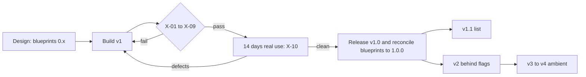

# v1 Scope

Status: core     Version: 0.1     Depends on: all `v1` files, 91-parking-lot, 92-versioning

## 1. Purpose

This file is the contract for the first release. It lists exactly what ships in v1, what is deliberately left out,
and what must be true before v1 is called done. It also gathers every "v1.1" and "planned" marker from the other
blueprints into one list, so nothing is lost in a footnote.

## 2. Behavior (what the user sees)

Nothing directly. This is a planning file. The user-visible result is a v1 that does fewer things, reliably.

## 3. Design

### 3.1 What ships in v1

| Area         | Feature                                                                                    | Blueprint              |
| ------------ | ------------------------------------------------------------------------------------------ | ---------------------- |
| Data         | One SQLCipher database, key wrapped by Android Keystore, app lock as a UI gate             | `10`, `16`         |
| Data         | Raw, derived and operational layers; migrations with snapshots                             | `11`, `14`         |
| Data         | Passphrase-encrypted export (`.mnex`) and restore into an empty app                      | `15`                 |
| Memory       | Soul with propose/approve (or auto-accept), seeded in onboarding                           | `12`                 |
| Memory       | Node/edge graph with status lifecycle                                                      | `13`                 |
| Memory       | Resolver (the "which dinner?" problem) with Undo                                           | `22`                 |
| Memory       | Tool gateway, alias IDs, `search_history`                                                | `23`                 |
| Intelligence | Fixed-budget context pack                                                                  | `20`                 |
| Intelligence | On-device EmbeddingGemma 2 (text-only), hybrid retrieval, summaries                        | `21`                 |
| Intelligence | Personas (presets and custom)                                                              | `24`                 |
| Intelligence | Visible behavioral learning                                                                | `25`                 |
| Proactive    | Reminder engine: alarm, then conversation (alarm only offline)                             | `30`                 |
| Proactive    | Nudge engine: one open thread, ignore-backoff, quiet hours, hidden fuse                    | `31`                 |
| Proactive    | Morning and late-evening check-ins, post-task review, weekly review, native charts         | `32`                 |
| Platform     | Provider layer: OpenAI-compatible, RPM limiter, 429 cooldown, fallback chain, normalizer   | `40`                 |
| Platform     | Offline queue, templates, alarm-only mode                                                  | `41`                 |
| Platform     | Reliability: reboot re-arm, sweeper, OEM guides, self-test, reliability score              | `42`                 |
| UI           | Daily session (one continuous timeline), scrubber, receipts                                | `50`                 |
| UI           | Quick capture: notification reply, optional capture notification, launcher shortcut        | `50`                 |
| UI           | Memory viewer and editor (seven areas, plus Ambient when `flag.ambient` is on), Trash and Erase | `51`                 |
| UI           | Onboarding, settings catalog, Quick setup on the Welcome screen                            | `52`                 |
| Release      | Signed APK on GitHub Releases, in-app "check for updates", LICENSE and third-party notices | `16`, `92`, `94` |

### 3.2 What does not ship in v1

Documented, but not built: everything in 3.3 to 3.5 and in `91-parking-lot.md`. Hooks that cost almost nothing
are built now (`flag.*` keys, the `source` and `proposed` fields, the `attrs` JSON column), so the later features
add rows and modules and never rewrite anything.

### 3.3 Planned for v1.1 (rough size: S small, M medium, L large)

| # | Item                                                                                               | From           | Size    |
| - | -------------------------------------------------------------------------------------------------- | -------------- | ------- |
| 1 | Provider setup import (a file or QR made by a tech-savvy friend: base URL and model, key optional) | `52`         | M       |
| 2 | Direct-boot alarm safety net (device-protected table of `fire_at` and a generic label)           | `30`, `42` | M       |
| 3 | Recurring reminders and habits (promote `attrs` fields to columns)                               | `14`, `30` | L       |
| 4 | Readable export (Markdown or JSON, for people and for the desktop reader)                          | `15` 3.4     | S       |
| 5 | Scheduled auto-export to a user-chosen folder                                                      | `15` 3.5     | S       |
| 6 | Rule-based quick add for offline use ("remind me at 6 to call mom")                                | `41`         | M       |
| 7 | Home screen widget and share sheet target ("Share to Mine")                                        | `50`         | M       |
| 8 | Memory viewer calendar grid and Items board view                                                   | `51`         | M       |
| 9 | Template packs for other languages                                                                 | `41`         | ongoing |

### 3.4 Planned for v2 (behind `flag.*`, after 2-3 weeks of real v1 use, D-026)

Context sensing (`43`), post-call nudge and voice note (`44`), speech input and on-demand speech output (`60`).

### 3.5 Planned for v3 to v4

Ambient listening (`61`): optional, off by default, own consent, audio never stored, proposal-only output.

### 3.6 Exit criteria for v1

v1 is done when every line below is true. "Author phone" means the phone you really carry.

| ID   | Gate            | Pass condition                                                                                                                                                                        |
| ---- | --------------- | ------------------------------------------------------------------------------------------------------------------------------------------------------------------------------------- |
| X-01 | Functional      | Every Tests section of every `v1` file passes, plus every `[R]` scenario in `93-test-scenarios.md`                                                                              |
| X-02 | Reminders       | Over 14 days on the author phone, no requested reminder is lost silently. A late one carries its "late" label                                                                         |
| X-03 | Reboot and kill | The reboot test and the force-stop test pass on at least 2 different phones (`42`)                                                                                                  |
| X-04 | Data safety     | Export, wipe, restore round trip keeps every count and every raw message hash. Migration from every earlier schema version passes. A kill during migration recovers from the snapshot |
| X-05 | Privacy         | The captured-request audit (`E-16`) shows no `local_only` data, no keys and no database IDs leaving the device                                                                    |
| X-06 | Budget          | The context pack stays inside its token budget on a 500-message day and on day 100 of test data (`20`)                                                                              |
| X-07 | Providers       | The recorded GLM stream fixtures pass, a 429 cooldown survives a process kill, and a fallback works (`40`)                                                                          |
| X-08 | Offline         | Airplane-mode day passes: alarms ring, messages queue, one follow-up after reconnecting (`41`)                                                                                      |
| X-09 | Release         | Signed APK, signing key stored in two separate places, LICENSE and third-party notices in the repo and in the About screen, release notes written (`94`)                            |
| X-10 | Real use        | The author uses it as the daily driver for 14 consecutive days. Defects go into a log. No open data-loss, missed-alarm or crash-loop bug                                              |

Each gate is checked off in the GitHub release checklist (`92` 3.6).

### 3.7 Cut order if the schedule slips

Move these to v1.1, in this order, before touching anything else:

1. Weekly review charts (the text review stays).
2. Extra persona presets beyond the default one and the custom persona.
3. The Learned area of the memory viewer (learning still works, it just has no screen).
4. The optional capture notification.

Never cut: encryption, the raw log, Undo, the resolver, reminders and alarms, export and restore, the reliability self-test.

### 3.8 Scope change rule

Adding a feature to v1 needs three things: a line in `03-decisions.md`, a section in the matching blueprint, and one item removed or deferred of equal size. Everything else goes to `91-parking-lot.md`.

## 4. Data

None.

## 5. Settings

None.

## 6. Edge cases and failure modes

- **A v1.1 item turns out to be required for reliability** (for example the direct-boot safety net fails the reboot gate on a real device). It is promoted into v1 under the scope change rule, and something else moves out.
- **The 14-day real-use gate keeps restarting** because of small defects. Only the defect classes in X-10 reset the clock. Polish items go to the log.
- **A gate cannot be tested for lack of a device** (for example a vendor phone). Record it as "unverified on <vendor></vendor>" in the release notes and in the OEM guide. It does not block the release.

## 7. Offline behavior

Not applicable.

## 8. Tests

The gates above are the tests of this file.

## 9. Open questions

- Is 14 days right for X-10, or should it be 21 to match the 2-3 weeks in D-026? Proposed: 14 for the release gate, then 2-3 more weeks before enabling any v2 flag.

## 10. Changelog

- 0.1 (2026-10-21): first draft.
