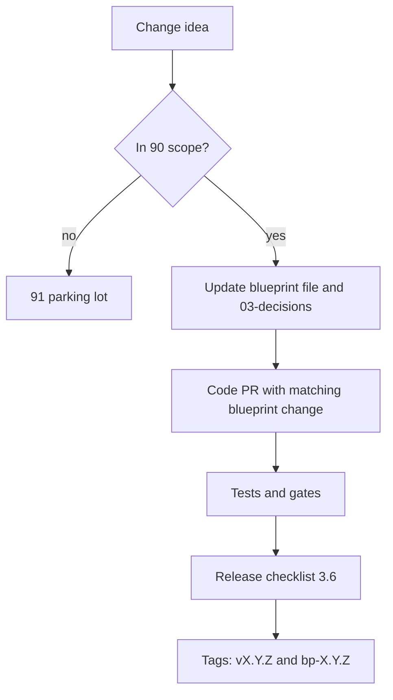

# Versioning

Status: core     Version: 0.1     Depends on: 14-migrations, 15-export-sync-prep, 21-retrieval-embeddings, 90-v1-scope

## 1. Purpose

Mine has several things that carry a version: the blueprints, the app, the database schema, the export file, the
embedding model, and the template packs. This file says what each number means, how they relate, and what happens
when they disagree. The goal is that nobody has to guess whether two pieces fit together.

## 2. Behavior (what the user sees)

- About screen shows: app version, build, schema version, export format version, embedding model version, and the license.
- "Check for updates" compares the installed app version with the latest GitHub release and links to its notes.
- Import of an export from a newer app is refused with a plain explanation and a link to update.

## 3. Design

### 3.1 The version stamps

| Stamp                     | Format                                                        | Bumps when                                      | Defined in |
| ------------------------- | ------------------------------------------------------------- | ----------------------------------------------- | ---------- |
| **Blueprint set**   | `x.y.z`                                                     | Any file changes (3.3)                          | this file  |
| **Blueprint file**  | `x.y` in its header                                         | Content change (`y`), contract change (`x`) | each file  |
| **App**             | `MAJOR.MINOR.PATCH` (`versionName`)                       | Release                                         | this file  |
| **App build**       | integer `versionCode` = `MAJOR*10000 + MINOR*100 + PATCH` | Release                                         | this file  |
| **Schema**          | integer                                                       | Any migration (`14`)                          | `14`     |
| **Export format**   | integer (`.mnex` format version 1 for v1)                   | Format change (`15`)                          | `15`     |
| **Embedding model** | model id plus integer                                         | Model or dimension change (`21` 3.8)          | `21`     |
| **Template pack**   | per language, `x.y`                                         | Template text change (`41`)                   | `41`     |

### 3.2 App versions

- **MAJOR:** a product-level change, or a schema change that cannot be rolled back.
- **MINOR:** new features, additive schema changes, new `flag.*` keys. v1.1 and v2 are minors or majors as decided at release time.
- **PATCH:** fixes only. No schema change.
- The `versionCode` formula keeps ordering correct and is **never reused**. Android refuses to install a lower `versionCode`.
- The signing key never changes (`16` 3.6). Package id is `com.anchor.mine` forever.

### 3.3 Blueprint set versions

- `0.x.y`: design phase for app v1. `0.1.0` is the first complete draft set.
- At app `v1.0.0` the set is **reconciled to as-built** and becomes `1.0.0`. Differences between the design and the code are written into the files, not left in people's heads.
- After that, the set's `MAJOR.MINOR` matches the app it describes. `PATCH` is for documentation fixes only.
- Tag the branch `bp-<version>` (for example `bp-1.0.0`).

### 3.4 Mapping between blueprints and app

| Blueprint set | App               | State                                                |
| ------------- | ----------------- | ---------------------------------------------------- |
| `0.1.0`     | targets `1.0.0` | Design phase                                         |
| `0.x`       | `1.0.0-dev`     | Implementation, files updated with each PR           |
| `1.0.0`     | `1.0.0`         | Reconciled at release                                |
| `1.1.x`     | `1.1.x`         | The v1.1 list in `90`                              |
| `2.0.x`     | `2.0.x`         | v2 features, flags default on after the trial period |

### 3.5 Compatibility rules

1. **Import:** the app can import any export with an equal or lower export format version, migrating as needed. A higher version is refused (`15` 3.3).
2. **Schema:** migrations only go forward. A snapshot is taken before each (`14`). A downgrade of the app is not supported, and the app says so if it detects a newer schema.
3. **Embeddings:** when the model or dimension changes, vectors are rebuilt in the background. Search falls back to keywords plus recency until the rebuild is done (`21` 3.8).
4. **Flags:** a `flag.*` key unknown to an older app is preserved and ignored (`52`).
5. **Templates:** a pack newer than the app is ignored and the English pack is used.

### 3.6 Release process (checklist for every GitHub release)

1. All gates in `90` 3.6 are green (for a PATCH release, the affected areas and the reminder tests).
2. `versionName` and `versionCode` bumped, schema version bumped if needed, migration test added.
3. Release notes written: what changed, what the user must do, known issues, and "unverified on <vendor></vendor>" notes.
4. Build signed with the permanent key. Verify the signature on the built file.
5. Tag the source `vX.Y.Z` in the code repo. Attach the APK and a SHA-256 checksum file. The tag must stay available for as long as the release is (`94`).
6. Update the third-party notices if any dependency changed (`94`).
7. Reconcile the blueprints and tag `bp-X.Y.Z`.
8. Install the release APK over the previous one on a real phone, and check that data, alarms and settings survive.

## 4. Data

`app_meta` holds `schema_version`, `export_format_version`, `embedding_model_version` and `template_pack.<lang>` (`14`, `52`).

## 5. Settings

None. The About screen is read-only. "Check for updates" is a button, not a background job.

## 6. Edge cases and failure modes

- **The signing key is lost.** Every user must uninstall and reinstall, losing data unless they exported. This is why the key is backed up in two places from day one (`16`).
- **GitHub is unreachable** during "check for updates". The button shows a calm message and nothing else changes.
- **A user sideloads an older APK.** Android refuses it by `versionCode`. The app never tries to downgrade the schema.
- **A pre-release build is published for testers.** Mark it as a GitHub pre-release. The "check for updates" button ignores pre-releases unless a developer option is on.

## 7. Offline behavior

All stamps are local. Only "check for updates" needs a network.

## 8. Tests

1. `versionCode` formula: unit test for ordering across `1.0.9`, `1.1.0` and `2.0.0`.
2. Import an export with a higher format version: refused, nothing changed.
3. Import an export with a lower format version: migrated and restored.
4. Unknown flag and unknown setting keys survive an update.
5. Install a newer APK over an older one: data, alarms and settings survive.
6. About screen shows all stamps and they match the database.

## 9. Open questions

- Should the app show a one-time "what's new" card after an update, from the release notes? Proposed: yes, from a bundled file (no network).

## 10. Changelog

- 0.1 (2026-10-21): first draft.
