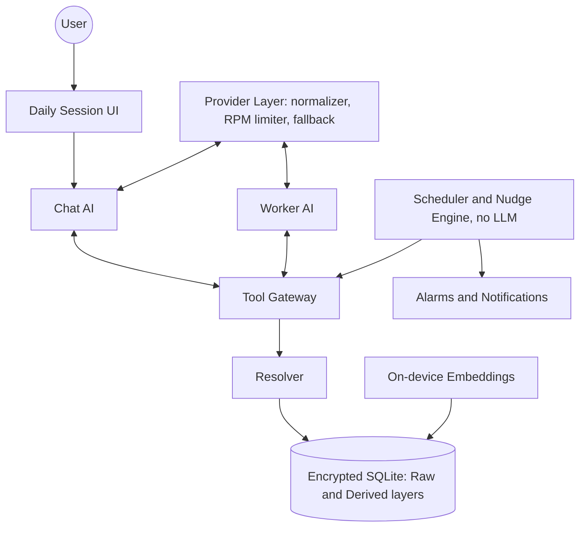

# Mine: Blueprints

> **Mine** is a local-first, encrypted, personal AI companion for Android.
> Its AI, **MineAI**, knows who you are, remembers your commitments, and starts conversations when it should.
> You bring your own AI endpoint (BYOK), and everything else stays on your device.

|                                 |                                                                                  |
| ------------------------------- | -------------------------------------------------------------------------------- |
| **Package**               | `com.anchor.mine` (permanent, never changes)                                   |
| **Platform**              | Android, minSdk 30 (Android 11), Kotlin                                          |
| **Distribution**          | GitHub Releases only (no Play Store). The signing key is backed up from day one. |
| **License**               | GPL-3.0-or-later (see [94-licensing.md](94-licensing.md) and `LICENSE`) |
| **Blueprint set version** | `0.1.0` (targets app `v1.0`)                                                 |
| **Status**                | Design phase                                                                     |

---

## 1. What this branch is

This branch holds the **design documents** for Mine and no code. Each file covers one feature or one aspect of the app. Each follows the same template (section 5), and all are indexed below. The branch is the source of truth for *what we are building and why*.

Features are documented even if they are not in v1. The **Status** column keeps the plan honest.

### Status legend

| Tag         | Meaning                                                              |
| ----------- | -------------------------------------------------------------------- |
| `v1`      | Ships in the first release                                           |
| `planned` | Decided, scheduled after v1 (v2 to v4), no schema surprises expected |
| `parked`  | Idea kept for later, not committed                                   |
| `core`    | Cross-cutting rule that every feature must follow                    |
| `drafted` | Design written, not yet reviewed against code                        |

---

## 2. Index of blueprints

### Overview

| File                                    | Description                                                          | Status   |
| --------------------------------------- | -------------------------------------------------------------------- | -------- |
| [00-vision.md](00-vision.md)             | Why Mine exists, principles, who it is for                           | `core` |
| [01-glossary.md](01-glossary.md)         | Soul, node, edge, event, nudge, session, and other terms             | `core` |
| [02-architecture.md](02-architecture.md) | Modules, data flow, the three actors (Chat AI, Worker AI, Scheduler) | `core` |
| [03-decisions.md](03-decisions.md)       | Decision log: what we chose and why                                  | `core` |

### Data

| File                                                    | Description                                                 | Status                              |
| ------------------------------------------------------- | ----------------------------------------------------------- | ----------------------------------- |
| [10-storage-encryption.md](10-storage-encryption.md)     | SQLCipher, key handling, passphrase-encrypted export        | `v1`                              |
| [11-layers-raw-derived.md](11-layers-raw-derived.md)     | Immutable raw layer vs rebuildable derived layer            | `core`                            |
| [12-soul.md](12-soul.md)                                 | The user's character definition, with propose/approve flow  | `v1`                              |
| [13-nodes-edges-statuses.md](13-nodes-edges-statuses.md) | Memory graph: node types, edge vocabulary, lifecycle states | `v1`                              |
| [14-migrations.md](14-migrations.md)                     | Schema evolution, rebuild jobs, version stamps              | `core`                            |
| [15-export-sync-prep.md](15-export-sync-prep.md)         | Export file now, desktop sync later                         | `v1` (export), `planned` (sync) |
| [16-security-privacy.md](16-security-privacy.md)         | Threat model, app lock, honest privacy wording              | `v1`                              |

### Intelligence

| File                                                    | Description                                                 | Status |
| ------------------------------------------------------- | ----------------------------------------------------------- | ------ |
| [20-context-pack.md](20-context-pack.md)                 | What is sent to the model each turn, with token budgets     | `v1` |
| [21-retrieval-embeddings.md](21-retrieval-embeddings.md) | EmbeddingGemma 2 (text-only), hybrid retrieval, summaries   | `v1` |
| [22-resolver.md](22-resolver.md)                         | Ambiguity handling (the "which dinner?" problem), undo      | `v1` |
| [23-tool-contracts.md](23-tool-contracts.md)             | Tools the AIs can call, alias IDs, the single write gateway | `v1` |
| [24-personas.md](24-personas.md)                         | Preset and custom personalities                             | `v1` |
| [25-learning.md](25-learning.md)                         | Visible behavioral learning vs Soul learning                | `v1` |

### Proactive

| File                                                | Description                                                  | Status |
| --------------------------------------------------- | ------------------------------------------------------------ | ------ |
| [30-reminder-engine.md](30-reminder-engine.md)       | Alarm, then conversation; guards, offline behavior           | `v1` |
| [31-nudge-engine.md](31-nudge-engine.md)             | When the AI speaks: triggers, scoring, gates, backoff        | `v1` |
| [32-briefings-checkins.md](32-briefings-checkins.md) | Morning and late-evening check-ins, post-task review, charts | `v1` |

### Platform

| File                                                  | Description                                                                               | Status           |
| ----------------------------------------------------- | ----------------------------------------------------------------------------------------- | ---------------- |
| [40-provider-layer.md](40-provider-layer.md)           | OpenAI-compatible adapter, RPM limiter, 429 cooldown, fallback chain, response normalizer | `v1`           |
| [41-offline-fallback.md](41-offline-fallback.md)       | Offline queue, templates, alarm-only mode                                                 | `v1`           |
| [42-android-reliability.md](42-android-reliability.md) | Background limits, OEM killers, battery, reliability screen and self-test                  | `v1`           |
| [43-context-sensing.md](43-context-sensing.md)         | Place x motion axes, debounce, triggers                                                   | `drafted` |
| [44-call-nudge.md](44-call-nudge.md)                   | Post-call nudge and voice note                                                            | `drafted` |

### UI

| File                                                  | Description                                    | Status |
| ----------------------------------------------------- | ---------------------------------------------- | ------ |
| [50-daily-session.md](50-daily-session.md)             | One-day-one-session chat, dividers, scrubber   | `drafted` |
| [51-memory-viewer.md](51-memory-viewer.md)             | "What do you know about me?" viewer and editor (seven areas, plus Ambient when `flag.ambient` is on) | `drafted` |
| [52-onboarding-settings.md](52-onboarding-settings.md) | First-run flow and every setting               | `drafted` |
| Quick capture                                          | Notification reply, optional capture notification | `v1` |

### Voice and ambient

| File                                              | Description                                                      | Status                 |
| ------------------------------------------------- | ---------------------------------------------------------------- | ---------------------- |
| [60-voice-stt-tts.md](60-voice-stt-tts.md)         | Speech input, on-demand speech output (Kokoro)                   | `drafted` |
| [61-ambient-listening.md](61-ambient-listening.md) | VAD, speaker labels, STT, proposal-only extraction, daily report | `drafted` |

### Roadmap and quality

| File                                        | Description                                | Status     |
| ------------------------------------------- | ------------------------------------------ | ---------- |
| [90-v1-scope.md](90-v1-scope.md)             | Exact v1 feature list and exit criteria    | `drafted` |
| [91-parking-lot.md](91-parking-lot.md)       | Ideas waiting their turn                   | `drafted` |
| [92-versioning.md](92-versioning.md)         | How blueprint versions map to app versions | `drafted` |
| [93-test-scenarios.md](93-test-scenarios.md) | Regression conversations and edge cases    | `drafted` |
| [94-licensing.md](94-licensing.md)          | GPLv3: notices, dependencies, models, contributions | `core` |

---

## 3. Architecture at a glance



The three actors:

- **Chat AI** talks to the user in the chosen persona.
- **Worker AI** extracts events and facts, and proposes changes.
- **Scheduler and Nudge Engine** is plain code with no model. It decides *when* things happen. An LLM is never the timer.

Every write to memory passes through the **Tool Gateway**, and the model never sees real database IDs.

---

## 4. Principles that every blueprint must respect

1. **Local first.** Data lives on the device, encrypted. Only what the user's chosen endpoints need leaves it, and the app says so plainly.
2. **Raw is sacred.** The raw layer (messages, event log) is append-only and never migrated. Everything else is derived and can be rebuilt.
3. **No destructive writes by similarity.** Ambiguity is resolved by asking, and every change is reversible (Undo, status changes, tombstones).
4. **Code decides time.** Dates, reminders, and nudges are code. The model writes words.
5. **Fixed prompt budget.** Per-turn cost does not grow with history.
6. **Visible learning.** Everything the app learns about the user can be inspected, edited, or reset.
7. **Proposals, not assumptions.** Soul facts and ambient extractions are proposed and approved, unless the user chose auto-accept.
8. **Graceful offline.** Every feature has a defined offline behavior.
9. **Cheap to extend.** New features add rows or modules, never rewrites. Flexible fields live in a JSON `attrs` column.
10. **Respect restraint.** There is no user-facing notification cap. The nudge engine regulates itself with one open thread, ignore-backoff, and quiet hours.

---

## 5. Template for every blueprint file

```text
# <Title>
Status: v1 | planned | parked | core     Version: x.y     Depends on: <files>

1. Purpose
2. Behavior (what the user sees)
3. Design (rules, state machines, flow as a mermaid chart)
4. Data (table schemas, fields, indexes)
5. Settings (what the user can change, defaults)
6. Edge cases and failure modes
7. Offline behavior
8. Tests (scenarios from 93-test-scenarios.md)
9. Open questions
10. Changelog
```

Files may be shorter than a full A4 page where the topic is small.

---

## 6. Locked decisions (summary)

Full reasoning lives in [03-decisions.md](03-decisions.md).

| Area               | Decision                                                                                                                                                                                                 |
| ------------------ | -------------------------------------------------------------------------------------------------------------------------------------------------------------------------------------------------------- |
| Identity           | App `Mine`, AI `MineAI`, package `com.anchor.mine`                                                                                                                                                 |
| Distribution       | GitHub Releases only; signing key backed up; in-app "check for updates"                                                                                                                                  |
| Storage            | One SQLCipher database; key wrapped by Android Keystore; separate passphrase-encrypted export file                                                                                                       |
| Keys               | UUID/ULID primary keys, device ID, `updated_at`, tombstones (sync-ready from day one)                                                                                                                  |
| Memory             | Soul (propose or auto-accept) plus node/edge graph with status lifecycle; `proposed` status and `source` provenance field exist from v1                                                              |
| Recall             | EmbeddingGemma 2 text-only, 256-dim int8, hybrid retrieval (vector + FTS5 + time + graph hop), hierarchical summaries, `search_history` tool                                                           |
| AI                 | OpenAI-compatible endpoints only; Chat slot and Worker slot (own provider, model, key each, or "same as chat")                                                                                           |
| Rate limits        | Per-provider RPM set by the user, plus a hard ceiling of 50 RPM per model; retries and tool rounds count; max tool rounds per turn                                                                       |
| 429                | Stop sending to that key for a user-set cooldown (default 15 min); the fallback chain or queue takes over                                                                                                |
| Normalizer         | Tolerant stream parser (array-style thinking parts, `reasoning_content`, `<think>` tags, fragmented tool calls); strict-history flag per provider                                                    |
| Architecture       | Core logic lives in a pure Kotlin module with no Android imports; Android code is limited to adapters                                                                                              |
| Sync               | Gateway-owned mutable rows carry hybrid logical clocks (`hlc`) for row-level last-write-wins merging                                                                                               |
| Proactive          | Candidates, then score, then gates, then delivery, then text, then learn; one open thread; ignore-backoff; user-set min gap and multiplier; hidden internal safety fuse; Pause nudges control; long silence mode |
| Reminders          | `setAlarmClock` alarm, then conversation when online; alarm only when offline; one follow-up after reconnecting                                                                |
| Day                | User-set start and end, may cross midnight; recommended 10-20 h (soft limits, sarcastic message outside); session rolls over at day start; configurable week start                                       |
| Sensing (v2)       | Place (home/away) and motion (still/walking/vehicle) as independent axes, debounced                                                                                                                      |
| Voice (v2)         | STT/TTS on demand; Kokoro for TTS (82M); no always-on TTS                                                                                                                                                |
| Ambient (v3 to v4) | Optional, off by default; labels `user` and `other`; audio never stored; transcripts expire after report review or 48 h; proposal-only; owner-labeled commitments need confidence, otherwise flagged |
| Roadmap            | v1 as an in-place daily driver, 2-3 weeks of real use, then v2 features as updates behind flags                                                                                                          |
| License            | GPL-3.0-or-later, DCO, model weights not bundled                                                                                                  |

---

## 7. v1 in one paragraph

Daily one-session chat, Soul, graph memory with the resolver, the provider layer, the reminder engine (alarm, then conversation), a memory viewer and editor, notification quick-reply capture, morning and late-evening check-ins, and encrypted export. Everything else is documented but scheduled later. See [90-v1-scope.md](90-v1-scope.md).

---

## 8. License

Mine is free software: you can redistribute it and/or modify it under the terms of the
GNU General Public License as published by the Free Software Foundation, either version 3
of the License, or (at your option) any later version.

Mine is distributed in the hope that it will be useful, but WITHOUT ANY WARRANTY; without
even the implied warranty of MERCHANTABILITY or FITNESS FOR A PARTICULAR PURPOSE. See the
GNU General Public License for more details.

You should have received a copy of the GNU General Public License along with Mine. If not,
see <https://www.gnu.org/licenses/>.

## 9. Contributing to the blueprints

- One topic per file, and keep the filename numbers.
- Update the **Status** and **Version** in the file header and in the table above together.
- Record every non-obvious choice in [03-decisions.md](03-decisions.md) with date and reason.
- A code change that breaks a blueprint requires a blueprint change in the same PR.
- New idea? Put it in [91-parking-lot.md](91-parking-lot.md) first.
- Commits carry a `Signed-off-by:` line (Developer Certificate of Origin).

---

*Last updated: 2026-10-21*
