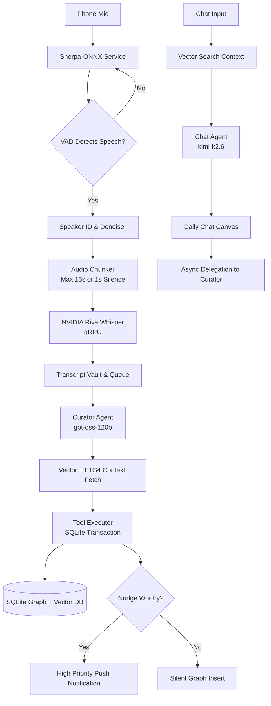

# Mine

> **Your phone knows everything. It remembers nothing. Mine fixes that.**

Mine is not a chatbot. It is a co-founder for your life — an ambient, graph-based second brain that listens, remembers, and nudges. Designed for the user who wants to own their data, own their memories, and never again forget the context of their own life.

Mine is **single-user, zero-server, and fully open source**. All data stays on your device. You bring your own AI models. You control your persona. You own your memory graph.

---

## Core Pillars

1. **Ambient First** — The microphone is an input, not an interface. Turn it on, live your life, Mine remembers.
2. **Zero Server** — No cloud backend. No telemetry. No accounts. Only your API keys, your SQLite database, your graph.
3. **Hybrid Memory** — A relational graph database (`Group > Branch > Node > Edge`) supercharged by a local Vector Database for semantic recall.
4. **Sovereign AI** — You bring the models (NVIDIA NIM). You control the persona presets. You own the data.

---

## How It Works



**The loop:** Ambient audio → VAD/denoise/speaker-ID → Whisper transcription → 120B Curator extracts facts via tool-calling → writes to an encrypted SQLite graph + local vector DB → surfaces nudges when you break a commitment or need a reminder.

---

## Component Stack

| Layer | Technology | Purpose |
|-------|-----------|---------|
| Platform | Android API 28+ | Operating system |
| Language | Kotlin (Coroutines/Flow) | Primary development language |
| UI | Jetpack Compose | User interface toolkit |
| Architecture | MVVM + Hilt DI | Code organization |
| Database | SQLite via Room + SQLCipher | Encrypted local storage |
| Search | SQLite FTS4 + Cosine Similarity | Keyword & Semantic node search |
| Audio | Sherpa-ONNX via JNI | VAD, Denoiser, Speaker ID |
| Network | Ktor + gRPC | REST and Binary API communication |
| Background | WorkManager | Offline queues, Chronos, Pruning |
| Crypto | Android Keystore + EncryptedSharedPreferences | Secure key storage |

---

## Project Structure

```
app/
└── src/main/java/com/mine/app/
    ├── MainActivity.kt
    ├── MineApplication.kt
    ├── ai/            # ChatAgent, CuratorAgent, ChronosAgent, ToolExecutor, ToolSchemas
    ├── data/
    │   ├── local/db/  # Room DB, DAOs (Graph/Chat/Queue), Entities
    │   └── remote/    # NimWhisperClient, NimApi, GroqApi, DTOs
    ├── di/           # Hilt modules (App, Database, Network)
    ├── service/       # AmbientListeningService, AudioRecorderManager, SherpaManager
    ├── ui/            # Compose screens + ViewModels
    ├── util/          # RateLimiter, NetworkMonitor, NotificationHelper, VectorUtils
    └── worker/        # QueueWorker, PruningWorker, ChronosWorker
```

---

## Getting Started

### Prerequisites
- Android Studio (AGP 9.2.1 compatible)
- JDK 11+
- An Android device or emulator running API 28 (Android 9) or higher
- Three NVIDIA NIM API keys (see below)

### Setup

1. **Clone the repository**
   ```bash
   git clone https://github.com/AtharvRG/mine.git
   cd mine
   ```

2. **Provide your NVIDIA NIM API keys**

   Create a `local.properties` file in the project root (this file is gitignored) and add your three keys:

   ```properties
   NVIDIA_API_KEY_CHAT=your_chat_key_here
   NVIDIA_API_KEY_AGENT=your_agent_key_here
   NVIDIA_API_KEY_WHISPER=your_whisper_key_here
   ```

   | Key | Model | Role |
   |-----|-------|------|
   | `NVIDIA_API_KEY_WHISPER` | Riva Whisper Large v3 | Ambient audio transcription (gRPC) |
   | `NVIDIA_API_KEY_AGENT` | gpt-oss-120b & nv-embed-v1 | Background Curator, Chronos, Embeddings |
   | `NVIDIA_API_KEY_CHAT` | kimi-k2.6 | Instant Chat UI responses |

3. **Build & Run**
   ```bash
   ./gradlew assembleDebug
   ```
   Or open the project in Android Studio and hit **Run**.

### Onboarding

On first launch, Mine walks you through:
1. Legal & Terms acceptance
2. API key validation
3. Voice enrollment (5s sample → Sherpa x-vector)
4. Persona selection (Visionary / Operator / Strategist / Confidant)
5. Battery optimization disable (critical for ambient listening)

---

## External Dependencies

- **NVIDIA NIM** — LLM inference (gpt-oss-120b, kimi-k2.6), embeddings (nv-embed-v1), and ASR (Riva Whisper via gRPC)
- **Sherpa-ONNX** — On-device VAD (Silero), noise suppression (GTCRN), speaker ID (WeSpeaker/3D-Speaker)
- **SQLCipher** — AES-256 encrypted SQLite at rest
- **Jetpack Security** — EncryptedSharedPreferences for config/secrets

> **Note:** You bring your own NVIDIA NIM keys. No cloud backend, no telemetry, no accounts.

---

## Privacy & Security

- **On-device only:** All audio, transcripts, and the memory graph stay on your device.
- **Encrypted at rest:** The SQLite database is SQLCipher-encrypted.
- **No telemetry, no crash reporting:** Nothing leaves the device except API calls to your configured NVIDIA endpoints.
- **User consent:** Ambient listening only runs when explicitly toggled ON, with a persistent notification always visible.
- **Manual encrypted export:** Backups are encrypted with a user-provided password.

---

## Features

- **Ambient Listening** — Always-on mic capture with system event handling (yields to calls, resumes after).
- **Nudge Talking** — Contextual memory surfacing via heads-up notifications with lock-screen direct reply.
- **Chat Interface** — A "Daily Canvas" chat with CQRS architecture (instant read path, async write path).
- **Post-Call Reflection** — Quick voice capture after phone calls.
- **Memory Graph UI** — Interactive graph editor + Transcript Vault with manual "Extract to Graph".
- **Proactive AI (Chronos)** — Wakes every 4h to surface stale tasks and approaching deadlines.
- **Nightly Pruning** — Summarizes the day's chat, prunes trashed nodes, clears the canvas for tomorrow.

---

## Documentation

Full design documentation lives in [`Docs/`](../Mine1/Docs):

| # | Doc | Description |
|---|-----|-------------|
| 01 | Project Manifesto | Identity, thesis, core pillars, non-goals |
| 02 | System Architecture | High-level data flow and component stack |
| 03 | Database Schema | SQLite schema for groups, branches, nodes, edges, vectors |
| 04 | Memory Graph Model | Hierarchical memory and local Vector DB deduplication |
| 05 | External APIs & Rate Limiting | 3-Key NVIDIA NIM architecture and Mutex Rate Limiter |
| 06 | AI Prompts & Tool Calling | JSON tool calling schema for the 120B curator agent |
| 07 | Audio Processing Pipeline | Mic → Sherpa VAD/Denoiser → Riva Whisper gRPC |
| 08 | Ambient Listening | Always-on mic capture with system event handling |
| 09 | Nudge Talking | Contextual memory surfacing via notifications |
| 10 | Chat Interface | Daily canvas chat stream with CQRS architecture |
| 11 | Post-Call Reflection | Quick voice capture after phone calls |
| 12 | Memory Graph UI & Dev Mode | Interactive graph viewer and Transcript Vault |
| 13 | Settings & Configuration | Persona presets, contextual location, voice enrollment |
| 14 | Onboarding | First-launch experience and setup flow |
| 15 | Background Agent & Queue System | Offline queue handling and nightly pruning |
| 16 | Security & Privacy | Encryption layers, threat model, key management |
| 17 | Development Guide | Kotlin project structure and build instructions |

---

## Status

> **This project is in a rough-wired, testing-mindset stage.** The system is functional end-to-end but has not yet been hardened for production. A robustness audit has been performed; known issues are tracked separately. Expect breaking changes as the codebase is decluttered and hardened.

---

## License

Open source. (License file to be added — MIT recommended.)

---

## Contributing

Contributing guidelines and issue templates will be added prior to the v1.0.0 release.
